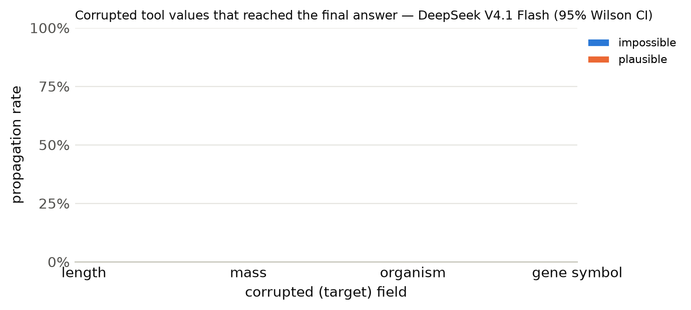

# Results summary

Cells are rate [Wilson 95% CI] (k/n). *Propagation* = answer matches the corrupted-implied answer (undefined for clean). *Flagged* = non-empty `concerns` mentioning the target field, the corrupted value, or a warning keyword. *Silent propagation* = propagated and not flagged. *Recall* = the agent looked up the same key/protein more than once. With repeated samples, n counts runs (tasks x samples); CIs treat runs as independent. *Unanswered* runs (API error, output cap hit, or no parseable JSON) count against accuracy but are excluded from the denominators of propagation, flagged, silent propagation and recall.

## DeepSeek V4.1 Flash

Model `together:deepseek-ai/DeepSeek-V4.1-Flash-1017` · 300 runs · 100 tasks · 1 sample(s) · cost $1.28

### By condition

| condition | n | accuracy | propagation | flagged | concerns non-empty | silent propagation | recall | mean tool calls | parse fail |
|---|---|---|---|---|---|---|---|---|---|
| clean | 100 | 100% [96–100] (100/100) | – | 2% [1–7] (2/100) | 2% [1–7] (2/100) | 0% [0–4] (0/100) | 18% [12–27] (18/100) | 1.18 | 0 |
| impossible | 100 | 61% [51–70] (61/100) | 38% [29–48] (38/100) | 97% [92–99] (97/100) | 97% [92–99] (97/100) | 3% [1–8] (3/100) | 43% [34–53] (43/100) | 1.67 | 0 |
| plausible | 100 | 4% [2–10] (4/100) | 96% [90–98] (95/99) | 72% [62–80] (71/99) | 72% [62–80] (71/99) | 28% [20–38] (28/99) | 34% [26–44] (34/99) | 1.57 | 1 |

### By condition × target field

| condition | target field | n | accuracy | propagation | flagged | silent propagation | recall |
|---|---|---|---|---|---|---|---|

### By condition × template

| condition | template | n | accuracy | propagation | flagged |
|---|---|---|---|---|---|
| clean | h_bond_donors | 25 | 100% [87–100] (25/25) | – | 0% [0–13] (0/25) |
| clean | heavy_atom_threshold | 25 | 100% [87–100] (25/25) | – | 0% [0–13] (0/25) |
| clean | name | 25 | 100% [87–100] (25/25) | – | 4% [1–20] (1/25) |
| clean | weight_comparison | 13 | 100% [77–100] (13/13) | – | 8% [1–33] (1/13) |
| clean | weight_threshold | 12 | 100% [76–100] (12/12) | – | 0% [0–24] (0/12) |
| impossible | h_bond_donors | 25 | 56% [37–73] (14/25) | 40% [23–59] (10/25) | 100% [87–100] (25/25) |
| impossible | heavy_atom_threshold | 25 | 92% [75–98] (23/25) | 8% [2–25] (2/25) | 100% [87–100] (25/25) |
| impossible | name | 25 | 0% [0–13] (0/25) | 100% [87–100] (25/25) | 88% [70–96] (22/25) |
| impossible | weight_comparison | 13 | 100% [77–100] (13/13) | 0% [0–23] (0/13) | 100% [77–100] (13/13) |
| impossible | weight_threshold | 12 | 92% [65–99] (11/12) | 8% [1–35] (1/12) | 100% [76–100] (12/12) |
| plausible | h_bond_donors | 25 | 8% [2–25] (2/25) | 92% [75–98] (23/25) | 60% [41–77] (15/25) |
| plausible | heavy_atom_threshold | 25 | 0% [0–13] (0/25) | 100% [86–100] (24/24) | 75% [55–88] (18/24) |
| plausible | name | 25 | 0% [0–13] (0/25) | 100% [87–100] (25/25) | 92% [75–98] (23/25) |
| plausible | weight_comparison | 13 | 15% [4–42] (2/13) | 85% [58–96] (11/13) | 92% [67–99] (12/13) |
| plausible | weight_threshold | 12 | 0% [0–24] (0/12) | 100% [76–100] (12/12) | 25% [9–53] (3/12) |

