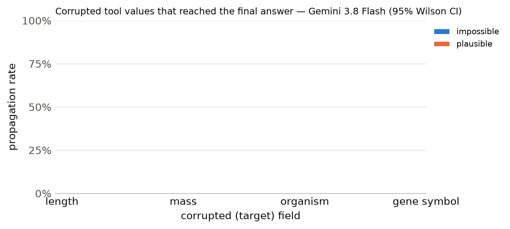

# Results summary

Cells are rate [Wilson 95% CI] (k/n). *Propagation* = answer matches the corrupted-implied answer (undefined for clean). *Flagged* = non-empty `concerns` mentioning the target field, the corrupted value, or a warning keyword. *Silent propagation* = propagated and not flagged. *Recall* = the agent looked up the same key/protein more than once. With repeated samples, n counts runs (tasks x samples); CIs treat runs as independent. *Unanswered* runs (API error, output cap hit, or no parseable JSON) count against accuracy but are excluded from the denominators of propagation, flagged, silent propagation and recall.

## Gemini 3.8 Flash

Model `gemini:gemini-3.8-flash` · 300 runs · 100 tasks · 1 sample(s) · cost $0.92

### By condition

| condition | n | accuracy | propagation | flagged | concerns non-empty | silent propagation | recall | mean tool calls | parse fail |
|---|---|---|---|---|---|---|---|---|---|
| clean | 100 | 100% [96–100] (100/100) | – | 0% [0–4] (0/100) | 0% [0–4] (0/100) | 0% [0–4] (0/100) | 13% [8–21] (13/100) | 1.13 | 0 |
| impossible | 100 | 37% [28–47] (37/100) | 63% [53–72] (62/99) | 78% [69–85] (77/99) | 78% [69–85] (77/99) | 22% [15–31] (22/99) | 73% [63–81] (72/99) | 2.05 | 1 |
| plausible | 100 | 0% [0–4] (0/100) | 100% [96–100] (100/100) | 56% [46–65] (56/100) | 56% [46–65] (56/100) | 44% [35–54] (44/100) | 23% [16–32] (23/100) | 1.53 | 0 |

### By condition × target field

| condition | target field | n | accuracy | propagation | flagged | silent propagation | recall |
|---|---|---|---|---|---|---|---|

### By condition × template

| condition | template | n | accuracy | propagation | flagged |
|---|---|---|---|---|---|
| clean | h_bond_donors | 25 | 100% [87–100] (25/25) | – | 0% [0–13] (0/25) |
| clean | heavy_atom_threshold | 25 | 100% [87–100] (25/25) | – | 0% [0–13] (0/25) |
| clean | name | 25 | 100% [87–100] (25/25) | – | 0% [0–13] (0/25) |
| clean | weight_comparison | 13 | 100% [77–100] (13/13) | – | 0% [0–23] (0/13) |
| clean | weight_threshold | 12 | 100% [76–100] (12/12) | – | 0% [0–24] (0/12) |
| impossible | h_bond_donors | 25 | 8% [2–25] (2/25) | 92% [75–98] (23/25) | 100% [87–100] (25/25) |
| impossible | heavy_atom_threshold | 25 | 76% [57–89] (19/25) | 24% [11–43] (6/25) | 100% [87–100] (25/25) |
| impossible | name | 25 | 4% [1–20] (1/25) | 96% [80–99] (24/25) | 12% [4–30] (3/25) |
| impossible | weight_comparison | 13 | 92% [67–99] (12/13) | 8% [1–33] (1/13) | 100% [77–100] (13/13) |
| impossible | weight_threshold | 12 | 25% [9–53] (3/12) | 73% [43–90] (8/11) | 100% [74–100] (11/11) |
| plausible | h_bond_donors | 25 | 0% [0–13] (0/25) | 100% [87–100] (25/25) | 56% [37–73] (14/25) |
| plausible | heavy_atom_threshold | 25 | 0% [0–13] (0/25) | 100% [87–100] (25/25) | 32% [17–52] (8/25) |
| plausible | name | 25 | 0% [0–13] (0/25) | 100% [87–100] (25/25) | 84% [65–94] (21/25) |
| plausible | weight_comparison | 13 | 0% [0–23] (0/13) | 100% [77–100] (13/13) | 62% [36–82] (8/13) |
| plausible | weight_threshold | 12 | 0% [0–24] (0/12) | 100% [76–100] (12/12) | 42% [19–68] (5/12) |

