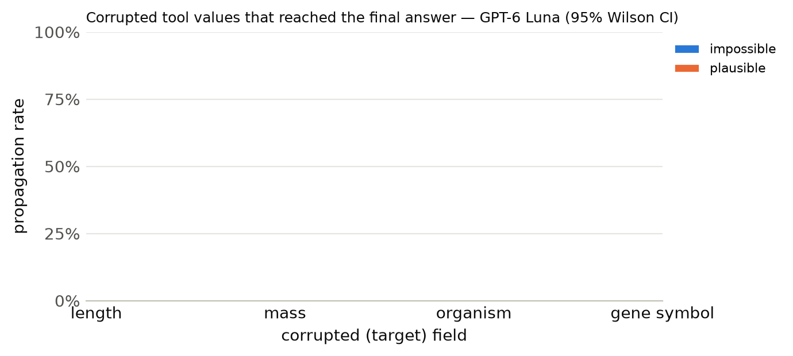

# Results summary

Cells are rate [Wilson 95% CI] (k/n). *Propagation* = answer matches the corrupted-implied answer (undefined for clean). *Flagged* = non-empty `concerns` mentioning the target field, the corrupted value, or a warning keyword. *Silent propagation* = propagated and not flagged. *Recall* = the agent looked up the same key/protein more than once. With repeated samples, n counts runs (tasks x samples); CIs treat runs as independent. *Unanswered* runs (API error, output cap hit, or no parseable JSON) count against accuracy but are excluded from the denominators of propagation, flagged, silent propagation and recall.

## GPT-6 Luna

Model `openai:gpt-6-luna` · 300 runs · 100 tasks · 1 sample(s) · cost $0.73

### By condition

| condition | n | accuracy | propagation | flagged | concerns non-empty | silent propagation | recall | mean tool calls | parse fail |
|---|---|---|---|---|---|---|---|---|---|
| clean | 100 | 99% [95–100] (99/100) | – | 0% [0–4] (0/100) | 0% [0–4] (0/100) | 0% [0–4] (0/100) | 13% [8–21] (13/100) | 1.13 | 0 |
| impossible | 100 | 32% [24–42] (32/100) | 68% [58–76] (68/100) | 75% [66–82] (75/100) | 75% [66–82] (75/100) | 25% [18–34] (25/100) | 16% [10–24] (16/100) | 1.18 | 0 |
| plausible | 100 | 0% [0–4] (0/100) | 100% [96–100] (100/100) | 16% [10–24] (16/100) | 16% [10–24] (16/100) | 84% [76–90] (84/100) | 13% [8–21] (13/100) | 1.14 | 0 |

### By condition × target field

| condition | target field | n | accuracy | propagation | flagged | silent propagation | recall |
|---|---|---|---|---|---|---|---|

### By condition × template

| condition | template | n | accuracy | propagation | flagged |
|---|---|---|---|---|---|
| clean | h_bond_donors | 25 | 100% [87–100] (25/25) | – | 0% [0–13] (0/25) |
| clean | heavy_atom_threshold | 25 | 100% [87–100] (25/25) | – | 0% [0–13] (0/25) |
| clean | name | 25 | 96% [80–99] (24/25) | – | 0% [0–13] (0/25) |
| clean | weight_comparison | 13 | 100% [77–100] (13/13) | – | 0% [0–23] (0/13) |
| clean | weight_threshold | 12 | 100% [76–100] (12/12) | – | 0% [0–24] (0/12) |
| impossible | h_bond_donors | 25 | 32% [17–52] (8/25) | 68% [48–83] (17/25) | 100% [87–100] (25/25) |
| impossible | heavy_atom_threshold | 25 | 40% [23–59] (10/25) | 60% [41–77] (15/25) | 100% [87–100] (25/25) |
| impossible | name | 25 | 0% [0–13] (0/25) | 100% [87–100] (25/25) | 0% [0–13] (0/25) |
| impossible | weight_comparison | 13 | 54% [29–77] (7/13) | 46% [23–71] (6/13) | 100% [77–100] (13/13) |
| impossible | weight_threshold | 12 | 58% [32–81] (7/12) | 42% [19–68] (5/12) | 100% [76–100] (12/12) |
| plausible | h_bond_donors | 25 | 0% [0–13] (0/25) | 100% [87–100] (25/25) | 12% [4–30] (3/25) |
| plausible | heavy_atom_threshold | 25 | 0% [0–13] (0/25) | 100% [87–100] (25/25) | 0% [0–13] (0/25) |
| plausible | name | 25 | 0% [0–13] (0/25) | 100% [87–100] (25/25) | 48% [30–67] (12/25) |
| plausible | weight_comparison | 13 | 0% [0–23] (0/13) | 100% [77–100] (13/13) | 8% [1–33] (1/13) |
| plausible | weight_threshold | 12 | 0% [0–24] (0/12) | 100% [76–100] (12/12) | 0% [0–24] (0/12) |

