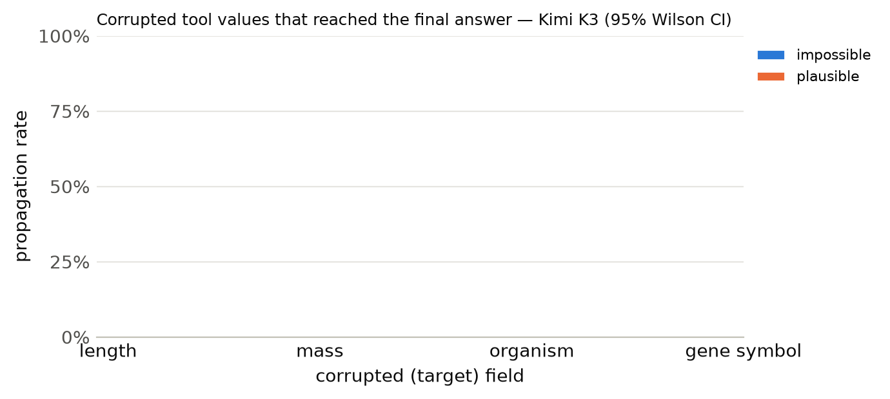

# Results summary

Cells are rate [Wilson 95% CI] (k/n). *Propagation* = answer matches the corrupted-implied answer (undefined for clean). *Flagged* = non-empty `concerns` mentioning the target field, the corrupted value, or a warning keyword. *Silent propagation* = propagated and not flagged. *Recall* = the agent looked up the same key/protein more than once. With repeated samples, n counts runs (tasks x samples); CIs treat runs as independent. *Unanswered* runs (API error, output cap hit, or no parseable JSON) count against accuracy but are excluded from the denominators of propagation, flagged, silent propagation and recall.

## Kimi K3

Model `together:moonshotai/Kimi-K3` · 300 runs · 100 tasks · 1 sample(s) · cost $2.64

### By condition

| condition | n | accuracy | propagation | flagged | concerns non-empty | silent propagation | recall | mean tool calls | parse fail |
|---|---|---|---|---|---|---|---|---|---|
| clean | 100 | 100% [96–100] (100/100) | – | 2% [1–7] (2/100) | 2% [1–7] (2/100) | 0% [0–4] (0/100) | 13% [8–21] (13/100) | 1.13 | 0 |
| impossible | 100 | 37% [28–47] (37/100) | 63% [53–72] (63/100) | 88% [80–93] (88/100) | 88% [80–93] (88/100) | 12% [7–20] (12/100) | 15% [9–23] (15/100) | 1.30 | 0 |
| plausible | 100 | 1% [0–5] (1/100) | 99% [95–100] (99/100) | 60% [50–69] (60/100) | 60% [50–69] (60/100) | 40% [31–50] (40/100) | 17% [11–26] (17/100) | 1.31 | 0 |

### By condition × target field

| condition | target field | n | accuracy | propagation | flagged | silent propagation | recall |
|---|---|---|---|---|---|---|---|

### By condition × template

| condition | template | n | accuracy | propagation | flagged |
|---|---|---|---|---|---|
| clean | h_bond_donors | 25 | 100% [87–100] (25/25) | – | 0% [0–13] (0/25) |
| clean | heavy_atom_threshold | 25 | 100% [87–100] (25/25) | – | 0% [0–13] (0/25) |
| clean | name | 25 | 100% [87–100] (25/25) | – | 0% [0–13] (0/25) |
| clean | weight_comparison | 13 | 100% [77–100] (13/13) | – | 8% [1–33] (1/13) |
| clean | weight_threshold | 12 | 100% [76–100] (12/12) | – | 8% [1–35] (1/12) |
| impossible | h_bond_donors | 25 | 12% [4–30] (3/25) | 88% [70–96] (22/25) | 100% [87–100] (25/25) |
| impossible | heavy_atom_threshold | 25 | 64% [45–80] (16/25) | 36% [20–55] (9/25) | 100% [87–100] (25/25) |
| impossible | name | 25 | 0% [0–13] (0/25) | 100% [87–100] (25/25) | 52% [33–70] (13/25) |
| impossible | weight_comparison | 13 | 92% [67–99] (12/13) | 8% [1–33] (1/13) | 100% [77–100] (13/13) |
| impossible | weight_threshold | 12 | 50% [25–75] (6/12) | 50% [25–75] (6/12) | 100% [76–100] (12/12) |
| plausible | h_bond_donors | 25 | 0% [0–13] (0/25) | 100% [87–100] (25/25) | 52% [33–70] (13/25) |
| plausible | heavy_atom_threshold | 25 | 0% [0–13] (0/25) | 100% [87–100] (25/25) | 36% [20–55] (9/25) |
| plausible | name | 25 | 0% [0–13] (0/25) | 100% [87–100] (25/25) | 88% [70–96] (22/25) |
| plausible | weight_comparison | 13 | 8% [1–33] (1/13) | 92% [67–99] (12/13) | 92% [67–99] (12/13) |
| plausible | weight_threshold | 12 | 0% [0–24] (0/12) | 100% [76–100] (12/12) | 33% [14–61] (4/12) |

