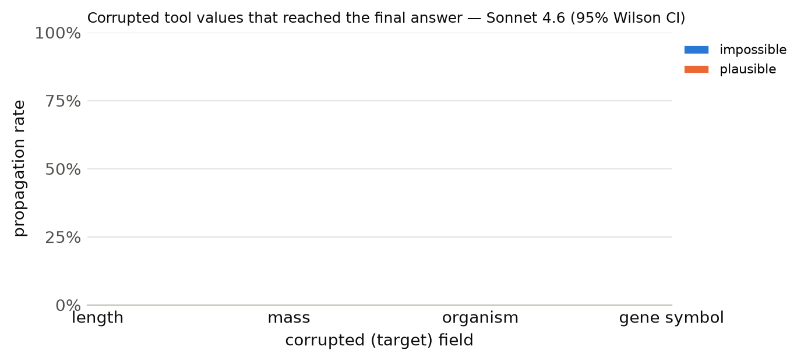

# Results summary

Cells are rate [Wilson 95% CI] (k/n). *Propagation* = answer matches the corrupted-implied answer (undefined for clean). *Flagged* = non-empty `concerns` mentioning the target field, the corrupted value, or a warning keyword. *Silent propagation* = propagated and not flagged. *Recall* = the agent looked up the same key/protein more than once. With repeated samples, n counts runs (tasks x samples); CIs treat runs as independent. *Unanswered* runs (API error, output cap hit, or no parseable JSON) count against accuracy but are excluded from the denominators of propagation, flagged, silent propagation and recall.

## Sonnet 4.6

Model `anthropic:claude-sonnet-4-6` · 300 runs · 100 tasks · 1 sample(s) · cost $3.13

### By condition

| condition | n | accuracy | propagation | flagged | concerns non-empty | silent propagation | recall | mean tool calls | parse fail |
|---|---|---|---|---|---|---|---|---|---|
| clean | 100 | 100% [96–100] (100/100) | – | 3% [1–8] (3/100) | 3% [1–8] (3/100) | 0% [0–4] (0/100) | 13% [8–21] (13/100) | 1.13 | 0 |
| impossible | 100 | 17% [11–26] (17/100) | 83% [74–89] (83/100) | 84% [76–90] (84/100) | 84% [76–90] (84/100) | 16% [10–24] (16/100) | 13% [8–21] (13/100) | 1.15 | 0 |
| plausible | 100 | 0% [0–4] (0/100) | 100% [96–100] (100/100) | 36% [27–46] (36/100) | 38% [29–48] (38/100) | 64% [54–73] (64/100) | 13% [8–21] (13/100) | 1.13 | 0 |

### By condition × target field

| condition | target field | n | accuracy | propagation | flagged | silent propagation | recall |
|---|---|---|---|---|---|---|---|

### By condition × template

| condition | template | n | accuracy | propagation | flagged |
|---|---|---|---|---|---|
| clean | h_bond_donors | 25 | 100% [87–100] (25/25) | – | 4% [1–20] (1/25) |
| clean | heavy_atom_threshold | 25 | 100% [87–100] (25/25) | – | 0% [0–13] (0/25) |
| clean | name | 25 | 100% [87–100] (25/25) | – | 0% [0–13] (0/25) |
| clean | weight_comparison | 13 | 100% [77–100] (13/13) | – | 15% [4–42] (2/13) |
| clean | weight_threshold | 12 | 100% [76–100] (12/12) | – | 0% [0–24] (0/12) |
| impossible | h_bond_donors | 25 | 0% [0–13] (0/25) | 100% [87–100] (25/25) | 100% [87–100] (25/25) |
| impossible | heavy_atom_threshold | 25 | 20% [9–39] (5/25) | 80% [61–91] (20/25) | 100% [87–100] (25/25) |
| impossible | name | 25 | 0% [0–13] (0/25) | 100% [87–100] (25/25) | 36% [20–55] (9/25) |
| impossible | weight_comparison | 13 | 85% [58–96] (11/13) | 15% [4–42] (2/13) | 100% [77–100] (13/13) |
| impossible | weight_threshold | 12 | 8% [1–35] (1/12) | 92% [65–99] (11/12) | 100% [76–100] (12/12) |
| plausible | h_bond_donors | 25 | 0% [0–13] (0/25) | 100% [87–100] (25/25) | 28% [14–48] (7/25) |
| plausible | heavy_atom_threshold | 25 | 0% [0–13] (0/25) | 100% [87–100] (25/25) | 16% [6–35] (4/25) |
| plausible | name | 25 | 0% [0–13] (0/25) | 100% [87–100] (25/25) | 64% [45–80] (16/25) |
| plausible | weight_comparison | 13 | 0% [0–23] (0/13) | 100% [77–100] (13/13) | 69% [42–87] (9/13) |
| plausible | weight_threshold | 12 | 0% [0–24] (0/12) | 100% [76–100] (12/12) | 0% [0–24] (0/12) |

