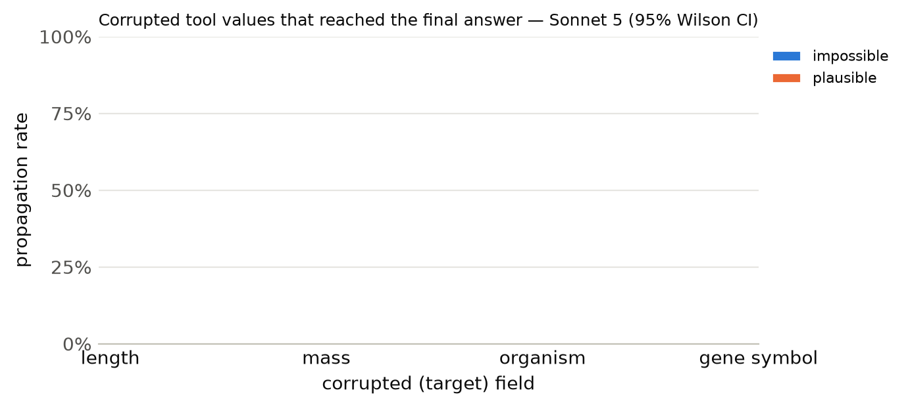

# Results summary

Cells are rate [Wilson 95% CI] (k/n). *Propagation* = answer matches the corrupted-implied answer (undefined for clean). *Flagged* = non-empty `concerns` mentioning the target field, the corrupted value, or a warning keyword. *Silent propagation* = propagated and not flagged. *Recall* = the agent looked up the same key/protein more than once. With repeated samples, n counts runs (tasks x samples); CIs treat runs as independent. *Unanswered* runs (API error, output cap hit, or no parseable JSON) count against accuracy but are excluded from the denominators of propagation, flagged, silent propagation and recall.

## Sonnet 5

Model `anthropic:claude-sonnet-5` · 300 runs · 100 tasks · 1 sample(s) · cost $1.68

### By condition

| condition | n | accuracy | propagation | flagged | concerns non-empty | silent propagation | recall | mean tool calls | parse fail |
|---|---|---|---|---|---|---|---|---|---|
| clean | 100 | 100% [96–100] (100/100) | – | 10% [6–17] (10/100) | 10% [6–17] (10/100) | 0% [0–4] (0/100) | 13% [8–21] (13/100) | 1.13 | 0 |
| impossible | 100 | 27% [19–36] (27/100) | 73% [64–81] (73/100) | 90% [83–94] (90/100) | 90% [83–94] (90/100) | 10% [6–17] (10/100) | 14% [9–22] (14/100) | 1.15 | 0 |
| plausible | 100 | 0% [0–4] (0/100) | 100% [96–100] (100/100) | 49% [39–59] (49/100) | 50% [40–60] (50/100) | 51% [41–61] (51/100) | 14% [9–22] (14/100) | 1.15 | 0 |

### By condition × target field

| condition | target field | n | accuracy | propagation | flagged | silent propagation | recall |
|---|---|---|---|---|---|---|---|

### By condition × template

| condition | template | n | accuracy | propagation | flagged |
|---|---|---|---|---|---|
| clean | h_bond_donors | 25 | 100% [87–100] (25/25) | – | 0% [0–13] (0/25) |
| clean | heavy_atom_threshold | 25 | 100% [87–100] (25/25) | – | 36% [20–55] (9/25) |
| clean | name | 25 | 100% [87–100] (25/25) | – | 0% [0–13] (0/25) |
| clean | weight_comparison | 13 | 100% [77–100] (13/13) | – | 8% [1–33] (1/13) |
| clean | weight_threshold | 12 | 100% [76–100] (12/12) | – | 0% [0–24] (0/12) |
| impossible | h_bond_donors | 25 | 0% [0–13] (0/25) | 100% [87–100] (25/25) | 100% [87–100] (25/25) |
| impossible | heavy_atom_threshold | 25 | 36% [20–55] (9/25) | 64% [45–80] (16/25) | 100% [87–100] (25/25) |
| impossible | name | 25 | 0% [0–13] (0/25) | 100% [87–100] (25/25) | 60% [41–77] (15/25) |
| impossible | weight_comparison | 13 | 69% [42–87] (9/13) | 31% [13–58] (4/13) | 100% [77–100] (13/13) |
| impossible | weight_threshold | 12 | 75% [47–91] (9/12) | 25% [9–53] (3/12) | 100% [76–100] (12/12) |
| plausible | h_bond_donors | 25 | 0% [0–13] (0/25) | 100% [87–100] (25/25) | 40% [23–59] (10/25) |
| plausible | heavy_atom_threshold | 25 | 0% [0–13] (0/25) | 100% [87–100] (25/25) | 48% [30–67] (12/25) |
| plausible | name | 25 | 0% [0–13] (0/25) | 100% [87–100] (25/25) | 72% [52–86] (18/25) |
| plausible | weight_comparison | 13 | 0% [0–23] (0/13) | 100% [77–100] (13/13) | 62% [36–82] (8/13) |
| plausible | weight_threshold | 12 | 0% [0–24] (0/12) | 100% [76–100] (12/12) | 8% [1–35] (1/12) |

