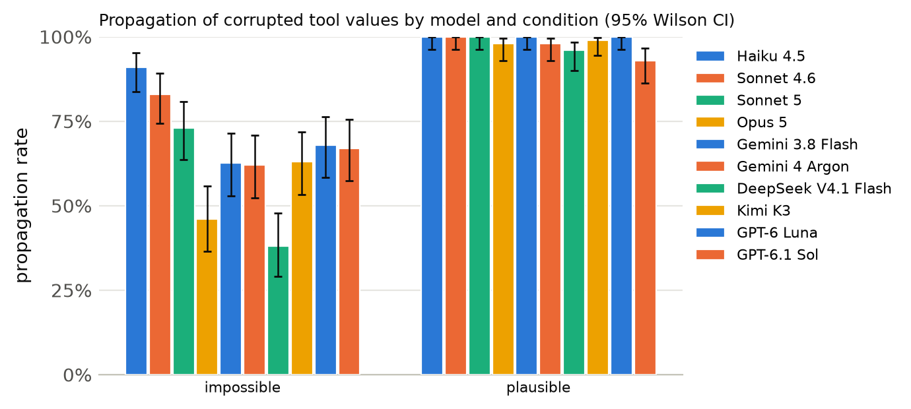
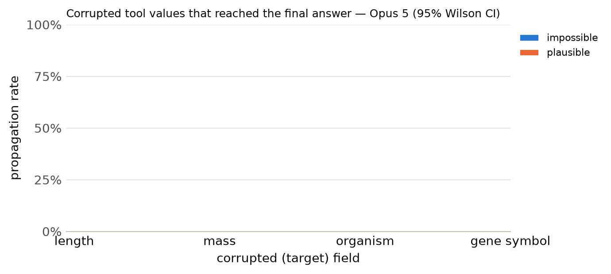

# Results summary

Cells are rate [Wilson 95% CI] (k/n). *Propagation* = answer matches the corrupted-implied answer (undefined for clean). *Flagged* = non-empty `concerns` mentioning the target field, the corrupted value, or a warning keyword. *Silent propagation* = propagated and not flagged. *Recall* = the agent looked up the same key/protein more than once. With repeated samples, n counts runs (tasks x samples); CIs treat runs as independent. *Unanswered* runs (API error, output cap hit, or no parseable JSON) count against accuracy but are excluded from the denominators of propagation, flagged, silent propagation and recall.

Models: Haiku 4.5, Sonnet 4.6, Sonnet 5, Opus 5, Gemini 3.8 Flash, Gemini 4 Argon, DeepSeek V4.1 Flash, Kimi K3, GPT-6 Luna, GPT-6.1 Sol · total runs: 3000 · total cost: $20.23

## Cross-model

| model | condition | n | accuracy | propagation | flagged | silent propagation | recall |
|---|---|---|---|---|---|---|---|
| Haiku 4.5 | clean | 100 | 100% [96–100] (100/100) | – | 2% [1–7] (2/100) | 0% [0–4] (0/100) | 13% [8–21] (13/100) |
| Haiku 4.5 | impossible | 100 | 9% [5–16] (9/100) | 91% [84–95] (91/100) | 75% [66–82] (75/100) | 25% [18–34] (25/100) | 13% [8–21] (13/100) |
| Haiku 4.5 | plausible | 100 | 0% [0–4] (0/100) | 100% [96–100] (100/100) | 3% [1–8] (3/100) | 97% [92–99] (97/100) | 13% [8–21] (13/100) |
| Sonnet 4.6 | clean | 100 | 100% [96–100] (100/100) | – | 3% [1–8] (3/100) | 0% [0–4] (0/100) | 13% [8–21] (13/100) |
| Sonnet 4.6 | impossible | 100 | 17% [11–26] (17/100) | 83% [74–89] (83/100) | 84% [76–90] (84/100) | 16% [10–24] (16/100) | 13% [8–21] (13/100) |
| Sonnet 4.6 | plausible | 100 | 0% [0–4] (0/100) | 100% [96–100] (100/100) | 36% [27–46] (36/100) | 64% [54–73] (64/100) | 13% [8–21] (13/100) |
| Sonnet 5 | clean | 100 | 100% [96–100] (100/100) | – | 10% [6–17] (10/100) | 0% [0–4] (0/100) | 13% [8–21] (13/100) |
| Sonnet 5 | impossible | 100 | 27% [19–36] (27/100) | 73% [64–81] (73/100) | 90% [83–94] (90/100) | 10% [6–17] (10/100) | 14% [9–22] (14/100) |
| Sonnet 5 | plausible | 100 | 0% [0–4] (0/100) | 100% [96–100] (100/100) | 49% [39–59] (49/100) | 51% [41–61] (51/100) | 14% [9–22] (14/100) |
| Opus 5 | clean | 100 | 100% [96–100] (100/100) | – | 8% [4–15] (8/100) | 0% [0–4] (0/100) | 37% [28–47] (37/100) |
| Opus 5 | impossible | 100 | 56% [46–65] (56/100) | 46% [37–56] (46/100) | 100% [96–100] (100/100) | 0% [0–4] (0/100) | 63% [53–72] (63/100) |
| Opus 5 | plausible | 100 | 2% [1–7] (2/100) | 98% [93–99] (98/100) | 96% [90–98] (96/100) | 4% [2–10] (4/100) | 29% [21–39] (29/100) |
| Gemini 3.8 Flash | clean | 100 | 100% [96–100] (100/100) | – | 0% [0–4] (0/100) | 0% [0–4] (0/100) | 13% [8–21] (13/100) |
| Gemini 3.8 Flash | impossible | 100 | 37% [28–47] (37/100) | 63% [53–72] (62/99) | 78% [69–85] (77/99) | 22% [15–31] (22/99) | 73% [63–81] (72/99) |
| Gemini 3.8 Flash | plausible | 100 | 0% [0–4] (0/100) | 100% [96–100] (100/100) | 56% [46–65] (56/100) | 44% [35–54] (44/100) | 23% [16–32] (23/100) |
| Gemini 4 Argon | clean | 100 | 100% [96–100] (100/100) | – | 0% [0–4] (0/100) | 0% [0–4] (0/100) | 14% [9–22] (14/100) |
| Gemini 4 Argon | impossible | 100 | 38% [29–48] (38/100) | 62% [52–71] (62/100) | 91% [84–95] (91/100) | 9% [5–16] (9/100) | 14% [9–22] (14/100) |
| Gemini 4 Argon | plausible | 100 | 2% [1–7] (2/100) | 98% [93–99] (98/100) | 90% [83–94] (90/100) | 10% [6–17] (10/100) | 20% [13–29] (20/100) |
| DeepSeek V4.1 Flash | clean | 100 | 100% [96–100] (100/100) | – | 2% [1–7] (2/100) | 0% [0–4] (0/100) | 18% [12–27] (18/100) |
| DeepSeek V4.1 Flash | impossible | 100 | 61% [51–70] (61/100) | 38% [29–48] (38/100) | 97% [92–99] (97/100) | 3% [1–8] (3/100) | 43% [34–53] (43/100) |
| DeepSeek V4.1 Flash | plausible | 100 | 4% [2–10] (4/100) | 96% [90–98] (95/99) | 72% [62–80] (71/99) | 28% [20–38] (28/99) | 34% [26–44] (34/99) |
| Kimi K3 | clean | 100 | 100% [96–100] (100/100) | – | 2% [1–7] (2/100) | 0% [0–4] (0/100) | 13% [8–21] (13/100) |
| Kimi K3 | impossible | 100 | 37% [28–47] (37/100) | 63% [53–72] (63/100) | 88% [80–93] (88/100) | 12% [7–20] (12/100) | 15% [9–23] (15/100) |
| Kimi K3 | plausible | 100 | 1% [0–5] (1/100) | 99% [95–100] (99/100) | 60% [50–69] (60/100) | 40% [31–50] (40/100) | 17% [11–26] (17/100) |
| GPT-6 Luna | clean | 100 | 99% [95–100] (99/100) | – | 0% [0–4] (0/100) | 0% [0–4] (0/100) | 13% [8–21] (13/100) |
| GPT-6 Luna | impossible | 100 | 32% [24–42] (32/100) | 68% [58–76] (68/100) | 75% [66–82] (75/100) | 25% [18–34] (25/100) | 16% [10–24] (16/100) |
| GPT-6 Luna | plausible | 100 | 0% [0–4] (0/100) | 100% [96–100] (100/100) | 16% [10–24] (16/100) | 84% [76–90] (84/100) | 13% [8–21] (13/100) |
| GPT-6.1 Sol | clean | 100 | 100% [96–100] (100/100) | – | 0% [0–4] (0/100) | 0% [0–4] (0/100) | 13% [8–21] (13/100) |
| GPT-6.1 Sol | impossible | 100 | 33% [25–43] (33/100) | 67% [57–75] (67/100) | 78% [69–85] (78/100) | 22% [15–31] (22/100) | 70% [60–78] (70/100) |
| GPT-6.1 Sol | plausible | 100 | 6% [3–12] (6/100) | 93% [86–97] (93/100) | 70% [60–78] (70/100) | 30% [22–40] (30/100) | 30% [22–40] (30/100) |

## Primary model: Opus 5

Model `anthropic:claude-opus-5` · 300 runs · 100 tasks · 1 sample(s) · cost $7.21

### By condition

| condition | n | accuracy | propagation | flagged | concerns non-empty | silent propagation | recall | mean tool calls | parse fail |
|---|---|---|---|---|---|---|---|---|---|
| clean | 100 | 100% [96–100] (100/100) | – | 8% [4–15] (8/100) | 12% [7–20] (12/100) | 0% [0–4] (0/100) | 37% [28–47] (37/100) | 1.40 | 0 |
| impossible | 100 | 56% [46–65] (56/100) | 46% [37–56] (46/100) | 100% [96–100] (100/100) | 100% [96–100] (100/100) | 0% [0–4] (0/100) | 63% [53–72] (63/100) | 1.97 | 0 |
| plausible | 100 | 2% [1–7] (2/100) | 98% [93–99] (98/100) | 96% [90–98] (96/100) | 97% [92–99] (97/100) | 4% [2–10] (4/100) | 29% [21–39] (29/100) | 1.57 | 0 |

### By condition × target field

| condition | target field | n | accuracy | propagation | flagged | silent propagation | recall |
|---|---|---|---|---|---|---|---|

### By condition × template

| condition | template | n | accuracy | propagation | flagged |
|---|---|---|---|---|---|
| clean | h_bond_donors | 25 | 100% [87–100] (25/25) | – | 0% [0–13] (0/25) |
| clean | heavy_atom_threshold | 25 | 100% [87–100] (25/25) | – | 8% [2–25] (2/25) |
| clean | name | 25 | 100% [87–100] (25/25) | – | 8% [2–25] (2/25) |
| clean | weight_comparison | 13 | 100% [77–100] (13/13) | – | 23% [8–50] (3/13) |
| clean | weight_threshold | 12 | 100% [76–100] (12/12) | – | 8% [1–35] (1/12) |
| impossible | h_bond_donors | 25 | 48% [30–67] (12/25) | 52% [33–70] (13/25) | 100% [87–100] (25/25) |
| impossible | heavy_atom_threshold | 25 | 96% [80–99] (24/25) | 4% [1–20] (1/25) | 100% [87–100] (25/25) |
| impossible | name | 25 | 0% [0–13] (0/25) | 100% [87–100] (25/25) | 100% [87–100] (25/25) |
| impossible | weight_comparison | 13 | 77% [50–92] (10/13) | 38% [18–64] (5/13) | 100% [77–100] (13/13) |
| impossible | weight_threshold | 12 | 83% [55–95] (10/12) | 17% [5–45] (2/12) | 100% [76–100] (12/12) |
| plausible | h_bond_donors | 25 | 0% [0–13] (0/25) | 100% [87–100] (25/25) | 92% [75–98] (23/25) |
| plausible | heavy_atom_threshold | 25 | 0% [0–13] (0/25) | 100% [87–100] (25/25) | 96% [80–99] (24/25) |
| plausible | name | 25 | 0% [0–13] (0/25) | 100% [87–100] (25/25) | 100% [87–100] (25/25) |
| plausible | weight_comparison | 13 | 15% [4–42] (2/13) | 85% [58–96] (11/13) | 92% [67–99] (12/13) |
| plausible | weight_threshold | 12 | 0% [0–24] (0/12) | 100% [76–100] (12/12) | 100% [76–100] (12/12) |

Per-model tables, figures and examples: `models/haiku_4_5/`, `models/sonnet_4_6/`, `models/sonnet_5/`, `models/opus_5/`, `models/gemini_3_8_flash/`, `models/gemini_4_argon/`, `models/deepseek_v4_1_flash/`, `models/kimi_k3/`, `models/gpt_6_luna/`, `models/gpt_6_1_sol/`

