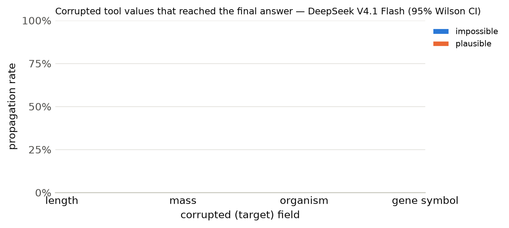

# Results summary

Cells are rate [Wilson 95% CI] (k/n). *Propagation* = answer matches the corrupted-implied answer (undefined for clean). *Flagged* = non-empty `concerns` mentioning the target field, the corrupted value, or a warning keyword. *Silent propagation* = propagated and not flagged. *Recall* = the agent looked up the same key/protein more than once. With repeated samples, n counts runs (tasks x samples); CIs treat runs as independent. *Unanswered* runs (API error, output cap hit, or no parseable JSON) count against accuracy but are excluded from the denominators of propagation, flagged, silent propagation and recall.

## DeepSeek V4.1 Flash

Model `together:deepseek-ai/DeepSeek-V4.1-Flash-1017` · 300 runs · 100 tasks · 1 sample(s) · cost $1.44

### By condition

| condition | n | accuracy | propagation | flagged | concerns non-empty | silent propagation | recall | mean tool calls | parse fail |
|---|---|---|---|---|---|---|---|---|---|
| clean | 100 | 100% [96–100] (100/100) | – | 2% [1–7] (2/100) | 2% [1–7] (2/100) | 0% [0–4] (0/100) | 14% [9–22] (14/100) | 1.14 | 0 |
| impossible | 100 | 77% [68–84] (77/100) | 20% [13–29] (20/100) | 96% [90–98] (96/100) | 96% [90–98] (96/100) | 4% [2–10] (4/100) | 24% [17–33] (24/100) | 1.36 | 0 |
| plausible | 100 | 47% [38–57] (47/100) | 51% [41–61] (51/100) | 91% [84–95] (91/100) | 91% [84–95] (91/100) | 9% [5–16] (9/100) | 40% [31–50] (40/100) | 1.60 | 0 |

### By condition × target field

| condition | target field | n | accuracy | propagation | flagged | silent propagation | recall |
|---|---|---|---|---|---|---|---|

### By condition × template

| condition | template | n | accuracy | propagation | flagged |
|---|---|---|---|---|---|
| clean | h_bond_donors | 25 | 100% [87–100] (25/25) | – | 4% [1–20] (1/25) |
| clean | heavy_atom_threshold | 25 | 100% [87–100] (25/25) | – | 0% [0–13] (0/25) |
| clean | name | 25 | 100% [87–100] (25/25) | – | 0% [0–13] (0/25) |
| clean | weight_comparison | 13 | 100% [77–100] (13/13) | – | 8% [1–33] (1/13) |
| clean | weight_threshold | 12 | 100% [76–100] (12/12) | – | 0% [0–24] (0/12) |
| impossible | h_bond_donors | 25 | 92% [75–98] (23/25) | 0% [0–13] (0/25) | 100% [87–100] (25/25) |
| impossible | heavy_atom_threshold | 25 | 100% [87–100] (25/25) | 0% [0–13] (0/25) | 100% [87–100] (25/25) |
| impossible | name | 25 | 16% [6–35] (4/25) | 80% [61–91] (20/25) | 84% [65–94] (21/25) |
| impossible | weight_comparison | 13 | 100% [77–100] (13/13) | 0% [0–23] (0/13) | 100% [77–100] (13/13) |
| impossible | weight_threshold | 12 | 100% [76–100] (12/12) | 0% [0–24] (0/12) | 100% [76–100] (12/12) |
| plausible | h_bond_donors | 25 | 40% [23–59] (10/25) | 60% [41–77] (15/25) | 92% [75–98] (23/25) |
| plausible | heavy_atom_threshold | 25 | 56% [37–73] (14/25) | 44% [27–63] (11/25) | 96% [80–99] (24/25) |
| plausible | name | 25 | 36% [20–55] (9/25) | 56% [37–73] (14/25) | 100% [87–100] (25/25) |
| plausible | weight_comparison | 13 | 92% [67–99] (12/13) | 8% [1–33] (1/13) | 92% [67–99] (12/13) |
| plausible | weight_threshold | 12 | 17% [5–45] (2/12) | 83% [55–95] (10/12) | 58% [32–81] (7/12) |

