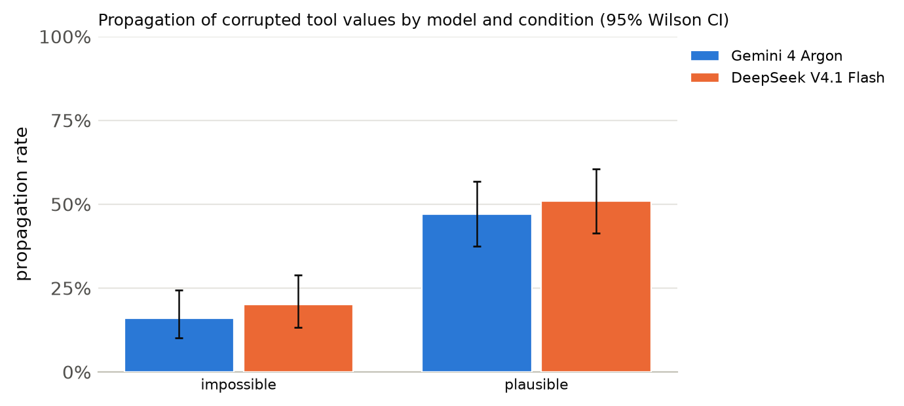
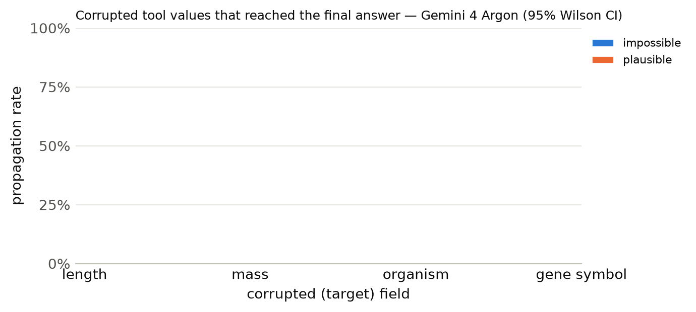

# Results summary

Cells are rate [Wilson 95% CI] (k/n). *Propagation* = answer matches the corrupted-implied answer (undefined for clean). *Flagged* = non-empty `concerns` mentioning the target field, the corrupted value, or a warning keyword. *Silent propagation* = propagated and not flagged. *Recall* = the agent looked up the same key/protein more than once. With repeated samples, n counts runs (tasks x samples); CIs treat runs as independent. *Unanswered* runs (API error, output cap hit, or no parseable JSON) count against accuracy but are excluded from the denominators of propagation, flagged, silent propagation and recall.

Models: Gemini 4 Argon, DeepSeek V4.1 Flash · total runs: 600 · total cost: $2.54

## Cross-model

| model | condition | n | accuracy | propagation | flagged | silent propagation | recall |
|---|---|---|---|---|---|---|---|
| Gemini 4 Argon | clean | 100 | 100% [96–100] (100/100) | – | 0% [0–4] (0/100) | 0% [0–4] (0/100) | 13% [8–21] (13/100) |
| Gemini 4 Argon | impossible | 100 | 82% [73–88] (82/100) | 16% [10–24] (16/100) | 100% [96–100] (100/100) | 0% [0–4] (0/100) | 19% [13–28] (19/100) |
| Gemini 4 Argon | plausible | 100 | 51% [41–61] (51/100) | 47% [38–57] (47/100) | 99% [95–100] (99/100) | 1% [0–5] (1/100) | 21% [14–30] (21/100) |
| DeepSeek V4.1 Flash | clean | 100 | 100% [96–100] (100/100) | – | 2% [1–7] (2/100) | 0% [0–4] (0/100) | 14% [9–22] (14/100) |
| DeepSeek V4.1 Flash | impossible | 100 | 77% [68–84] (77/100) | 20% [13–29] (20/100) | 96% [90–98] (96/100) | 4% [2–10] (4/100) | 24% [17–33] (24/100) |
| DeepSeek V4.1 Flash | plausible | 100 | 47% [38–57] (47/100) | 51% [41–61] (51/100) | 91% [84–95] (91/100) | 9% [5–16] (9/100) | 40% [31–50] (40/100) |

## Primary model: Gemini 4 Argon

Model `gemini:gemini-4-argon` · 300 runs · 100 tasks · 1 sample(s) · cost $1.10

### By condition

| condition | n | accuracy | propagation | flagged | concerns non-empty | silent propagation | recall | mean tool calls | parse fail |
|---|---|---|---|---|---|---|---|---|---|
| clean | 100 | 100% [96–100] (100/100) | – | 0% [0–4] (0/100) | 0% [0–4] (0/100) | 0% [0–4] (0/100) | 13% [8–21] (13/100) | 1.13 | 0 |
| impossible | 100 | 82% [73–88] (82/100) | 16% [10–24] (16/100) | 100% [96–100] (100/100) | 100% [96–100] (100/100) | 0% [0–4] (0/100) | 19% [13–28] (19/100) | 1.26 | 0 |
| plausible | 100 | 51% [41–61] (51/100) | 47% [38–57] (47/100) | 99% [95–100] (99/100) | 99% [95–100] (99/100) | 1% [0–5] (1/100) | 21% [14–30] (21/100) | 1.28 | 0 |

### By condition × target field

| condition | target field | n | accuracy | propagation | flagged | silent propagation | recall |
|---|---|---|---|---|---|---|---|

### By condition × template

| condition | template | n | accuracy | propagation | flagged |
|---|---|---|---|---|---|
| clean | h_bond_donors | 25 | 100% [87–100] (25/25) | – | 0% [0–13] (0/25) |
| clean | heavy_atom_threshold | 25 | 100% [87–100] (25/25) | – | 0% [0–13] (0/25) |
| clean | name | 25 | 100% [87–100] (25/25) | – | 0% [0–13] (0/25) |
| clean | weight_comparison | 13 | 100% [77–100] (13/13) | – | 0% [0–23] (0/13) |
| clean | weight_threshold | 12 | 100% [76–100] (12/12) | – | 0% [0–24] (0/12) |
| impossible | h_bond_donors | 25 | 100% [87–100] (25/25) | 0% [0–13] (0/25) | 100% [87–100] (25/25) |
| impossible | heavy_atom_threshold | 25 | 100% [87–100] (25/25) | 0% [0–13] (0/25) | 100% [87–100] (25/25) |
| impossible | name | 25 | 28% [14–48] (7/25) | 64% [45–80] (16/25) | 100% [87–100] (25/25) |
| impossible | weight_comparison | 13 | 100% [77–100] (13/13) | 0% [0–23] (0/13) | 100% [77–100] (13/13) |
| impossible | weight_threshold | 12 | 100% [76–100] (12/12) | 0% [0–24] (0/12) | 100% [76–100] (12/12) |
| plausible | h_bond_donors | 25 | 56% [37–73] (14/25) | 44% [27–63] (11/25) | 96% [80–99] (24/25) |
| plausible | heavy_atom_threshold | 25 | 60% [41–77] (15/25) | 40% [23–59] (10/25) | 100% [87–100] (25/25) |
| plausible | name | 25 | 32% [17–52] (8/25) | 60% [41–77] (15/25) | 100% [87–100] (25/25) |
| plausible | weight_comparison | 13 | 69% [42–87] (9/13) | 31% [13–58] (4/13) | 100% [77–100] (13/13) |
| plausible | weight_threshold | 12 | 42% [19–68] (5/12) | 58% [32–81] (7/12) | 100% [76–100] (12/12) |

Per-model tables, figures and examples: `models/gemini_4_argon/`, `models/deepseek_v4_1_flash/`

