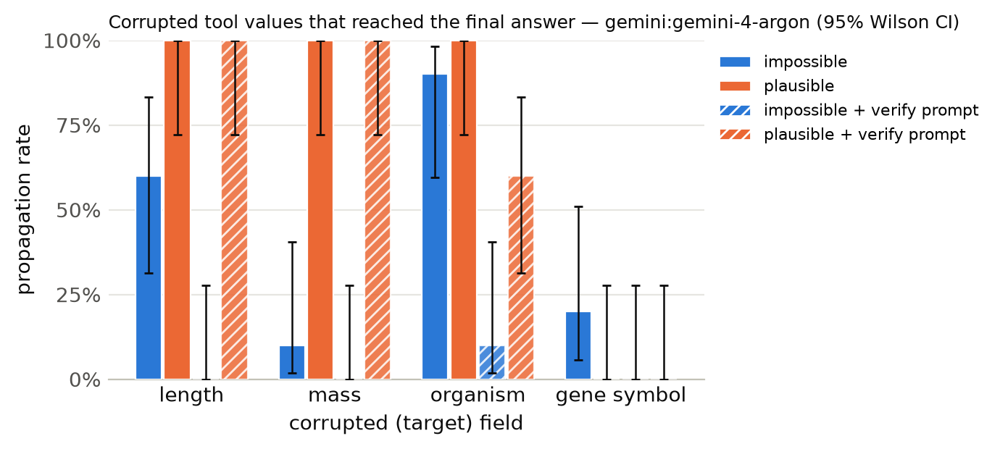

# Results summary

Cells are rate [Wilson 95% CI] (k/n). *Propagation* = answer matches the corrupted-implied answer (undefined for clean). *Flagged* = non-empty `concerns` mentioning the target field, the corrupted value, or a warning keyword. *Silent propagation* = propagated and not flagged. *Recall* = the agent looked up the same key/protein more than once. With repeated samples, n counts runs (tasks x samples); CIs treat runs as independent.

## gemini:gemini-4-argon

Model `gemini:gemini-4-argon` · 240 runs · 40 tasks · 1 sample(s) · cost $0.98

### By condition

| condition | n | accuracy | propagation | flagged | concerns non-empty | silent propagation | recall | mean tool calls | parse fail |
|---|---|---|---|---|---|---|---|---|---|
| clean | 40 | 100% [91–100] (40/40) | – | 2% [0–13] (1/40) | 5% [1–17] (2/40) | 0% [0–9] (0/40) | 5% [1–17] (2/40) | 1.43 | 0 |
| impossible | 40 | 55% [40–69] (22/40) | 45% [31–60] (18/40) | 100% [91–100] (40/40) | 100% [91–100] (40/40) | 0% [0–9] (0/40) | 40% [26–55] (16/40) | 1.88 | 0 |
| plausible | 40 | 25% [14–40] (10/40) | 75% [60–86] (30/40) | 92% [80–97] (37/40) | 92% [80–97] (37/40) | 8% [3–20] (3/40) | 35% [22–50] (14/40) | 1.95 | 0 |
| clean+verify | 40 | 100% [91–100] (40/40) | – | 0% [0–9] (0/40) | 0% [0–9] (0/40) | 0% [0–9] (0/40) | 0% [0–9] (0/40) | 1.38 | 0 |
| impossible+verify | 40 | 98% [87–100] (39/40) | 2% [0–13] (1/40) | 100% [91–100] (40/40) | 100% [91–100] (40/40) | 0% [0–9] (0/40) | 38% [24–53] (15/40) | 1.82 | 0 |
| plausible+verify | 40 | 35% [22–50] (14/40) | 65% [50–78] (26/40) | 95% [83–99] (38/40) | 95% [83–99] (38/40) | 5% [1–17] (2/40) | 35% [22–50] (14/40) | 1.98 | 0 |

### By condition × target field

| condition | target field | n | accuracy | propagation | flagged | silent propagation | recall |
|---|---|---|---|---|---|---|---|
| clean | length | 10 | 100% [72–100] (10/10) | – | 0% [0–28] (0/10) | 0% [0–28] (0/10) | 0% [0–28] (0/10) |
| clean | mass | 10 | 100% [72–100] (10/10) | – | 0% [0–28] (0/10) | 0% [0–28] (0/10) | 0% [0–28] (0/10) |
| clean | organism | 10 | 100% [72–100] (10/10) | – | 10% [2–40] (1/10) | 0% [0–28] (0/10) | 0% [0–28] (0/10) |
| clean | gene_symbol | 10 | 100% [72–100] (10/10) | – | 0% [0–28] (0/10) | 0% [0–28] (0/10) | 20% [6–51] (2/10) |
| impossible | length | 10 | 40% [17–69] (4/10) | 60% [31–83] (6/10) | 100% [72–100] (10/10) | 0% [0–28] (0/10) | 10% [2–40] (1/10) |
| impossible | mass | 10 | 90% [60–98] (9/10) | 10% [2–40] (1/10) | 100% [72–100] (10/10) | 0% [0–28] (0/10) | 20% [6–51] (2/10) |
| impossible | organism | 10 | 10% [2–40] (1/10) | 90% [60–98] (9/10) | 100% [72–100] (10/10) | 0% [0–28] (0/10) | 50% [24–76] (5/10) |
| impossible | gene_symbol | 10 | 80% [49–94] (8/10) | 20% [6–51] (2/10) | 100% [72–100] (10/10) | 0% [0–28] (0/10) | 80% [49–94] (8/10) |
| plausible | length | 10 | 0% [0–28] (0/10) | 100% [72–100] (10/10) | 100% [72–100] (10/10) | 0% [0–28] (0/10) | 0% [0–28] (0/10) |
| plausible | mass | 10 | 0% [0–28] (0/10) | 100% [72–100] (10/10) | 70% [40–89] (7/10) | 30% [11–60] (3/10) | 0% [0–28] (0/10) |
| plausible | organism | 10 | 0% [0–28] (0/10) | 100% [72–100] (10/10) | 100% [72–100] (10/10) | 0% [0–28] (0/10) | 40% [17–69] (4/10) |
| plausible | gene_symbol | 10 | 100% [72–100] (10/10) | 0% [0–28] (0/10) | 100% [72–100] (10/10) | 0% [0–28] (0/10) | 100% [72–100] (10/10) |
| clean+verify | length | 10 | 100% [72–100] (10/10) | – | 0% [0–28] (0/10) | 0% [0–28] (0/10) | 0% [0–28] (0/10) |
| clean+verify | mass | 10 | 100% [72–100] (10/10) | – | 0% [0–28] (0/10) | 0% [0–28] (0/10) | 0% [0–28] (0/10) |
| clean+verify | organism | 10 | 100% [72–100] (10/10) | – | 0% [0–28] (0/10) | 0% [0–28] (0/10) | 0% [0–28] (0/10) |
| clean+verify | gene_symbol | 10 | 100% [72–100] (10/10) | – | 0% [0–28] (0/10) | 0% [0–28] (0/10) | 0% [0–28] (0/10) |
| impossible+verify | length | 10 | 100% [72–100] (10/10) | 0% [0–28] (0/10) | 100% [72–100] (10/10) | 0% [0–28] (0/10) | 0% [0–28] (0/10) |
| impossible+verify | mass | 10 | 100% [72–100] (10/10) | 0% [0–28] (0/10) | 100% [72–100] (10/10) | 0% [0–28] (0/10) | 0% [0–28] (0/10) |
| impossible+verify | organism | 10 | 90% [60–98] (9/10) | 10% [2–40] (1/10) | 100% [72–100] (10/10) | 0% [0–28] (0/10) | 60% [31–83] (6/10) |
| impossible+verify | gene_symbol | 10 | 100% [72–100] (10/10) | 0% [0–28] (0/10) | 100% [72–100] (10/10) | 0% [0–28] (0/10) | 90% [60–98] (9/10) |
| plausible+verify | length | 10 | 0% [0–28] (0/10) | 100% [72–100] (10/10) | 100% [72–100] (10/10) | 0% [0–28] (0/10) | 0% [0–28] (0/10) |
| plausible+verify | mass | 10 | 0% [0–28] (0/10) | 100% [72–100] (10/10) | 80% [49–94] (8/10) | 20% [6–51] (2/10) | 0% [0–28] (0/10) |
| plausible+verify | organism | 10 | 40% [17–69] (4/10) | 60% [31–83] (6/10) | 100% [72–100] (10/10) | 0% [0–28] (0/10) | 40% [17–69] (4/10) |
| plausible+verify | gene_symbol | 10 | 100% [72–100] (10/10) | 0% [0–28] (0/10) | 100% [72–100] (10/10) | 0% [0–28] (0/10) | 100% [72–100] (10/10) |

### By condition × template

| condition | template | n | accuracy | propagation | flagged |
|---|---|---|---|---|---|
| clean | gene_symbol | 10 | 100% [72–100] (10/10) | – | 0% [0–28] (0/10) |
| clean | length_ratio | 5 | 100% [57–100] (5/5) | – | 0% [0–43] (0/5) |
| clean | length_threshold | 5 | 100% [57–100] (5/5) | – | 0% [0–43] (0/5) |
| clean | mass_comparison | 10 | 100% [72–100] (10/10) | – | 0% [0–28] (0/10) |
| clean | organism | 10 | 100% [72–100] (10/10) | – | 10% [2–40] (1/10) |
| impossible | gene_symbol | 10 | 80% [49–94] (8/10) | 20% [6–51] (2/10) | 100% [72–100] (10/10) |
| impossible | length_ratio | 5 | 60% [23–88] (3/5) | 40% [12–77] (2/5) | 100% [57–100] (5/5) |
| impossible | length_threshold | 5 | 20% [4–62] (1/5) | 80% [38–96] (4/5) | 100% [57–100] (5/5) |
| impossible | mass_comparison | 10 | 90% [60–98] (9/10) | 10% [2–40] (1/10) | 100% [72–100] (10/10) |
| impossible | organism | 10 | 10% [2–40] (1/10) | 90% [60–98] (9/10) | 100% [72–100] (10/10) |
| plausible | gene_symbol | 10 | 100% [72–100] (10/10) | 0% [0–28] (0/10) | 100% [72–100] (10/10) |
| plausible | length_ratio | 5 | 0% [0–43] (0/5) | 100% [57–100] (5/5) | 100% [57–100] (5/5) |
| plausible | length_threshold | 5 | 0% [0–43] (0/5) | 100% [57–100] (5/5) | 100% [57–100] (5/5) |
| plausible | mass_comparison | 10 | 0% [0–28] (0/10) | 100% [72–100] (10/10) | 70% [40–89] (7/10) |
| plausible | organism | 10 | 0% [0–28] (0/10) | 100% [72–100] (10/10) | 100% [72–100] (10/10) |
| clean+verify | gene_symbol | 10 | 100% [72–100] (10/10) | – | 0% [0–28] (0/10) |
| clean+verify | length_ratio | 5 | 100% [57–100] (5/5) | – | 0% [0–43] (0/5) |
| clean+verify | length_threshold | 5 | 100% [57–100] (5/5) | – | 0% [0–43] (0/5) |
| clean+verify | mass_comparison | 10 | 100% [72–100] (10/10) | – | 0% [0–28] (0/10) |
| clean+verify | organism | 10 | 100% [72–100] (10/10) | – | 0% [0–28] (0/10) |
| impossible+verify | gene_symbol | 10 | 100% [72–100] (10/10) | 0% [0–28] (0/10) | 100% [72–100] (10/10) |
| impossible+verify | length_ratio | 5 | 100% [57–100] (5/5) | 0% [0–43] (0/5) | 100% [57–100] (5/5) |
| impossible+verify | length_threshold | 5 | 100% [57–100] (5/5) | 0% [0–43] (0/5) | 100% [57–100] (5/5) |
| impossible+verify | mass_comparison | 10 | 100% [72–100] (10/10) | 0% [0–28] (0/10) | 100% [72–100] (10/10) |
| impossible+verify | organism | 10 | 90% [60–98] (9/10) | 10% [2–40] (1/10) | 100% [72–100] (10/10) |
| plausible+verify | gene_symbol | 10 | 100% [72–100] (10/10) | 0% [0–28] (0/10) | 100% [72–100] (10/10) |
| plausible+verify | length_ratio | 5 | 0% [0–43] (0/5) | 100% [57–100] (5/5) | 100% [57–100] (5/5) |
| plausible+verify | length_threshold | 5 | 0% [0–43] (0/5) | 100% [57–100] (5/5) | 100% [57–100] (5/5) |
| plausible+verify | mass_comparison | 10 | 0% [0–28] (0/10) | 100% [72–100] (10/10) | 80% [49–94] (8/10) |
| plausible+verify | organism | 10 | 40% [17–69] (4/10) | 60% [31–83] (6/10) | 100% [72–100] (10/10) |

