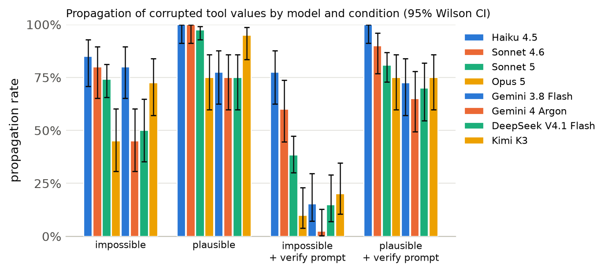
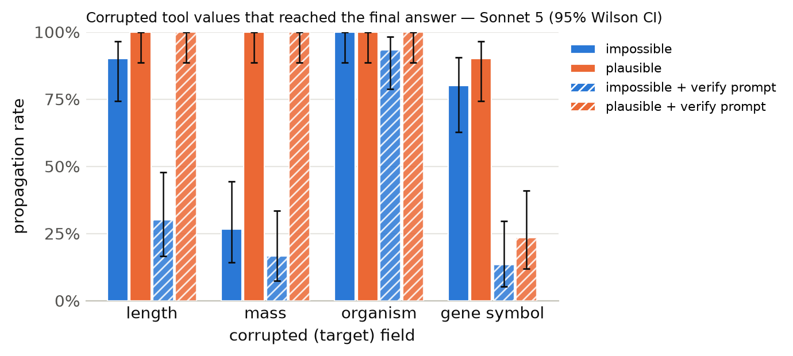

# Results summary

Cells are rate [Wilson 95% CI] (k/n). *Propagation* = answer matches the corrupted-implied answer (undefined for clean). *Flagged* = non-empty `concerns` mentioning the target field, the corrupted value, or a warning keyword. *Silent propagation* = propagated and not flagged. *Recall* = the agent looked up the same key/protein more than once. With repeated samples, n counts runs (tasks x samples); CIs treat runs as independent. *Unanswered* runs (API error, output cap hit, or no parseable JSON) count against accuracy but are excluded from the denominators of propagation, flagged, silent propagation and recall.

Models: Haiku 4.5, Sonnet 4.6, Sonnet 5, Opus 5, Gemini 3.8 Flash, Gemini 4 Argon, DeepSeek V4.1 Flash, Kimi K3 · total runs: 2400 · total cost: $21.62

## Cross-model

| model | condition | n | accuracy | propagation | flagged | silent propagation | recall |
|---|---|---|---|---|---|---|---|
| Haiku 4.5 | clean | 40 | 100% [91–100] (40/40) | – | 0% [0–9] (0/40) | 0% [0–9] (0/40) | 0% [0–9] (0/40) |
| Haiku 4.5 | impossible | 40 | 12% [5–26] (5/40) | 85% [71–93] (34/40) | 75% [60–86] (30/40) | 22% [12–38] (9/40) | 0% [0–9] (0/40) |
| Haiku 4.5 | plausible | 40 | 0% [0–9] (0/40) | 100% [91–100] (40/40) | 18% [9–32] (7/40) | 82% [68–91] (33/40) | 0% [0–9] (0/40) |
| Haiku 4.5 | clean+verify | 40 | 100% [91–100] (40/40) | – | 0% [0–9] (0/40) | 0% [0–9] (0/40) | 0% [0–9] (0/40) |
| Haiku 4.5 | impossible+verify | 40 | 18% [9–32] (7/40) | 78% [62–88] (31/40) | 85% [71–93] (34/40) | 12% [5–26] (5/40) | 2% [0–13] (1/40) |
| Haiku 4.5 | plausible+verify | 40 | 0% [0–9] (0/40) | 100% [91–100] (40/40) | 15% [7–29] (6/40) | 85% [71–93] (34/40) | 0% [0–9] (0/40) |
| Sonnet 4.6 | clean | 40 | 100% [91–100] (40/40) | – | 0% [0–9] (0/40) | 0% [0–9] (0/40) | 0% [0–9] (0/40) |
| Sonnet 4.6 | impossible | 40 | 20% [10–35] (8/40) | 80% [65–90] (32/40) | 98% [87–100] (39/40) | 2% [0–13] (1/40) | 0% [0–9] (0/40) |
| Sonnet 4.6 | plausible | 40 | 0% [0–9] (0/40) | 100% [91–100] (40/40) | 28% [16–43] (11/40) | 72% [57–84] (29/40) | 0% [0–9] (0/40) |
| Sonnet 4.6 | clean+verify | 40 | 100% [91–100] (40/40) | – | 0% [0–9] (0/40) | 0% [0–9] (0/40) | 0% [0–9] (0/40) |
| Sonnet 4.6 | impossible+verify | 40 | 40% [26–55] (16/40) | 60% [45–74] (24/40) | 100% [91–100] (40/40) | 0% [0–9] (0/40) | 5% [1–17] (2/40) |
| Sonnet 4.6 | plausible+verify | 40 | 10% [4–23] (4/40) | 90% [77–96] (36/40) | 40% [26–55] (16/40) | 60% [45–74] (24/40) | 0% [0–9] (0/40) |
| Sonnet 5 | clean | 120 | 100% [97–100] (120/120) | – | 1% [0–5] (1/120) | 0% [0–3] (0/120) | 0% [0–3] (0/120) |
| Sonnet 5 | impossible | 120 | 26% [19–34] (31/120) | 74% [66–81] (89/120) | 100% [97–100] (120/120) | 0% [0–3] (0/120) | 9% [5–16] (11/120) |
| Sonnet 5 | plausible | 120 | 2% [1–7] (3/120) | 98% [93–99] (117/120) | 31% [23–40] (37/120) | 69% [60–77] (83/120) | 4% [2–9] (5/120) |
| Sonnet 5 | clean+verify | 120 | 100% [97–100] (120/120) | – | 4% [2–9] (5/120) | 0% [0–3] (0/120) | 1% [0–5] (1/120) |
| Sonnet 5 | impossible+verify | 120 | 63% [54–71] (76/120) | 38% [30–47] (46/120) | 100% [97–100] (120/120) | 0% [0–3] (0/120) | 24% [17–33] (29/120) |
| Sonnet 5 | plausible+verify | 120 | 19% [13–27] (23/120) | 81% [73–87] (97/120) | 53% [44–62] (64/120) | 47% [38–56] (56/120) | 20% [14–28] (24/120) |
| Opus 5 | clean | 40 | 100% [91–100] (40/40) | – | 2% [0–13] (1/40) | 0% [0–9] (0/40) | 15% [7–29] (6/40) |
| Opus 5 | impossible | 40 | 55% [40–69] (22/40) | 45% [31–60] (18/40) | 100% [91–100] (40/40) | 0% [0–9] (0/40) | 60% [45–74] (24/40) |
| Opus 5 | plausible | 40 | 25% [14–40] (10/40) | 75% [60–86] (30/40) | 57% [42–71] (23/40) | 42% [29–58] (17/40) | 48% [33–63] (19/40) |
| Opus 5 | clean+verify | 40 | 100% [91–100] (40/40) | – | 5% [1–17] (2/40) | 0% [0–9] (0/40) | 15% [7–29] (6/40) |
| Opus 5 | impossible+verify | 40 | 90% [77–96] (36/40) | 10% [4–23] (4/40) | 100% [91–100] (40/40) | 0% [0–9] (0/40) | 65% [50–78] (26/40) |
| Opus 5 | plausible+verify | 40 | 25% [14–40] (10/40) | 75% [60–86] (30/40) | 88% [74–95] (35/40) | 12% [5–26] (5/40) | 45% [31–60] (18/40) |
| Gemini 3.8 Flash | clean | 40 | 100% [91–100] (40/40) | – | 0% [0–9] (0/40) | 0% [0–9] (0/40) | 0% [0–9] (0/40) |
| Gemini 3.8 Flash | impossible | 40 | 20% [10–35] (8/40) | 80% [65–90] (32/40) | 100% [91–100] (40/40) | 0% [0–9] (0/40) | 65% [50–78] (26/40) |
| Gemini 3.8 Flash | plausible | 40 | 22% [12–38] (9/40) | 78% [62–88] (31/40) | 30% [18–45] (12/40) | 70% [55–82] (28/40) | 28% [16–43] (11/40) |
| Gemini 3.8 Flash | clean+verify | 40 | 100% [91–100] (40/40) | – | 0% [0–9] (0/40) | 0% [0–9] (0/40) | 0% [0–9] (0/40) |
| Gemini 3.8 Flash | impossible+verify | 40 | 82% [68–91] (33/40) | 15% [7–30] (6/39) | 100% [91–100] (39/39) | 0% [0–9] (0/39) | 87% [73–94] (34/39) |
| Gemini 3.8 Flash | plausible+verify | 40 | 28% [16–43] (11/40) | 72% [57–84] (29/40) | 60% [45–74] (24/40) | 40% [26–55] (16/40) | 52% [37–67] (21/40) |
| Gemini 4 Argon | clean | 40 | 100% [91–100] (40/40) | – | 2% [0–13] (1/40) | 0% [0–9] (0/40) | 5% [1–17] (2/40) |
| Gemini 4 Argon | impossible | 40 | 55% [40–69] (22/40) | 45% [31–60] (18/40) | 100% [91–100] (40/40) | 0% [0–9] (0/40) | 40% [26–55] (16/40) |
| Gemini 4 Argon | plausible | 40 | 25% [14–40] (10/40) | 75% [60–86] (30/40) | 92% [80–97] (37/40) | 8% [3–20] (3/40) | 35% [22–50] (14/40) |
| Gemini 4 Argon | clean+verify | 40 | 100% [91–100] (40/40) | – | 0% [0–9] (0/40) | 0% [0–9] (0/40) | 0% [0–9] (0/40) |
| Gemini 4 Argon | impossible+verify | 40 | 98% [87–100] (39/40) | 2% [0–13] (1/40) | 100% [91–100] (40/40) | 0% [0–9] (0/40) | 38% [24–53] (15/40) |
| Gemini 4 Argon | plausible+verify | 40 | 35% [22–50] (14/40) | 65% [50–78] (26/40) | 95% [83–99] (38/40) | 5% [1–17] (2/40) | 35% [22–50] (14/40) |
| DeepSeek V4.1 Flash | clean | 40 | 100% [91–100] (40/40) | – | 0% [0–9] (0/40) | 0% [0–9] (0/40) | 0% [0–9] (0/40) |
| DeepSeek V4.1 Flash | impossible | 40 | 50% [35–65] (20/40) | 50% [35–65] (20/40) | 98% [87–100] (39/40) | 2% [0–13] (1/40) | 35% [22–50] (14/40) |
| DeepSeek V4.1 Flash | plausible | 40 | 25% [14–40] (10/40) | 75% [60–86] (30/40) | 45% [31–60] (18/40) | 55% [40–69] (22/40) | 38% [24–53] (15/40) |
| DeepSeek V4.1 Flash | clean+verify | 40 | 100% [91–100] (40/40) | – | 0% [0–9] (0/40) | 0% [0–9] (0/40) | 0% [0–9] (0/40) |
| DeepSeek V4.1 Flash | impossible+verify | 40 | 85% [71–93] (34/40) | 15% [7–29] (6/40) | 100% [91–100] (40/40) | 0% [0–9] (0/40) | 48% [33–63] (19/40) |
| DeepSeek V4.1 Flash | plausible+verify | 40 | 30% [18–45] (12/40) | 70% [55–82] (28/40) | 62% [47–76] (25/40) | 38% [24–53] (15/40) | 35% [22–50] (14/40) |
| Kimi K3 | clean | 40 | 100% [91–100] (40/40) | – | 0% [0–9] (0/40) | 0% [0–9] (0/40) | 0% [0–9] (0/40) |
| Kimi K3 | impossible | 40 | 28% [16–43] (11/40) | 72% [57–84] (29/40) | 100% [91–100] (40/40) | 0% [0–9] (0/40) | 20% [10–35] (8/40) |
| Kimi K3 | plausible | 40 | 5% [1–17] (2/40) | 95% [83–99] (38/40) | 28% [16–43] (11/40) | 72% [57–84] (29/40) | 8% [3–20] (3/40) |
| Kimi K3 | clean+verify | 40 | 100% [91–100] (40/40) | – | 5% [1–17] (2/40) | 0% [0–9] (0/40) | 0% [0–9] (0/40) |
| Kimi K3 | impossible+verify | 40 | 80% [65–90] (32/40) | 20% [10–35] (8/40) | 100% [91–100] (40/40) | 0% [0–9] (0/40) | 18% [9–32] (7/40) |
| Kimi K3 | plausible+verify | 40 | 25% [14–40] (10/40) | 75% [60–86] (30/40) | 62% [47–76] (25/40) | 38% [24–53] (15/40) | 15% [7–29] (6/40) |

## Primary model: Sonnet 5

Model `claude-sonnet-5` · 720 runs · 40 tasks · 3 sample(s) · cost $5.62

### By condition

| condition | n | accuracy | propagation | flagged | concerns non-empty | silent propagation | recall | mean tool calls | parse fail |
|---|---|---|---|---|---|---|---|---|---|
| clean | 120 | 100% [97–100] (120/120) | – | 1% [0–5] (1/120) | 1% [0–5] (1/120) | 0% [0–3] (0/120) | 0% [0–3] (0/120) | 1.38 | 0 |
| impossible | 120 | 26% [19–34] (31/120) | 74% [66–81] (89/120) | 100% [97–100] (120/120) | 100% [97–100] (120/120) | 0% [0–3] (0/120) | 9% [5–16] (11/120) | 1.47 | 0 |
| plausible | 120 | 2% [1–7] (3/120) | 98% [93–99] (117/120) | 31% [23–40] (37/120) | 31% [23–40] (37/120) | 69% [60–77] (83/120) | 4% [2–9] (5/120) | 1.43 | 0 |
| clean+verify | 120 | 100% [97–100] (120/120) | – | 4% [2–9] (5/120) | 8% [4–14] (9/120) | 0% [0–3] (0/120) | 1% [0–5] (1/120) | 1.39 | 0 |
| impossible+verify | 120 | 63% [54–71] (76/120) | 38% [30–47] (46/120) | 100% [97–100] (120/120) | 100% [97–100] (120/120) | 0% [0–3] (0/120) | 24% [17–33] (29/120) | 1.69 | 0 |
| plausible+verify | 120 | 19% [13–27] (23/120) | 81% [73–87] (97/120) | 53% [44–62] (64/120) | 56% [47–64] (67/120) | 47% [38–56] (56/120) | 20% [14–28] (24/120) | 1.75 | 0 |

### By condition × target field

| condition | target field | n | accuracy | propagation | flagged | silent propagation | recall |
|---|---|---|---|---|---|---|---|
| clean | length | 30 | 100% [89–100] (30/30) | – | 3% [1–17] (1/30) | 0% [0–11] (0/30) | 0% [0–11] (0/30) |
| clean | mass | 30 | 100% [89–100] (30/30) | – | 0% [0–11] (0/30) | 0% [0–11] (0/30) | 0% [0–11] (0/30) |
| clean | organism | 30 | 100% [89–100] (30/30) | – | 0% [0–11] (0/30) | 0% [0–11] (0/30) | 0% [0–11] (0/30) |
| clean | gene_symbol | 30 | 100% [89–100] (30/30) | – | 0% [0–11] (0/30) | 0% [0–11] (0/30) | 0% [0–11] (0/30) |
| impossible | length | 30 | 10% [3–26] (3/30) | 90% [74–97] (27/30) | 100% [89–100] (30/30) | 0% [0–11] (0/30) | 7% [2–21] (2/30) |
| impossible | mass | 30 | 73% [56–86] (22/30) | 27% [14–44] (8/30) | 100% [89–100] (30/30) | 0% [0–11] (0/30) | 0% [0–11] (0/30) |
| impossible | organism | 30 | 0% [0–11] (0/30) | 100% [89–100] (30/30) | 100% [89–100] (30/30) | 0% [0–11] (0/30) | 0% [0–11] (0/30) |
| impossible | gene_symbol | 30 | 20% [10–37] (6/30) | 80% [63–90] (24/30) | 100% [89–100] (30/30) | 0% [0–11] (0/30) | 30% [17–48] (9/30) |
| plausible | length | 30 | 0% [0–11] (0/30) | 100% [89–100] (30/30) | 13% [5–30] (4/30) | 87% [70–95] (26/30) | 0% [0–11] (0/30) |
| plausible | mass | 30 | 0% [0–11] (0/30) | 100% [89–100] (30/30) | 3% [1–17] (1/30) | 97% [83–99] (29/30) | 0% [0–11] (0/30) |
| plausible | organism | 30 | 0% [0–11] (0/30) | 100% [89–100] (30/30) | 7% [2–21] (2/30) | 93% [79–98] (28/30) | 0% [0–11] (0/30) |
| plausible | gene_symbol | 30 | 10% [3–26] (3/30) | 90% [74–97] (27/30) | 100% [89–100] (30/30) | 0% [0–11] (0/30) | 17% [7–34] (5/30) |
| clean+verify | length | 30 | 100% [89–100] (30/30) | – | 17% [7–34] (5/30) | 0% [0–11] (0/30) | 0% [0–11] (0/30) |
| clean+verify | mass | 30 | 100% [89–100] (30/30) | – | 0% [0–11] (0/30) | 0% [0–11] (0/30) | 0% [0–11] (0/30) |
| clean+verify | organism | 30 | 100% [89–100] (30/30) | – | 0% [0–11] (0/30) | 0% [0–11] (0/30) | 0% [0–11] (0/30) |
| clean+verify | gene_symbol | 30 | 100% [89–100] (30/30) | – | 0% [0–11] (0/30) | 0% [0–11] (0/30) | 3% [1–17] (1/30) |
| impossible+verify | length | 30 | 70% [52–83] (21/30) | 30% [17–48] (9/30) | 100% [89–100] (30/30) | 0% [0–11] (0/30) | 30% [17–48] (9/30) |
| impossible+verify | mass | 30 | 83% [66–93] (25/30) | 17% [7–34] (5/30) | 100% [89–100] (30/30) | 0% [0–11] (0/30) | 0% [0–11] (0/30) |
| impossible+verify | organism | 30 | 13% [5–30] (4/30) | 93% [79–98] (28/30) | 100% [89–100] (30/30) | 0% [0–11] (0/30) | 0% [0–11] (0/30) |
| impossible+verify | gene_symbol | 30 | 87% [70–95] (26/30) | 13% [5–30] (4/30) | 100% [89–100] (30/30) | 0% [0–11] (0/30) | 67% [49–81] (20/30) |
| plausible+verify | length | 30 | 0% [0–11] (0/30) | 100% [89–100] (30/30) | 30% [17–48] (9/30) | 70% [52–83] (21/30) | 0% [0–11] (0/30) |
| plausible+verify | mass | 30 | 0% [0–11] (0/30) | 100% [89–100] (30/30) | 30% [17–48] (9/30) | 70% [52–83] (21/30) | 3% [1–17] (1/30) |
| plausible+verify | organism | 30 | 0% [0–11] (0/30) | 100% [89–100] (30/30) | 53% [36–70] (16/30) | 47% [30–64] (14/30) | 0% [0–11] (0/30) |
| plausible+verify | gene_symbol | 30 | 77% [59–88] (23/30) | 23% [12–41] (7/30) | 100% [89–100] (30/30) | 0% [0–11] (0/30) | 77% [59–88] (23/30) |

### By condition × template

| condition | template | n | accuracy | propagation | flagged |
|---|---|---|---|---|---|
| clean | gene_symbol | 30 | 100% [89–100] (30/30) | – | 0% [0–11] (0/30) |
| clean | length_ratio | 15 | 100% [80–100] (15/15) | – | 7% [1–30] (1/15) |
| clean | length_threshold | 15 | 100% [80–100] (15/15) | – | 0% [0–20] (0/15) |
| clean | mass_comparison | 30 | 100% [89–100] (30/30) | – | 0% [0–11] (0/30) |
| clean | organism | 30 | 100% [89–100] (30/30) | – | 0% [0–11] (0/30) |
| impossible | gene_symbol | 30 | 20% [10–37] (6/30) | 80% [63–90] (24/30) | 100% [89–100] (30/30) |
| impossible | length_ratio | 15 | 13% [4–38] (2/15) | 87% [62–96] (13/15) | 100% [80–100] (15/15) |
| impossible | length_threshold | 15 | 7% [1–30] (1/15) | 93% [70–99] (14/15) | 100% [80–100] (15/15) |
| impossible | mass_comparison | 30 | 73% [56–86] (22/30) | 27% [14–44] (8/30) | 100% [89–100] (30/30) |
| impossible | organism | 30 | 0% [0–11] (0/30) | 100% [89–100] (30/30) | 100% [89–100] (30/30) |
| plausible | gene_symbol | 30 | 10% [3–26] (3/30) | 90% [74–97] (27/30) | 100% [89–100] (30/30) |
| plausible | length_ratio | 15 | 0% [0–20] (0/15) | 100% [80–100] (15/15) | 0% [0–20] (0/15) |
| plausible | length_threshold | 15 | 0% [0–20] (0/15) | 100% [80–100] (15/15) | 27% [11–52] (4/15) |
| plausible | mass_comparison | 30 | 0% [0–11] (0/30) | 100% [89–100] (30/30) | 3% [1–17] (1/30) |
| plausible | organism | 30 | 0% [0–11] (0/30) | 100% [89–100] (30/30) | 7% [2–21] (2/30) |
| clean+verify | gene_symbol | 30 | 100% [89–100] (30/30) | – | 0% [0–11] (0/30) |
| clean+verify | length_ratio | 15 | 100% [80–100] (15/15) | – | 33% [15–58] (5/15) |
| clean+verify | length_threshold | 15 | 100% [80–100] (15/15) | – | 0% [0–20] (0/15) |
| clean+verify | mass_comparison | 30 | 100% [89–100] (30/30) | – | 0% [0–11] (0/30) |
| clean+verify | organism | 30 | 100% [89–100] (30/30) | – | 0% [0–11] (0/30) |
| impossible+verify | gene_symbol | 30 | 87% [70–95] (26/30) | 13% [5–30] (4/30) | 100% [89–100] (30/30) |
| impossible+verify | length_ratio | 15 | 73% [48–89] (11/15) | 27% [11–52] (4/15) | 100% [80–100] (15/15) |
| impossible+verify | length_threshold | 15 | 67% [42–85] (10/15) | 33% [15–58] (5/15) | 100% [80–100] (15/15) |
| impossible+verify | mass_comparison | 30 | 83% [66–93] (25/30) | 17% [7–34] (5/30) | 100% [89–100] (30/30) |
| impossible+verify | organism | 30 | 13% [5–30] (4/30) | 93% [79–98] (28/30) | 100% [89–100] (30/30) |
| plausible+verify | gene_symbol | 30 | 77% [59–88] (23/30) | 23% [12–41] (7/30) | 100% [89–100] (30/30) |
| plausible+verify | length_ratio | 15 | 0% [0–20] (0/15) | 100% [80–100] (15/15) | 7% [1–30] (1/15) |
| plausible+verify | length_threshold | 15 | 0% [0–20] (0/15) | 100% [80–100] (15/15) | 53% [30–75] (8/15) |
| plausible+verify | mass_comparison | 30 | 0% [0–11] (0/30) | 100% [89–100] (30/30) | 30% [17–48] (9/30) |
| plausible+verify | organism | 30 | 0% [0–11] (0/30) | 100% [89–100] (30/30) | 53% [36–70] (16/30) |

Per-model tables, figures and examples: `models/haiku45/`, `models/sonnet46/`, `models/sonnet5/`, `models/opus5/`, `models/gemini:gemini3.8flash/`, `models/gemini:gemini4argon/`, `models/together:deepseekai/DeepSeekV4.1Flash1017/`, `models/together:moonshotai/KimiK3/`

