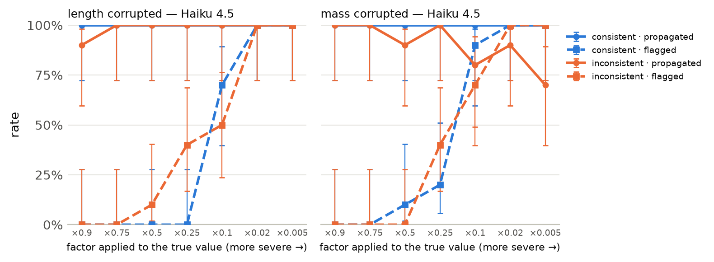
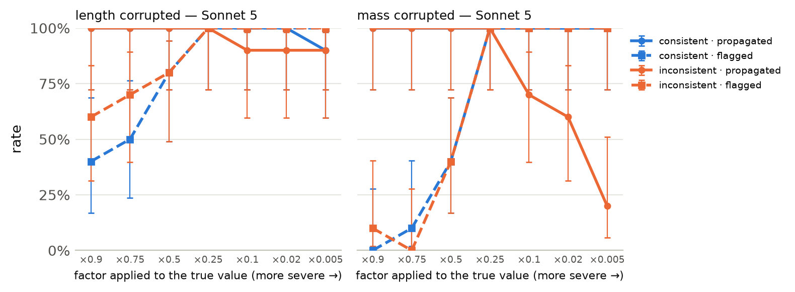

# Plausibility sweep

Single-call threshold tasks (10 length, 10 mass). The target field is scaled by `factor`; in the *consistent* arm the paired field (mass for length, length for mass) is scaled too, so the record stays internally consistent; in the *inconsistent* arm only the target field changes. Gold is always 'yes' and every corrupted record implies 'no'. Cells: rate [Wilson 95% CI] (k/n).

## Haiku 4.5

Clean accuracy on the sweep tasks: 100% [84–100] (20/20) · runs: 300 · cost $1.19

### Propagation

| factor | length · consistent | length · inconsistent | mass · consistent | mass · inconsistent | all · consistent | all · inconsistent |
|---|---|---|---|---|---|---|
| 0.9 | 100% [72–100] (10/10) | 90% [60–98] (9/10) | 100% [72–100] (10/10) | 100% [72–100] (10/10) | 100% [84–100] (20/20) | 95% [76–99] (19/20) |
| 0.75 | 100% [72–100] (10/10) | 100% [72–100] (10/10) | 100% [72–100] (10/10) | 100% [72–100] (10/10) | 100% [84–100] (20/20) | 100% [84–100] (20/20) |
| 0.5 | 100% [72–100] (10/10) | 100% [72–100] (10/10) | 100% [72–100] (10/10) | 90% [60–98] (9/10) | 100% [84–100] (20/20) | 95% [76–99] (19/20) |
| 0.25 | 100% [72–100] (10/10) | 100% [72–100] (10/10) | 100% [72–100] (10/10) | 100% [72–100] (10/10) | 100% [84–100] (20/20) | 100% [84–100] (20/20) |
| 0.1 | 100% [72–100] (10/10) | 100% [72–100] (10/10) | 100% [72–100] (10/10) | 80% [49–94] (8/10) | 100% [84–100] (20/20) | 90% [70–97] (18/20) |
| 0.02 | 100% [72–100] (10/10) | 100% [72–100] (10/10) | 100% [72–100] (10/10) | 90% [60–98] (9/10) | 100% [84–100] (20/20) | 95% [76–99] (19/20) |
| 0.005 | 100% [72–100] (10/10) | 100% [72–100] (10/10) | 100% [72–100] (10/10) | 70% [40–89] (7/10) | 100% [84–100] (20/20) | 85% [64–95] (17/20) |

### Flagged

| factor | length · consistent | length · inconsistent | mass · consistent | mass · inconsistent | all · consistent | all · inconsistent |
|---|---|---|---|---|---|---|
| 0.9 | 0% [0–28] (0/10) | 0% [0–28] (0/10) | 0% [0–28] (0/10) | 0% [0–28] (0/10) | 0% [0–16] (0/20) | 0% [0–16] (0/20) |
| 0.75 | 0% [0–28] (0/10) | 0% [0–28] (0/10) | 0% [0–28] (0/10) | 0% [0–28] (0/10) | 0% [0–16] (0/20) | 0% [0–16] (0/20) |
| 0.5 | 0% [0–28] (0/10) | 10% [2–40] (1/10) | 10% [2–40] (1/10) | 0% [0–28] (0/10) | 5% [1–24] (1/20) | 5% [1–24] (1/20) |
| 0.25 | 0% [0–28] (0/10) | 40% [17–69] (4/10) | 20% [6–51] (2/10) | 40% [17–69] (4/10) | 10% [3–30] (2/20) | 40% [22–61] (8/20) |
| 0.1 | 70% [40–89] (7/10) | 50% [24–76] (5/10) | 90% [60–98] (9/10) | 70% [40–89] (7/10) | 80% [58–92] (16/20) | 60% [39–78] (12/20) |
| 0.02 | 100% [72–100] (10/10) | 100% [72–100] (10/10) | 100% [72–100] (10/10) | 100% [72–100] (10/10) | 100% [84–100] (20/20) | 100% [84–100] (20/20) |
| 0.005 | 100% [72–100] (10/10) | 100% [72–100] (10/10) | 100% [72–100] (10/10) | 100% [72–100] (10/10) | 100% [84–100] (20/20) | 100% [84–100] (20/20) |

### Silent propagation

| factor | length · consistent | length · inconsistent | mass · consistent | mass · inconsistent | all · consistent | all · inconsistent |
|---|---|---|---|---|---|---|
| 0.9 | 100% [72–100] (10/10) | 90% [60–98] (9/10) | 100% [72–100] (10/10) | 100% [72–100] (10/10) | 100% [84–100] (20/20) | 95% [76–99] (19/20) |
| 0.75 | 100% [72–100] (10/10) | 100% [72–100] (10/10) | 100% [72–100] (10/10) | 100% [72–100] (10/10) | 100% [84–100] (20/20) | 100% [84–100] (20/20) |
| 0.5 | 100% [72–100] (10/10) | 90% [60–98] (9/10) | 90% [60–98] (9/10) | 90% [60–98] (9/10) | 95% [76–99] (19/20) | 90% [70–97] (18/20) |
| 0.25 | 100% [72–100] (10/10) | 60% [31–83] (6/10) | 80% [49–94] (8/10) | 60% [31–83] (6/10) | 90% [70–97] (18/20) | 60% [39–78] (12/20) |
| 0.1 | 30% [11–60] (3/10) | 50% [24–76] (5/10) | 10% [2–40] (1/10) | 10% [2–40] (1/10) | 20% [8–42] (4/20) | 30% [15–52] (6/20) |
| 0.02 | 0% [0–28] (0/10) | 0% [0–28] (0/10) | 0% [0–28] (0/10) | 0% [0–28] (0/10) | 0% [0–16] (0/20) | 0% [0–16] (0/20) |
| 0.005 | 0% [0–28] (0/10) | 0% [0–28] (0/10) | 0% [0–28] (0/10) | 0% [0–28] (0/10) | 0% [0–16] (0/20) | 0% [0–16] (0/20) |

## Sonnet 5

Clean accuracy on the sweep tasks: 100% [84–100] (20/20) · runs: 300 · cost $2.12

### Propagation

| factor | length · consistent | length · inconsistent | mass · consistent | mass · inconsistent | all · consistent | all · inconsistent |
|---|---|---|---|---|---|---|
| 0.9 | 100% [72–100] (10/10) | 100% [72–100] (10/10) | 100% [72–100] (10/10) | 100% [72–100] (10/10) | 100% [84–100] (20/20) | 100% [84–100] (20/20) |
| 0.75 | 100% [72–100] (10/10) | 100% [72–100] (10/10) | 100% [72–100] (10/10) | 100% [72–100] (10/10) | 100% [84–100] (20/20) | 100% [84–100] (20/20) |
| 0.5 | 100% [72–100] (10/10) | 100% [72–100] (10/10) | 100% [72–100] (10/10) | 100% [72–100] (10/10) | 100% [84–100] (20/20) | 100% [84–100] (20/20) |
| 0.25 | 100% [72–100] (10/10) | 100% [72–100] (10/10) | 100% [72–100] (10/10) | 100% [72–100] (10/10) | 100% [84–100] (20/20) | 100% [84–100] (20/20) |
| 0.1 | 100% [72–100] (10/10) | 90% [60–98] (9/10) | 100% [72–100] (10/10) | 70% [40–89] (7/10) | 100% [84–100] (20/20) | 80% [58–92] (16/20) |
| 0.02 | 100% [72–100] (10/10) | 90% [60–98] (9/10) | 100% [72–100] (10/10) | 60% [31–83] (6/10) | 100% [84–100] (20/20) | 75% [53–89] (15/20) |
| 0.005 | 90% [60–98] (9/10) | 90% [60–98] (9/10) | 100% [72–100] (10/10) | 20% [6–51] (2/10) | 95% [76–99] (19/20) | 55% [34–74] (11/20) |

### Flagged

| factor | length · consistent | length · inconsistent | mass · consistent | mass · inconsistent | all · consistent | all · inconsistent |
|---|---|---|---|---|---|---|
| 0.9 | 40% [17–69] (4/10) | 60% [31–83] (6/10) | 0% [0–28] (0/10) | 10% [2–40] (1/10) | 20% [8–42] (4/20) | 35% [18–57] (7/20) |
| 0.75 | 50% [24–76] (5/10) | 70% [40–89] (7/10) | 10% [2–40] (1/10) | 0% [0–28] (0/10) | 30% [15–52] (6/20) | 35% [18–57] (7/20) |
| 0.5 | 80% [49–94] (8/10) | 80% [49–94] (8/10) | 40% [17–69] (4/10) | 40% [17–69] (4/10) | 60% [39–78] (12/20) | 60% [39–78] (12/20) |
| 0.25 | 100% [72–100] (10/10) | 100% [72–100] (10/10) | 100% [72–100] (10/10) | 100% [72–100] (10/10) | 100% [84–100] (20/20) | 100% [84–100] (20/20) |
| 0.1 | 100% [72–100] (10/10) | 100% [72–100] (10/10) | 100% [72–100] (10/10) | 100% [72–100] (10/10) | 100% [84–100] (20/20) | 100% [84–100] (20/20) |
| 0.02 | 100% [72–100] (10/10) | 100% [72–100] (10/10) | 100% [72–100] (10/10) | 100% [72–100] (10/10) | 100% [84–100] (20/20) | 100% [84–100] (20/20) |
| 0.005 | 100% [72–100] (10/10) | 100% [72–100] (10/10) | 100% [72–100] (10/10) | 100% [72–100] (10/10) | 100% [84–100] (20/20) | 100% [84–100] (20/20) |

### Silent propagation

| factor | length · consistent | length · inconsistent | mass · consistent | mass · inconsistent | all · consistent | all · inconsistent |
|---|---|---|---|---|---|---|
| 0.9 | 60% [31–83] (6/10) | 40% [17–69] (4/10) | 100% [72–100] (10/10) | 90% [60–98] (9/10) | 80% [58–92] (16/20) | 65% [43–82] (13/20) |
| 0.75 | 50% [24–76] (5/10) | 30% [11–60] (3/10) | 90% [60–98] (9/10) | 100% [72–100] (10/10) | 70% [48–85] (14/20) | 65% [43–82] (13/20) |
| 0.5 | 20% [6–51] (2/10) | 20% [6–51] (2/10) | 60% [31–83] (6/10) | 60% [31–83] (6/10) | 40% [22–61] (8/20) | 40% [22–61] (8/20) |
| 0.25 | 0% [0–28] (0/10) | 0% [0–28] (0/10) | 0% [0–28] (0/10) | 0% [0–28] (0/10) | 0% [0–16] (0/20) | 0% [0–16] (0/20) |
| 0.1 | 0% [0–28] (0/10) | 0% [0–28] (0/10) | 0% [0–28] (0/10) | 0% [0–28] (0/10) | 0% [0–16] (0/20) | 0% [0–16] (0/20) |
| 0.02 | 0% [0–28] (0/10) | 0% [0–28] (0/10) | 0% [0–28] (0/10) | 0% [0–28] (0/10) | 0% [0–16] (0/20) | 0% [0–16] (0/20) |
| 0.005 | 0% [0–28] (0/10) | 0% [0–28] (0/10) | 0% [0–28] (0/10) | 0% [0–28] (0/10) | 0% [0–16] (0/20) | 0% [0–16] (0/20) |

## Opus 5

Clean accuracy on the sweep tasks: 100% [84–100] (20/20) · runs: 300 · cost $6.46

### Propagation

| factor | length · consistent | length · inconsistent | mass · consistent | mass · inconsistent | all · consistent | all · inconsistent |
|---|---|---|---|---|---|---|
| 0.9 | 100% [72–100] (10/10) | 100% [72–100] (10/10) | 100% [72–100] (10/10) | 100% [72–100] (10/10) | 100% [84–100] (20/20) | 100% [84–100] (20/20) |
| 0.75 | 100% [72–100] (10/10) | 100% [72–100] (10/10) | 100% [72–100] (10/10) | 100% [72–100] (10/10) | 100% [84–100] (20/20) | 100% [84–100] (20/20) |
| 0.5 | 100% [72–100] (10/10) | 100% [72–100] (10/10) | 100% [72–100] (10/10) | 100% [72–100] (10/10) | 100% [84–100] (20/20) | 100% [84–100] (20/20) |
| 0.25 | 100% [72–100] (10/10) | 100% [72–100] (10/10) | 100% [72–100] (10/10) | 100% [72–100] (10/10) | 100% [84–100] (20/20) | 100% [84–100] (20/20) |
| 0.1 | 100% [72–100] (10/10) | 100% [72–100] (10/10) | 100% [72–100] (10/10) | 30% [11–60] (3/10) | 100% [84–100] (20/20) | 65% [43–82] (13/20) |
| 0.02 | 100% [72–100] (10/10) | 90% [60–98] (9/10) | 100% [72–100] (10/10) | 100% [72–100] (10/10) | 100% [84–100] (20/20) | 95% [76–99] (19/20) |
| 0.005 | 100% [72–100] (10/10) | 40% [17–69] (4/10) | 100% [72–100] (10/10) | 70% [40–89] (7/10) | 100% [84–100] (20/20) | 55% [34–74] (11/20) |

### Flagged

| factor | length · consistent | length · inconsistent | mass · consistent | mass · inconsistent | all · consistent | all · inconsistent |
|---|---|---|---|---|---|---|
| 0.9 | 0% [0–28] (0/10) | 20% [6–51] (2/10) | 40% [17–69] (4/10) | 40% [17–69] (4/10) | 20% [8–42] (4/20) | 30% [15–52] (6/20) |
| 0.75 | 30% [11–60] (3/10) | 40% [17–69] (4/10) | 80% [49–94] (8/10) | 90% [60–98] (9/10) | 55% [34–74] (11/20) | 65% [43–82] (13/20) |
| 0.5 | 100% [72–100] (10/10) | 100% [72–100] (10/10) | 100% [72–100] (10/10) | 100% [72–100] (10/10) | 100% [84–100] (20/20) | 100% [84–100] (20/20) |
| 0.25 | 100% [72–100] (10/10) | 100% [72–100] (10/10) | 100% [72–100] (10/10) | 100% [72–100] (10/10) | 100% [84–100] (20/20) | 100% [84–100] (20/20) |
| 0.1 | 100% [72–100] (10/10) | 100% [72–100] (10/10) | 100% [72–100] (10/10) | 100% [72–100] (10/10) | 100% [84–100] (20/20) | 100% [84–100] (20/20) |
| 0.02 | 100% [72–100] (10/10) | 100% [72–100] (10/10) | 100% [72–100] (10/10) | 100% [72–100] (10/10) | 100% [84–100] (20/20) | 100% [84–100] (20/20) |
| 0.005 | 100% [72–100] (10/10) | 100% [72–100] (10/10) | 100% [72–100] (10/10) | 100% [72–100] (10/10) | 100% [84–100] (20/20) | 100% [84–100] (20/20) |

### Silent propagation

| factor | length · consistent | length · inconsistent | mass · consistent | mass · inconsistent | all · consistent | all · inconsistent |
|---|---|---|---|---|---|---|
| 0.9 | 100% [72–100] (10/10) | 80% [49–94] (8/10) | 60% [31–83] (6/10) | 60% [31–83] (6/10) | 80% [58–92] (16/20) | 70% [48–85] (14/20) |
| 0.75 | 70% [40–89] (7/10) | 60% [31–83] (6/10) | 20% [6–51] (2/10) | 10% [2–40] (1/10) | 45% [26–66] (9/20) | 35% [18–57] (7/20) |
| 0.5 | 0% [0–28] (0/10) | 0% [0–28] (0/10) | 0% [0–28] (0/10) | 0% [0–28] (0/10) | 0% [0–16] (0/20) | 0% [0–16] (0/20) |
| 0.25 | 0% [0–28] (0/10) | 0% [0–28] (0/10) | 0% [0–28] (0/10) | 0% [0–28] (0/10) | 0% [0–16] (0/20) | 0% [0–16] (0/20) |
| 0.1 | 0% [0–28] (0/10) | 0% [0–28] (0/10) | 0% [0–28] (0/10) | 0% [0–28] (0/10) | 0% [0–16] (0/20) | 0% [0–16] (0/20) |
| 0.02 | 0% [0–28] (0/10) | 0% [0–28] (0/10) | 0% [0–28] (0/10) | 0% [0–28] (0/10) | 0% [0–16] (0/20) | 0% [0–16] (0/20) |
| 0.005 | 0% [0–28] (0/10) | 0% [0–28] (0/10) | 0% [0–28] (0/10) | 0% [0–28] (0/10) | 0% [0–16] (0/20) | 0% [0–16] (0/20) |

