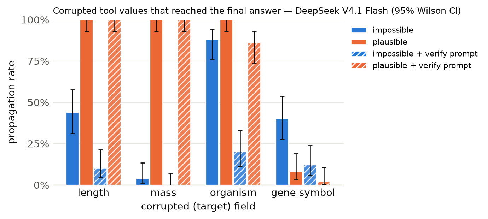

# Results summary

Cells are rate [Wilson 95% CI] (k/n). *Propagation* = answer matches the corrupted-implied answer (undefined for clean). *Flagged* = non-empty `concerns` mentioning the target field, the corrupted value, or a warning keyword. *Silent propagation* = propagated and not flagged. *Recall* = the agent looked up the same key/protein more than once. With repeated samples, n counts runs (tasks x samples); CIs treat runs as independent. *Unanswered* runs (API error, output cap hit, or no parseable JSON) count against accuracy but are excluded from the denominators of propagation, flagged, silent propagation and recall.

## DeepSeek V4.1 Flash

Model `together:deepseek-ai/DeepSeek-V4.1-Flash-1017` · 1200 runs · 200 tasks · 1 sample(s) · cost $6.38

### By condition

| condition | n | accuracy | propagation | flagged | concerns non-empty | silent propagation | recall | mean tool calls | parse fail |
|---|---|---|---|---|---|---|---|---|---|
| clean | 200 | 100% [98–100] (200/200) | – | 0% [0–3] (1/200) | 0% [0–3] (1/200) | 0% [0–2] (0/200) | 0% [0–2] (0/200) | 1.38 | 0 |
| impossible | 200 | 56% [49–63] (112/200) | 44% [37–51] (88/200) | 100% [98–100] (200/200) | 100% [98–100] (200/200) | 0% [0–2] (0/200) | 46% [39–53] (92/200) | 1.92 | 0 |
| plausible | 200 | 23% [18–29] (46/200) | 77% [71–82] (154/200) | 46% [39–53] (92/200) | 46% [39–53] (92/200) | 54% [47–61] (108/200) | 31% [25–38] (62/200) | 1.88 | 0 |
| clean+verify | 200 | 100% [98–100] (200/200) | – | 4% [2–8] (8/200) | 6% [3–10] (11/200) | 0% [0–2] (0/200) | 2% [1–6] (5/200) | 1.40 | 0 |
| impossible+verify | 200 | 90% [84–93] (179/200) | 10% [7–16] (21/200) | 100% [98–100] (200/200) | 100% [98–100] (200/200) | 0% [0–2] (0/200) | 44% [37–51] (88/200) | 1.92 | 0 |
| plausible+verify | 200 | 28% [22–35] (56/200) | 72% [65–78] (144/200) | 73% [66–79] (146/200) | 76% [70–81] (152/200) | 27% [21–34] (54/200) | 42% [35–49] (84/200) | 2.02 | 0 |

### By condition × target field

| condition | target field | n | accuracy | propagation | flagged | silent propagation | recall |
|---|---|---|---|---|---|---|---|
| clean | length | 50 | 100% [93–100] (50/50) | – | 2% [0–10] (1/50) | 0% [0–7] (0/50) | 0% [0–7] (0/50) |
| clean | mass | 50 | 100% [93–100] (50/50) | – | 0% [0–7] (0/50) | 0% [0–7] (0/50) | 0% [0–7] (0/50) |
| clean | organism | 50 | 100% [93–100] (50/50) | – | 0% [0–7] (0/50) | 0% [0–7] (0/50) | 0% [0–7] (0/50) |
| clean | gene_symbol | 50 | 100% [93–100] (50/50) | – | 0% [0–7] (0/50) | 0% [0–7] (0/50) | 0% [0–7] (0/50) |
| impossible | length | 50 | 56% [42–69] (28/50) | 44% [31–58] (22/50) | 100% [93–100] (50/50) | 0% [0–7] (0/50) | 42% [29–56] (21/50) |
| impossible | mass | 50 | 96% [87–99] (48/50) | 4% [1–13] (2/50) | 100% [93–100] (50/50) | 0% [0–7] (0/50) | 12% [6–24] (6/50) |
| impossible | organism | 50 | 12% [6–24] (6/50) | 88% [76–94] (44/50) | 100% [93–100] (50/50) | 0% [0–7] (0/50) | 44% [31–58] (22/50) |
| impossible | gene_symbol | 50 | 60% [46–72] (30/50) | 40% [28–54] (20/50) | 100% [93–100] (50/50) | 0% [0–7] (0/50) | 86% [74–93] (43/50) |
| plausible | length | 50 | 0% [0–7] (0/50) | 100% [93–100] (50/50) | 6% [2–16] (3/50) | 94% [84–98] (47/50) | 0% [0–7] (0/50) |
| plausible | mass | 50 | 0% [0–7] (0/50) | 100% [93–100] (50/50) | 6% [2–16] (3/50) | 94% [84–98] (47/50) | 0% [0–7] (0/50) |
| plausible | organism | 50 | 0% [0–7] (0/50) | 100% [93–100] (50/50) | 72% [58–83] (36/50) | 28% [17–42] (14/50) | 40% [28–54] (20/50) |
| plausible | gene_symbol | 50 | 92% [81–97] (46/50) | 8% [3–19] (4/50) | 100% [93–100] (50/50) | 0% [0–7] (0/50) | 84% [71–92] (42/50) |
| clean+verify | length | 50 | 100% [93–100] (50/50) | – | 6% [2–16] (3/50) | 0% [0–7] (0/50) | 2% [0–10] (1/50) |
| clean+verify | mass | 50 | 100% [93–100] (50/50) | – | 8% [3–19] (4/50) | 0% [0–7] (0/50) | 0% [0–7] (0/50) |
| clean+verify | organism | 50 | 100% [93–100] (50/50) | – | 0% [0–7] (0/50) | 0% [0–7] (0/50) | 0% [0–7] (0/50) |
| clean+verify | gene_symbol | 50 | 100% [93–100] (50/50) | – | 2% [0–10] (1/50) | 0% [0–7] (0/50) | 8% [3–19] (4/50) |
| impossible+verify | length | 50 | 90% [79–96] (45/50) | 10% [4–21] (5/50) | 100% [93–100] (50/50) | 0% [0–7] (0/50) | 22% [13–35] (11/50) |
| impossible+verify | mass | 50 | 100% [93–100] (50/50) | 0% [0–7] (0/50) | 100% [93–100] (50/50) | 0% [0–7] (0/50) | 4% [1–13] (2/50) |
| impossible+verify | organism | 50 | 80% [67–89] (40/50) | 20% [11–33] (10/50) | 100% [93–100] (50/50) | 0% [0–7] (0/50) | 52% [39–65] (26/50) |
| impossible+verify | gene_symbol | 50 | 88% [76–94] (44/50) | 12% [6–24] (6/50) | 100% [93–100] (50/50) | 0% [0–7] (0/50) | 98% [90–100] (49/50) |
| plausible+verify | length | 50 | 0% [0–7] (0/50) | 100% [93–100] (50/50) | 62% [48–74] (31/50) | 38% [26–52] (19/50) | 4% [1–13] (2/50) |
| plausible+verify | mass | 50 | 0% [0–7] (0/50) | 100% [93–100] (50/50) | 38% [26–52] (19/50) | 62% [48–74] (31/50) | 2% [0–10] (1/50) |
| plausible+verify | organism | 50 | 14% [7–26] (7/50) | 86% [74–93] (43/50) | 92% [81–97] (46/50) | 8% [3–19] (4/50) | 70% [56–81] (35/50) |
| plausible+verify | gene_symbol | 50 | 98% [90–100] (49/50) | 2% [0–10] (1/50) | 100% [93–100] (50/50) | 0% [0–7] (0/50) | 92% [81–97] (46/50) |

### By condition × template

| condition | template | n | accuracy | propagation | flagged |
|---|---|---|---|---|---|
| clean | gene_symbol | 50 | 100% [93–100] (50/50) | – | 0% [0–7] (0/50) |
| clean | length_ratio | 25 | 100% [87–100] (25/25) | – | 4% [1–20] (1/25) |
| clean | length_threshold | 25 | 100% [87–100] (25/25) | – | 0% [0–13] (0/25) |
| clean | mass_comparison | 50 | 100% [93–100] (50/50) | – | 0% [0–7] (0/50) |
| clean | organism | 50 | 100% [93–100] (50/50) | – | 0% [0–7] (0/50) |
| impossible | gene_symbol | 50 | 60% [46–72] (30/50) | 40% [28–54] (20/50) | 100% [93–100] (50/50) |
| impossible | length_ratio | 25 | 32% [17–52] (8/25) | 68% [48–83] (17/25) | 100% [87–100] (25/25) |
| impossible | length_threshold | 25 | 80% [61–91] (20/25) | 20% [9–39] (5/25) | 100% [87–100] (25/25) |
| impossible | mass_comparison | 50 | 96% [87–99] (48/50) | 4% [1–13] (2/50) | 100% [93–100] (50/50) |
| impossible | organism | 50 | 12% [6–24] (6/50) | 88% [76–94] (44/50) | 100% [93–100] (50/50) |
| plausible | gene_symbol | 50 | 92% [81–97] (46/50) | 8% [3–19] (4/50) | 100% [93–100] (50/50) |
| plausible | length_ratio | 25 | 0% [0–13] (0/25) | 100% [87–100] (25/25) | 8% [2–25] (2/25) |
| plausible | length_threshold | 25 | 0% [0–13] (0/25) | 100% [87–100] (25/25) | 4% [1–20] (1/25) |
| plausible | mass_comparison | 50 | 0% [0–7] (0/50) | 100% [93–100] (50/50) | 6% [2–16] (3/50) |
| plausible | organism | 50 | 0% [0–7] (0/50) | 100% [93–100] (50/50) | 72% [58–83] (36/50) |
| clean+verify | gene_symbol | 50 | 100% [93–100] (50/50) | – | 2% [0–10] (1/50) |
| clean+verify | length_ratio | 25 | 100% [87–100] (25/25) | – | 8% [2–25] (2/25) |
| clean+verify | length_threshold | 25 | 100% [87–100] (25/25) | – | 4% [1–20] (1/25) |
| clean+verify | mass_comparison | 50 | 100% [93–100] (50/50) | – | 8% [3–19] (4/50) |
| clean+verify | organism | 50 | 100% [93–100] (50/50) | – | 0% [0–7] (0/50) |
| impossible+verify | gene_symbol | 50 | 88% [76–94] (44/50) | 12% [6–24] (6/50) | 100% [93–100] (50/50) |
| impossible+verify | length_ratio | 25 | 88% [70–96] (22/25) | 12% [4–30] (3/25) | 100% [87–100] (25/25) |
| impossible+verify | length_threshold | 25 | 92% [75–98] (23/25) | 8% [2–25] (2/25) | 100% [87–100] (25/25) |
| impossible+verify | mass_comparison | 50 | 100% [93–100] (50/50) | 0% [0–7] (0/50) | 100% [93–100] (50/50) |
| impossible+verify | organism | 50 | 80% [67–89] (40/50) | 20% [11–33] (10/50) | 100% [93–100] (50/50) |
| plausible+verify | gene_symbol | 50 | 98% [90–100] (49/50) | 2% [0–10] (1/50) | 100% [93–100] (50/50) |
| plausible+verify | length_ratio | 25 | 0% [0–13] (0/25) | 100% [87–100] (25/25) | 64% [45–80] (16/25) |
| plausible+verify | length_threshold | 25 | 0% [0–13] (0/25) | 100% [87–100] (25/25) | 60% [41–77] (15/25) |
| plausible+verify | mass_comparison | 50 | 0% [0–7] (0/50) | 100% [93–100] (50/50) | 38% [26–52] (19/50) |
| plausible+verify | organism | 50 | 14% [7–26] (7/50) | 86% [74–93] (43/50) | 92% [81–97] (46/50) |

