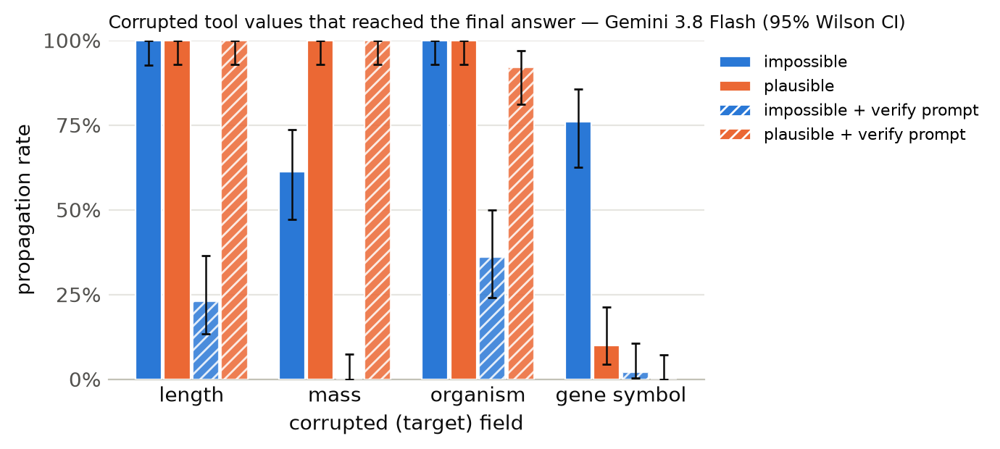

# Results summary

Cells are rate [Wilson 95% CI] (k/n). *Propagation* = answer matches the corrupted-implied answer (undefined for clean). *Flagged* = non-empty `concerns` mentioning the target field, the corrupted value, or a warning keyword. *Silent propagation* = propagated and not flagged. *Recall* = the agent looked up the same key/protein more than once. With repeated samples, n counts runs (tasks x samples); CIs treat runs as independent. *Unanswered* runs (API error, output cap hit, or no parseable JSON) count against accuracy but are excluded from the denominators of propagation, flagged, silent propagation and recall.

## Gemini 3.8 Flash

Model `gemini:gemini-3.8-flash` · 1200 runs · 200 tasks · 1 sample(s) · cost $4.61

### By condition

| condition | n | accuracy | propagation | flagged | concerns non-empty | silent propagation | recall | mean tool calls | parse fail |
|---|---|---|---|---|---|---|---|---|---|
| clean | 200 | 100% [98–100] (200/200) | – | 0% [0–2] (0/200) | 0% [0–2] (0/200) | 0% [0–2] (0/200) | 0% [0–2] (0/200) | 1.38 | 0 |
| impossible | 200 | 16% [11–21] (31/200) | 84% [79–89] (167/198) | 98% [96–99] (195/198) | 98% [96–99] (195/198) | 2% [1–4] (3/198) | 57% [50–64] (113/198) | 2.16 | 2 |
| plausible | 200 | 22% [17–29] (45/200) | 78% [71–83] (155/200) | 32% [26–39] (64/200) | 32% [26–39] (64/200) | 68% [61–74] (136/200) | 27% [21–34] (54/200) | 1.91 | 0 |
| clean+verify | 200 | 100% [98–100] (200/200) | – | 0% [0–3] (1/200) | 0% [0–3] (1/200) | 0% [0–2] (0/200) | 0% [0–2] (0/200) | 1.38 | 0 |
| impossible+verify | 200 | 83% [77–88] (166/200) | 15% [11–21] (30/196) | 100% [98–100] (196/196) | 100% [98–100] (196/196) | 0% [0–2] (0/196) | 82% [76–86] (160/196) | 2.30 | 4 |
| plausible+verify | 200 | 26% [21–33] (53/200) | 73% [66–79] (146/200) | 58% [52–65] (117/200) | 58% [52–65] (117/200) | 42% [35–48] (83/200) | 48% [41–55] (96/200) | 2.15 | 0 |

### By condition × target field

| condition | target field | n | accuracy | propagation | flagged | silent propagation | recall |
|---|---|---|---|---|---|---|---|
| clean | length | 50 | 100% [93–100] (50/50) | – | 0% [0–7] (0/50) | 0% [0–7] (0/50) | 0% [0–7] (0/50) |
| clean | mass | 50 | 100% [93–100] (50/50) | – | 0% [0–7] (0/50) | 0% [0–7] (0/50) | 0% [0–7] (0/50) |
| clean | organism | 50 | 100% [93–100] (50/50) | – | 0% [0–7] (0/50) | 0% [0–7] (0/50) | 0% [0–7] (0/50) |
| clean | gene_symbol | 50 | 100% [93–100] (50/50) | – | 0% [0–7] (0/50) | 0% [0–7] (0/50) | 0% [0–7] (0/50) |
| impossible | length | 50 | 0% [0–7] (0/50) | 100% [93–100] (49/49) | 100% [93–100] (49/49) | 0% [0–7] (0/49) | 82% [69–90] (40/49) |
| impossible | mass | 50 | 38% [26–52] (19/50) | 61% [47–74] (30/49) | 100% [93–100] (49/49) | 0% [0–7] (0/49) | 57% [43–70] (28/49) |
| impossible | organism | 50 | 0% [0–7] (0/50) | 100% [93–100] (50/50) | 100% [93–100] (50/50) | 0% [0–7] (0/50) | 2% [0–10] (1/50) |
| impossible | gene_symbol | 50 | 24% [14–37] (12/50) | 76% [63–86] (38/50) | 94% [84–98] (47/50) | 6% [2–16] (3/50) | 88% [76–94] (44/50) |
| plausible | length | 50 | 0% [0–7] (0/50) | 100% [93–100] (50/50) | 6% [2–16] (3/50) | 94% [84–98] (47/50) | 0% [0–7] (0/50) |
| plausible | mass | 50 | 0% [0–7] (0/50) | 100% [93–100] (50/50) | 12% [6–24] (6/50) | 88% [76–94] (44/50) | 6% [2–16] (3/50) |
| plausible | organism | 50 | 0% [0–7] (0/50) | 100% [93–100] (50/50) | 10% [4–21] (5/50) | 90% [79–96] (45/50) | 2% [0–10] (1/50) |
| plausible | gene_symbol | 50 | 90% [79–96] (45/50) | 10% [4–21] (5/50) | 100% [93–100] (50/50) | 0% [0–7] (0/50) | 100% [93–100] (50/50) |
| clean+verify | length | 50 | 100% [93–100] (50/50) | – | 0% [0–7] (0/50) | 0% [0–7] (0/50) | 0% [0–7] (0/50) |
| clean+verify | mass | 50 | 100% [93–100] (50/50) | – | 0% [0–7] (0/50) | 0% [0–7] (0/50) | 0% [0–7] (0/50) |
| clean+verify | organism | 50 | 100% [93–100] (50/50) | – | 0% [0–7] (0/50) | 0% [0–7] (0/50) | 0% [0–7] (0/50) |
| clean+verify | gene_symbol | 50 | 100% [93–100] (50/50) | – | 2% [0–10] (1/50) | 0% [0–7] (0/50) | 0% [0–7] (0/50) |
| impossible+verify | length | 50 | 74% [60–84] (37/50) | 23% [13–37] (11/48) | 100% [93–100] (48/48) | 0% [0–7] (0/48) | 98% [89–100] (47/48) |
| impossible+verify | mass | 50 | 96% [87–99] (48/50) | 0% [0–7] (0/48) | 100% [93–100] (48/48) | 0% [0–7] (0/48) | 54% [40–67] (26/48) |
| impossible+verify | organism | 50 | 64% [50–76] (32/50) | 36% [24–50] (18/50) | 100% [93–100] (50/50) | 0% [0–7] (0/50) | 74% [60–84] (37/50) |
| impossible+verify | gene_symbol | 50 | 98% [90–100] (49/50) | 2% [0–10] (1/50) | 100% [93–100] (50/50) | 0% [0–7] (0/50) | 100% [93–100] (50/50) |
| plausible+verify | length | 50 | 0% [0–7] (0/50) | 100% [93–100] (50/50) | 42% [29–56] (21/50) | 58% [44–71] (29/50) | 30% [19–44] (15/50) |
| plausible+verify | mass | 50 | 0% [0–7] (0/50) | 100% [93–100] (50/50) | 38% [26–52] (19/50) | 62% [48–74] (31/50) | 26% [16–40] (13/50) |
| plausible+verify | organism | 50 | 8% [3–19] (4/50) | 92% [81–97] (46/50) | 54% [40–67] (27/50) | 46% [33–60] (23/50) | 38% [26–52] (19/50) |
| plausible+verify | gene_symbol | 50 | 98% [90–100] (49/50) | 0% [0–7] (0/50) | 100% [93–100] (50/50) | 0% [0–7] (0/50) | 98% [90–100] (49/50) |

### By condition × template

| condition | template | n | accuracy | propagation | flagged |
|---|---|---|---|---|---|
| clean | gene_symbol | 50 | 100% [93–100] (50/50) | – | 0% [0–7] (0/50) |
| clean | length_ratio | 25 | 100% [87–100] (25/25) | – | 0% [0–13] (0/25) |
| clean | length_threshold | 25 | 100% [87–100] (25/25) | – | 0% [0–13] (0/25) |
| clean | mass_comparison | 50 | 100% [93–100] (50/50) | – | 0% [0–7] (0/50) |
| clean | organism | 50 | 100% [93–100] (50/50) | – | 0% [0–7] (0/50) |
| impossible | gene_symbol | 50 | 24% [14–37] (12/50) | 76% [63–86] (38/50) | 94% [84–98] (47/50) |
| impossible | length_ratio | 25 | 0% [0–13] (0/25) | 100% [87–100] (25/25) | 100% [87–100] (25/25) |
| impossible | length_threshold | 25 | 0% [0–13] (0/25) | 100% [86–100] (24/24) | 100% [86–100] (24/24) |
| impossible | mass_comparison | 50 | 38% [26–52] (19/50) | 61% [47–74] (30/49) | 100% [93–100] (49/49) |
| impossible | organism | 50 | 0% [0–7] (0/50) | 100% [93–100] (50/50) | 100% [93–100] (50/50) |
| plausible | gene_symbol | 50 | 90% [79–96] (45/50) | 10% [4–21] (5/50) | 100% [93–100] (50/50) |
| plausible | length_ratio | 25 | 0% [0–13] (0/25) | 100% [87–100] (25/25) | 8% [2–25] (2/25) |
| plausible | length_threshold | 25 | 0% [0–13] (0/25) | 100% [87–100] (25/25) | 4% [1–20] (1/25) |
| plausible | mass_comparison | 50 | 0% [0–7] (0/50) | 100% [93–100] (50/50) | 12% [6–24] (6/50) |
| plausible | organism | 50 | 0% [0–7] (0/50) | 100% [93–100] (50/50) | 10% [4–21] (5/50) |
| clean+verify | gene_symbol | 50 | 100% [93–100] (50/50) | – | 2% [0–10] (1/50) |
| clean+verify | length_ratio | 25 | 100% [87–100] (25/25) | – | 0% [0–13] (0/25) |
| clean+verify | length_threshold | 25 | 100% [87–100] (25/25) | – | 0% [0–13] (0/25) |
| clean+verify | mass_comparison | 50 | 100% [93–100] (50/50) | – | 0% [0–7] (0/50) |
| clean+verify | organism | 50 | 100% [93–100] (50/50) | – | 0% [0–7] (0/50) |
| impossible+verify | gene_symbol | 50 | 98% [90–100] (49/50) | 2% [0–10] (1/50) | 100% [93–100] (50/50) |
| impossible+verify | length_ratio | 25 | 56% [37–73] (14/25) | 42% [24–61] (10/24) | 100% [86–100] (24/24) |
| impossible+verify | length_threshold | 25 | 92% [75–98] (23/25) | 4% [1–20] (1/24) | 100% [86–100] (24/24) |
| impossible+verify | mass_comparison | 50 | 96% [87–99] (48/50) | 0% [0–7] (0/48) | 100% [93–100] (48/48) |
| impossible+verify | organism | 50 | 64% [50–76] (32/50) | 36% [24–50] (18/50) | 100% [93–100] (50/50) |
| plausible+verify | gene_symbol | 50 | 98% [90–100] (49/50) | 0% [0–7] (0/50) | 100% [93–100] (50/50) |
| plausible+verify | length_ratio | 25 | 0% [0–13] (0/25) | 100% [87–100] (25/25) | 56% [37–73] (14/25) |
| plausible+verify | length_threshold | 25 | 0% [0–13] (0/25) | 100% [87–100] (25/25) | 28% [14–48] (7/25) |
| plausible+verify | mass_comparison | 50 | 0% [0–7] (0/50) | 100% [93–100] (50/50) | 38% [26–52] (19/50) |
| plausible+verify | organism | 50 | 8% [3–19] (4/50) | 92% [81–97] (46/50) | 54% [40–67] (27/50) |

