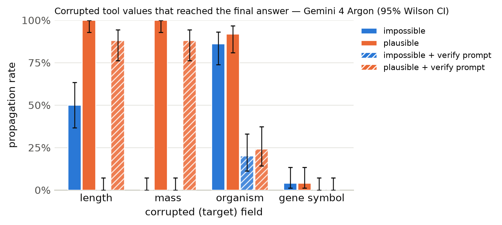

# Results summary

Cells are rate [Wilson 95% CI] (k/n). *Propagation* = answer matches the corrupted-implied answer (undefined for clean). *Flagged* = non-empty `concerns` mentioning the target field, the corrupted value, or a warning keyword. *Silent propagation* = propagated and not flagged. *Recall* = the agent looked up the same key/protein more than once. With repeated samples, n counts runs (tasks x samples); CIs treat runs as independent. *Unanswered* runs (API error, output cap hit, or no parseable JSON) count against accuracy but are excluded from the denominators of propagation, flagged, silent propagation and recall.

## Gemini 4 Argon

Model `gemini:gemini-4-argon` · 1200 runs · 200 tasks · 1 sample(s) · cost $4.98

### By condition

| condition | n | accuracy | propagation | flagged | concerns non-empty | silent propagation | recall | mean tool calls | parse fail |
|---|---|---|---|---|---|---|---|---|---|
| clean | 200 | 100% [98–100] (200/200) | – | 0% [0–3] (1/200) | 2% [1–5] (4/200) | 0% [0–2] (0/200) | 4% [2–8] (8/200) | 1.42 | 0 |
| impossible | 200 | 65% [58–71] (130/200) | 35% [29–42] (70/200) | 100% [98–100] (200/200) | 100% [98–100] (200/200) | 0% [0–2] (0/200) | 40% [33–46] (79/200) | 1.88 | 0 |
| plausible | 200 | 26% [20–32] (52/200) | 74% [67–79] (147/199) | 95% [91–97] (189/199) | 95% [91–97] (189/199) | 5% [3–9] (10/199) | 34% [28–41] (68/199) | 1.96 | 1 |
| clean+verify | 200 | 100% [98–100] (200/200) | – | 0% [0–2] (0/200) | 2% [1–4] (3/200) | 0% [0–2] (0/200) | 2% [1–5] (4/200) | 1.40 | 0 |
| impossible+verify | 200 | 95% [91–97] (190/200) | 5% [3–9] (10/200) | 100% [98–100] (200/200) | 100% [98–100] (200/200) | 0% [0–2] (0/200) | 41% [34–48] (82/200) | 1.82 | 0 |
| plausible+verify | 200 | 50% [43–57] (100/200) | 50% [43–57] (100/200) | 98% [96–99] (197/200) | 98% [96–99] (197/200) | 2% [1–4] (3/200) | 40% [33–46] (79/200) | 1.99 | 0 |

### By condition × target field

| condition | target field | n | accuracy | propagation | flagged | silent propagation | recall |
|---|---|---|---|---|---|---|---|
| clean | length | 50 | 100% [93–100] (50/50) | – | 0% [0–7] (0/50) | 0% [0–7] (0/50) | 2% [0–10] (1/50) |
| clean | mass | 50 | 100% [93–100] (50/50) | – | 0% [0–7] (0/50) | 0% [0–7] (0/50) | 0% [0–7] (0/50) |
| clean | organism | 50 | 100% [93–100] (50/50) | – | 2% [0–10] (1/50) | 0% [0–7] (0/50) | 0% [0–7] (0/50) |
| clean | gene_symbol | 50 | 100% [93–100] (50/50) | – | 0% [0–7] (0/50) | 0% [0–7] (0/50) | 14% [7–26] (7/50) |
| impossible | length | 50 | 50% [37–63] (25/50) | 50% [37–63] (25/50) | 100% [93–100] (50/50) | 0% [0–7] (0/50) | 6% [2–16] (3/50) |
| impossible | mass | 50 | 100% [93–100] (50/50) | 0% [0–7] (0/50) | 100% [93–100] (50/50) | 0% [0–7] (0/50) | 2% [0–10] (1/50) |
| impossible | organism | 50 | 14% [7–26] (7/50) | 86% [74–93] (43/50) | 100% [93–100] (50/50) | 0% [0–7] (0/50) | 58% [44–71] (29/50) |
| impossible | gene_symbol | 50 | 96% [87–99] (48/50) | 4% [1–13] (2/50) | 100% [93–100] (50/50) | 0% [0–7] (0/50) | 92% [81–97] (46/50) |
| plausible | length | 50 | 0% [0–7] (0/50) | 100% [93–100] (50/50) | 98% [90–100] (49/50) | 2% [0–10] (1/50) | 4% [1–13] (2/50) |
| plausible | mass | 50 | 0% [0–7] (0/50) | 100% [93–100] (50/50) | 84% [71–92] (42/50) | 16% [8–29] (8/50) | 0% [0–7] (0/50) |
| plausible | organism | 50 | 8% [3–19] (4/50) | 92% [81–97] (45/49) | 98% [89–100] (48/49) | 2% [0–11] (1/49) | 37% [25–51] (18/49) |
| plausible | gene_symbol | 50 | 96% [87–99] (48/50) | 4% [1–13] (2/50) | 100% [93–100] (50/50) | 0% [0–7] (0/50) | 96% [87–99] (48/50) |
| clean+verify | length | 50 | 100% [93–100] (50/50) | – | 0% [0–7] (0/50) | 0% [0–7] (0/50) | 0% [0–7] (0/50) |
| clean+verify | mass | 50 | 100% [93–100] (50/50) | – | 0% [0–7] (0/50) | 0% [0–7] (0/50) | 0% [0–7] (0/50) |
| clean+verify | organism | 50 | 100% [93–100] (50/50) | – | 0% [0–7] (0/50) | 0% [0–7] (0/50) | 0% [0–7] (0/50) |
| clean+verify | gene_symbol | 50 | 100% [93–100] (50/50) | – | 0% [0–7] (0/50) | 0% [0–7] (0/50) | 8% [3–19] (4/50) |
| impossible+verify | length | 50 | 100% [93–100] (50/50) | 0% [0–7] (0/50) | 100% [93–100] (50/50) | 0% [0–7] (0/50) | 2% [0–10] (1/50) |
| impossible+verify | mass | 50 | 100% [93–100] (50/50) | 0% [0–7] (0/50) | 100% [93–100] (50/50) | 0% [0–7] (0/50) | 0% [0–7] (0/50) |
| impossible+verify | organism | 50 | 80% [67–89] (40/50) | 20% [11–33] (10/50) | 100% [93–100] (50/50) | 0% [0–7] (0/50) | 64% [50–76] (32/50) |
| impossible+verify | gene_symbol | 50 | 100% [93–100] (50/50) | 0% [0–7] (0/50) | 100% [93–100] (50/50) | 0% [0–7] (0/50) | 98% [90–100] (49/50) |
| plausible+verify | length | 50 | 12% [6–24] (6/50) | 88% [76–94] (44/50) | 100% [93–100] (50/50) | 0% [0–7] (0/50) | 0% [0–7] (0/50) |
| plausible+verify | mass | 50 | 12% [6–24] (6/50) | 88% [76–94] (44/50) | 94% [84–98] (47/50) | 6% [2–16] (3/50) | 0% [0–7] (0/50) |
| plausible+verify | organism | 50 | 76% [63–86] (38/50) | 24% [14–37] (12/50) | 100% [93–100] (50/50) | 0% [0–7] (0/50) | 60% [46–72] (30/50) |
| plausible+verify | gene_symbol | 50 | 100% [93–100] (50/50) | 0% [0–7] (0/50) | 100% [93–100] (50/50) | 0% [0–7] (0/50) | 98% [90–100] (49/50) |

### By condition × template

| condition | template | n | accuracy | propagation | flagged |
|---|---|---|---|---|---|
| clean | gene_symbol | 50 | 100% [93–100] (50/50) | – | 0% [0–7] (0/50) |
| clean | length_ratio | 25 | 100% [87–100] (25/25) | – | 0% [0–13] (0/25) |
| clean | length_threshold | 25 | 100% [87–100] (25/25) | – | 0% [0–13] (0/25) |
| clean | mass_comparison | 50 | 100% [93–100] (50/50) | – | 0% [0–7] (0/50) |
| clean | organism | 50 | 100% [93–100] (50/50) | – | 2% [0–10] (1/50) |
| impossible | gene_symbol | 50 | 96% [87–99] (48/50) | 4% [1–13] (2/50) | 100% [93–100] (50/50) |
| impossible | length_ratio | 25 | 40% [23–59] (10/25) | 60% [41–77] (15/25) | 100% [87–100] (25/25) |
| impossible | length_threshold | 25 | 60% [41–77] (15/25) | 40% [23–59] (10/25) | 100% [87–100] (25/25) |
| impossible | mass_comparison | 50 | 100% [93–100] (50/50) | 0% [0–7] (0/50) | 100% [93–100] (50/50) |
| impossible | organism | 50 | 14% [7–26] (7/50) | 86% [74–93] (43/50) | 100% [93–100] (50/50) |
| plausible | gene_symbol | 50 | 96% [87–99] (48/50) | 4% [1–13] (2/50) | 100% [93–100] (50/50) |
| plausible | length_ratio | 25 | 0% [0–13] (0/25) | 100% [87–100] (25/25) | 96% [80–99] (24/25) |
| plausible | length_threshold | 25 | 0% [0–13] (0/25) | 100% [87–100] (25/25) | 100% [87–100] (25/25) |
| plausible | mass_comparison | 50 | 0% [0–7] (0/50) | 100% [93–100] (50/50) | 84% [71–92] (42/50) |
| plausible | organism | 50 | 8% [3–19] (4/50) | 92% [81–97] (45/49) | 98% [89–100] (48/49) |
| clean+verify | gene_symbol | 50 | 100% [93–100] (50/50) | – | 0% [0–7] (0/50) |
| clean+verify | length_ratio | 25 | 100% [87–100] (25/25) | – | 0% [0–13] (0/25) |
| clean+verify | length_threshold | 25 | 100% [87–100] (25/25) | – | 0% [0–13] (0/25) |
| clean+verify | mass_comparison | 50 | 100% [93–100] (50/50) | – | 0% [0–7] (0/50) |
| clean+verify | organism | 50 | 100% [93–100] (50/50) | – | 0% [0–7] (0/50) |
| impossible+verify | gene_symbol | 50 | 100% [93–100] (50/50) | 0% [0–7] (0/50) | 100% [93–100] (50/50) |
| impossible+verify | length_ratio | 25 | 100% [87–100] (25/25) | 0% [0–13] (0/25) | 100% [87–100] (25/25) |
| impossible+verify | length_threshold | 25 | 100% [87–100] (25/25) | 0% [0–13] (0/25) | 100% [87–100] (25/25) |
| impossible+verify | mass_comparison | 50 | 100% [93–100] (50/50) | 0% [0–7] (0/50) | 100% [93–100] (50/50) |
| impossible+verify | organism | 50 | 80% [67–89] (40/50) | 20% [11–33] (10/50) | 100% [93–100] (50/50) |
| plausible+verify | gene_symbol | 50 | 100% [93–100] (50/50) | 0% [0–7] (0/50) | 100% [93–100] (50/50) |
| plausible+verify | length_ratio | 25 | 12% [4–30] (3/25) | 88% [70–96] (22/25) | 100% [87–100] (25/25) |
| plausible+verify | length_threshold | 25 | 12% [4–30] (3/25) | 88% [70–96] (22/25) | 100% [87–100] (25/25) |
| plausible+verify | mass_comparison | 50 | 12% [6–24] (6/50) | 88% [76–94] (44/50) | 94% [84–98] (47/50) |
| plausible+verify | organism | 50 | 76% [63–86] (38/50) | 24% [14–37] (12/50) | 100% [93–100] (50/50) |

