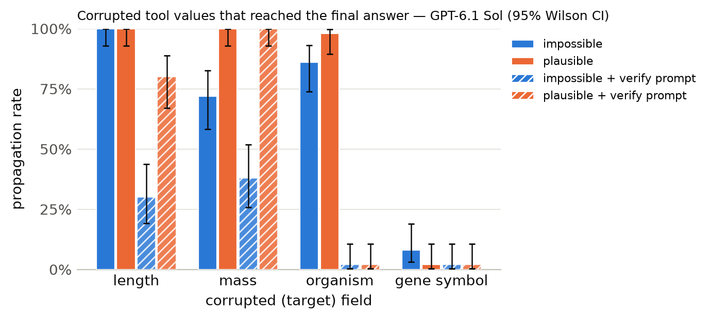

# Results summary

Cells are rate [Wilson 95% CI] (k/n). *Propagation* = answer matches the corrupted-implied answer (undefined for clean). *Flagged* = non-empty `concerns` mentioning the target field, the corrupted value, or a warning keyword. *Silent propagation* = propagated and not flagged. *Recall* = the agent looked up the same key/protein more than once. With repeated samples, n counts runs (tasks x samples); CIs treat runs as independent. *Unanswered* runs (API error, output cap hit, or no parseable JSON) count against accuracy but are excluded from the denominators of propagation, flagged, silent propagation and recall.

## GPT-6.1 Sol

Model `openai:gpt-6.1-sol` · 1200 runs · 200 tasks · 1 sample(s) · cost $4.35

### By condition

| condition | n | accuracy | propagation | flagged | concerns non-empty | silent propagation | recall | mean tool calls | parse fail |
|---|---|---|---|---|---|---|---|---|---|
| clean | 200 | 100% [98–100] (200/200) | – | 0% [0–3] (1/200) | 0% [0–3] (1/200) | 0% [0–2] (0/200) | 0% [0–2] (0/200) | 1.38 | 0 |
| impossible | 200 | 34% [27–40] (67/200) | 66% [60–73] (133/200) | 100% [98–100] (200/200) | 100% [98–100] (200/200) | 0% [0–2] (0/200) | 84% [79–89] (169/200) | 2.29 | 0 |
| plausible | 200 | 25% [20–31] (50/200) | 75% [69–80] (150/200) | 52% [45–59] (104/200) | 52% [46–59] (105/200) | 48% [41–55] (96/200) | 54% [47–61] (108/200) | 2.12 | 0 |
| clean+verify | 200 | 100% [98–100] (200/200) | – | 4% [2–8] (9/200) | 8% [5–12] (15/200) | 0% [0–2] (0/200) | 4% [2–8] (9/200) | 1.43 | 0 |
| impossible+verify | 200 | 82% [76–87] (164/200) | 18% [13–24] (36/200) | 100% [98–100] (200/200) | 100% [98–100] (200/200) | 0% [0–2] (0/200) | 98% [94–99] (195/200) | 2.37 | 0 |
| plausible+verify | 200 | 54% [47–61] (108/200) | 46% [39–53] (92/200) | 96% [93–98] (193/200) | 97% [94–99] (194/200) | 4% [2–7] (7/200) | 98% [94–99] (195/200) | 2.48 | 0 |

### By condition × target field

| condition | target field | n | accuracy | propagation | flagged | silent propagation | recall |
|---|---|---|---|---|---|---|---|
| clean | length | 50 | 100% [93–100] (50/50) | – | 0% [0–7] (0/50) | 0% [0–7] (0/50) | 0% [0–7] (0/50) |
| clean | mass | 50 | 100% [93–100] (50/50) | – | 2% [0–10] (1/50) | 0% [0–7] (0/50) | 0% [0–7] (0/50) |
| clean | organism | 50 | 100% [93–100] (50/50) | – | 0% [0–7] (0/50) | 0% [0–7] (0/50) | 0% [0–7] (0/50) |
| clean | gene_symbol | 50 | 100% [93–100] (50/50) | – | 0% [0–7] (0/50) | 0% [0–7] (0/50) | 0% [0–7] (0/50) |
| impossible | length | 50 | 0% [0–7] (0/50) | 100% [93–100] (50/50) | 100% [93–100] (50/50) | 0% [0–7] (0/50) | 74% [60–84] (37/50) |
| impossible | mass | 50 | 28% [17–42] (14/50) | 72% [58–83] (36/50) | 100% [93–100] (50/50) | 0% [0–7] (0/50) | 98% [90–100] (49/50) |
| impossible | organism | 50 | 14% [7–26] (7/50) | 86% [74–93] (43/50) | 100% [93–100] (50/50) | 0% [0–7] (0/50) | 70% [56–81] (35/50) |
| impossible | gene_symbol | 50 | 92% [81–97] (46/50) | 8% [3–19] (4/50) | 100% [93–100] (50/50) | 0% [0–7] (0/50) | 96% [87–99] (48/50) |
| plausible | length | 50 | 0% [0–7] (0/50) | 100% [93–100] (50/50) | 26% [16–40] (13/50) | 74% [60–84] (37/50) | 30% [19–44] (15/50) |
| plausible | mass | 50 | 0% [0–7] (0/50) | 100% [93–100] (50/50) | 46% [33–60] (23/50) | 54% [40–67] (27/50) | 56% [42–69] (28/50) |
| plausible | organism | 50 | 2% [0–10] (1/50) | 98% [90–100] (49/50) | 36% [24–50] (18/50) | 64% [50–76] (32/50) | 32% [21–46] (16/50) |
| plausible | gene_symbol | 50 | 98% [90–100] (49/50) | 2% [0–10] (1/50) | 100% [93–100] (50/50) | 0% [0–7] (0/50) | 98% [90–100] (49/50) |
| clean+verify | length | 50 | 100% [93–100] (50/50) | – | 2% [0–10] (1/50) | 0% [0–7] (0/50) | 4% [1–13] (2/50) |
| clean+verify | mass | 50 | 100% [93–100] (50/50) | – | 10% [4–21] (5/50) | 0% [0–7] (0/50) | 10% [4–21] (5/50) |
| clean+verify | organism | 50 | 100% [93–100] (50/50) | – | 0% [0–7] (0/50) | 0% [0–7] (0/50) | 0% [0–7] (0/50) |
| clean+verify | gene_symbol | 50 | 100% [93–100] (50/50) | – | 6% [2–16] (3/50) | 0% [0–7] (0/50) | 4% [1–13] (2/50) |
| impossible+verify | length | 50 | 70% [56–81] (35/50) | 30% [19–44] (15/50) | 100% [93–100] (50/50) | 0% [0–7] (0/50) | 96% [87–99] (48/50) |
| impossible+verify | mass | 50 | 62% [48–74] (31/50) | 38% [26–52] (19/50) | 100% [93–100] (50/50) | 0% [0–7] (0/50) | 100% [93–100] (50/50) |
| impossible+verify | organism | 50 | 98% [90–100] (49/50) | 2% [0–10] (1/50) | 100% [93–100] (50/50) | 0% [0–7] (0/50) | 96% [87–99] (48/50) |
| impossible+verify | gene_symbol | 50 | 98% [90–100] (49/50) | 2% [0–10] (1/50) | 100% [93–100] (50/50) | 0% [0–7] (0/50) | 98% [90–100] (49/50) |
| plausible+verify | length | 50 | 20% [11–33] (10/50) | 80% [67–89] (40/50) | 92% [81–97] (46/50) | 8% [3–19] (4/50) | 96% [87–99] (48/50) |
| plausible+verify | mass | 50 | 0% [0–7] (0/50) | 100% [93–100] (50/50) | 96% [87–99] (48/50) | 4% [1–13] (2/50) | 98% [90–100] (49/50) |
| plausible+verify | organism | 50 | 98% [90–100] (49/50) | 2% [0–10] (1/50) | 98% [90–100] (49/50) | 2% [0–10] (1/50) | 98% [90–100] (49/50) |
| plausible+verify | gene_symbol | 50 | 98% [90–100] (49/50) | 2% [0–10] (1/50) | 100% [93–100] (50/50) | 0% [0–7] (0/50) | 98% [90–100] (49/50) |

### By condition × template

| condition | template | n | accuracy | propagation | flagged |
|---|---|---|---|---|---|
| clean | gene_symbol | 50 | 100% [93–100] (50/50) | – | 0% [0–7] (0/50) |
| clean | length_ratio | 25 | 100% [87–100] (25/25) | – | 0% [0–13] (0/25) |
| clean | length_threshold | 25 | 100% [87–100] (25/25) | – | 0% [0–13] (0/25) |
| clean | mass_comparison | 50 | 100% [93–100] (50/50) | – | 2% [0–10] (1/50) |
| clean | organism | 50 | 100% [93–100] (50/50) | – | 0% [0–7] (0/50) |
| impossible | gene_symbol | 50 | 92% [81–97] (46/50) | 8% [3–19] (4/50) | 100% [93–100] (50/50) |
| impossible | length_ratio | 25 | 0% [0–13] (0/25) | 100% [87–100] (25/25) | 100% [87–100] (25/25) |
| impossible | length_threshold | 25 | 0% [0–13] (0/25) | 100% [87–100] (25/25) | 100% [87–100] (25/25) |
| impossible | mass_comparison | 50 | 28% [17–42] (14/50) | 72% [58–83] (36/50) | 100% [93–100] (50/50) |
| impossible | organism | 50 | 14% [7–26] (7/50) | 86% [74–93] (43/50) | 100% [93–100] (50/50) |
| plausible | gene_symbol | 50 | 98% [90–100] (49/50) | 2% [0–10] (1/50) | 100% [93–100] (50/50) |
| plausible | length_ratio | 25 | 0% [0–13] (0/25) | 100% [87–100] (25/25) | 48% [30–67] (12/25) |
| plausible | length_threshold | 25 | 0% [0–13] (0/25) | 100% [87–100] (25/25) | 4% [1–20] (1/25) |
| plausible | mass_comparison | 50 | 0% [0–7] (0/50) | 100% [93–100] (50/50) | 46% [33–60] (23/50) |
| plausible | organism | 50 | 2% [0–10] (1/50) | 98% [90–100] (49/50) | 36% [24–50] (18/50) |
| clean+verify | gene_symbol | 50 | 100% [93–100] (50/50) | – | 6% [2–16] (3/50) |
| clean+verify | length_ratio | 25 | 100% [87–100] (25/25) | – | 0% [0–13] (0/25) |
| clean+verify | length_threshold | 25 | 100% [87–100] (25/25) | – | 4% [1–20] (1/25) |
| clean+verify | mass_comparison | 50 | 100% [93–100] (50/50) | – | 10% [4–21] (5/50) |
| clean+verify | organism | 50 | 100% [93–100] (50/50) | – | 0% [0–7] (0/50) |
| impossible+verify | gene_symbol | 50 | 98% [90–100] (49/50) | 2% [0–10] (1/50) | 100% [93–100] (50/50) |
| impossible+verify | length_ratio | 25 | 92% [75–98] (23/25) | 8% [2–25] (2/25) | 100% [87–100] (25/25) |
| impossible+verify | length_threshold | 25 | 48% [30–67] (12/25) | 52% [33–70] (13/25) | 100% [87–100] (25/25) |
| impossible+verify | mass_comparison | 50 | 62% [48–74] (31/50) | 38% [26–52] (19/50) | 100% [93–100] (50/50) |
| impossible+verify | organism | 50 | 98% [90–100] (49/50) | 2% [0–10] (1/50) | 100% [93–100] (50/50) |
| plausible+verify | gene_symbol | 50 | 98% [90–100] (49/50) | 2% [0–10] (1/50) | 100% [93–100] (50/50) |
| plausible+verify | length_ratio | 25 | 40% [23–59] (10/25) | 60% [41–77] (15/25) | 100% [87–100] (25/25) |
| plausible+verify | length_threshold | 25 | 0% [0–13] (0/25) | 100% [87–100] (25/25) | 84% [65–94] (21/25) |
| plausible+verify | mass_comparison | 50 | 0% [0–7] (0/50) | 100% [93–100] (50/50) | 96% [87–99] (48/50) |
| plausible+verify | organism | 50 | 98% [90–100] (49/50) | 2% [0–10] (1/50) | 98% [90–100] (49/50) |

