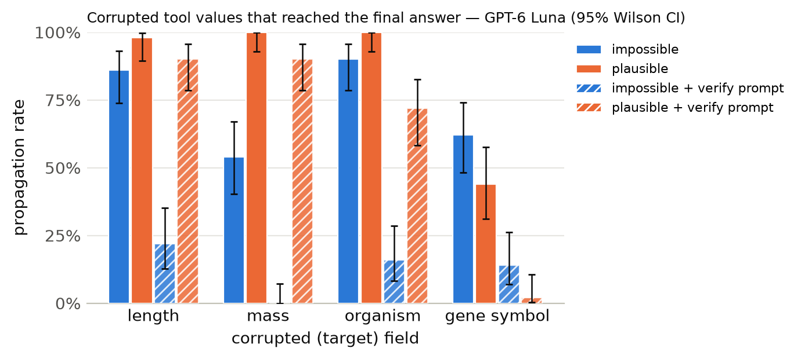

# Results summary

Cells are rate [Wilson 95% CI] (k/n). *Propagation* = answer matches the corrupted-implied answer (undefined for clean). *Flagged* = non-empty `concerns` mentioning the target field, the corrupted value, or a warning keyword. *Silent propagation* = propagated and not flagged. *Recall* = the agent looked up the same key/protein more than once. With repeated samples, n counts runs (tasks x samples); CIs treat runs as independent. *Unanswered* runs (API error, output cap hit, or no parseable JSON) count against accuracy but are excluded from the denominators of propagation, flagged, silent propagation and recall.

## GPT-6 Luna

Model `openai:gpt-6-luna` · 1200 runs · 200 tasks · 1 sample(s) · cost $4.89

### By condition

| condition | n | accuracy | propagation | flagged | concerns non-empty | silent propagation | recall | mean tool calls | parse fail |
|---|---|---|---|---|---|---|---|---|---|
| clean | 200 | 98% [95–99] (196/200) | – | 0% [0–2] (0/200) | 0% [0–2] (0/200) | 0% [0–2] (0/200) | 0% [0–2] (0/200) | 1.38 | 0 |
| impossible | 200 | 26% [21–33] (53/200) | 73% [66–79] (146/200) | 76% [70–82] (153/200) | 82% [76–86] (163/200) | 24% [18–30] (47/200) | 16% [12–22] (32/200) | 1.54 | 0 |
| plausible | 200 | 14% [10–20] (29/200) | 86% [80–90] (171/200) | 17% [12–23] (34/200) | 17% [12–23] (34/200) | 82% [77–87] (165/200) | 4% [2–8] (9/200) | 1.43 | 0 |
| clean+verify | 200 | 100% [98–100] (200/200) | – | 0% [0–3] (1/200) | 1% [0–4] (2/200) | 0% [0–2] (0/200) | 0% [0–2] (0/200) | 1.38 | 0 |
| impossible+verify | 200 | 86% [81–91] (173/200) | 13% [9–18] (26/200) | 99% [96–100] (198/200) | 99% [96–100] (198/200) | 1% [0–4] (2/200) | 18% [14–24] (37/200) | 1.60 | 0 |
| plausible+verify | 200 | 36% [30–43] (72/200) | 64% [57–70] (127/200) | 51% [44–58] (102/200) | 52% [45–58] (103/200) | 49% [42–56] (98/200) | 14% [9–19] (27/200) | 1.57 | 0 |

### By condition × target field

| condition | target field | n | accuracy | propagation | flagged | silent propagation | recall |
|---|---|---|---|---|---|---|---|
| clean | length | 50 | 92% [81–97] (46/50) | – | 0% [0–7] (0/50) | 0% [0–7] (0/50) | 0% [0–7] (0/50) |
| clean | mass | 50 | 100% [93–100] (50/50) | – | 0% [0–7] (0/50) | 0% [0–7] (0/50) | 0% [0–7] (0/50) |
| clean | organism | 50 | 100% [93–100] (50/50) | – | 0% [0–7] (0/50) | 0% [0–7] (0/50) | 0% [0–7] (0/50) |
| clean | gene_symbol | 50 | 100% [93–100] (50/50) | – | 0% [0–7] (0/50) | 0% [0–7] (0/50) | 0% [0–7] (0/50) |
| impossible | length | 50 | 14% [7–26] (7/50) | 86% [74–93] (43/50) | 100% [93–100] (50/50) | 0% [0–7] (0/50) | 30% [19–44] (15/50) |
| impossible | mass | 50 | 46% [33–60] (23/50) | 54% [40–67] (27/50) | 100% [93–100] (50/50) | 0% [0–7] (0/50) | 8% [3–19] (4/50) |
| impossible | organism | 50 | 10% [4–21] (5/50) | 90% [79–96] (45/50) | 64% [50–76] (32/50) | 36% [24–50] (18/50) | 6% [2–16] (3/50) |
| impossible | gene_symbol | 50 | 36% [24–50] (18/50) | 62% [48–74] (31/50) | 42% [29–56] (21/50) | 58% [44–71] (29/50) | 20% [11–33] (10/50) |
| plausible | length | 50 | 2% [0–10] (1/50) | 98% [90–100] (49/50) | 0% [0–7] (0/50) | 98% [90–100] (49/50) | 0% [0–7] (0/50) |
| plausible | mass | 50 | 0% [0–7] (0/50) | 100% [93–100] (50/50) | 0% [0–7] (0/50) | 100% [93–100] (50/50) | 0% [0–7] (0/50) |
| plausible | organism | 50 | 0% [0–7] (0/50) | 100% [93–100] (50/50) | 0% [0–7] (0/50) | 100% [93–100] (50/50) | 0% [0–7] (0/50) |
| plausible | gene_symbol | 50 | 56% [42–69] (28/50) | 44% [31–58] (22/50) | 68% [54–79] (34/50) | 32% [21–46] (16/50) | 18% [10–31] (9/50) |
| clean+verify | length | 50 | 100% [93–100] (50/50) | – | 2% [0–10] (1/50) | 0% [0–7] (0/50) | 0% [0–7] (0/50) |
| clean+verify | mass | 50 | 100% [93–100] (50/50) | – | 0% [0–7] (0/50) | 0% [0–7] (0/50) | 0% [0–7] (0/50) |
| clean+verify | organism | 50 | 100% [93–100] (50/50) | – | 0% [0–7] (0/50) | 0% [0–7] (0/50) | 0% [0–7] (0/50) |
| clean+verify | gene_symbol | 50 | 100% [93–100] (50/50) | – | 0% [0–7] (0/50) | 0% [0–7] (0/50) | 0% [0–7] (0/50) |
| impossible+verify | length | 50 | 78% [65–87] (39/50) | 22% [13–35] (11/50) | 100% [93–100] (50/50) | 0% [0–7] (0/50) | 20% [11–33] (10/50) |
| impossible+verify | mass | 50 | 100% [93–100] (50/50) | 0% [0–7] (0/50) | 100% [93–100] (50/50) | 0% [0–7] (0/50) | 0% [0–7] (0/50) |
| impossible+verify | organism | 50 | 84% [71–92] (42/50) | 16% [8–29] (8/50) | 100% [93–100] (50/50) | 0% [0–7] (0/50) | 14% [7–26] (7/50) |
| impossible+verify | gene_symbol | 50 | 84% [71–92] (42/50) | 14% [7–26] (7/50) | 96% [87–99] (48/50) | 4% [1–13] (2/50) | 40% [28–54] (20/50) |
| plausible+verify | length | 50 | 10% [4–21] (5/50) | 90% [79–96] (45/50) | 46% [33–60] (23/50) | 54% [40–67] (27/50) | 12% [6–24] (6/50) |
| plausible+verify | mass | 50 | 10% [4–21] (5/50) | 90% [79–96] (45/50) | 30% [19–44] (15/50) | 70% [56–81] (35/50) | 6% [2–16] (3/50) |
| plausible+verify | organism | 50 | 28% [17–42] (14/50) | 72% [58–83] (36/50) | 30% [19–44] (15/50) | 70% [56–81] (35/50) | 6% [2–16] (3/50) |
| plausible+verify | gene_symbol | 50 | 96% [87–99] (48/50) | 2% [0–10] (1/50) | 98% [90–100] (49/50) | 2% [0–10] (1/50) | 30% [19–44] (15/50) |

### By condition × template

| condition | template | n | accuracy | propagation | flagged |
|---|---|---|---|---|---|
| clean | gene_symbol | 50 | 100% [93–100] (50/50) | – | 0% [0–7] (0/50) |
| clean | length_ratio | 25 | 84% [65–94] (21/25) | – | 0% [0–13] (0/25) |
| clean | length_threshold | 25 | 100% [87–100] (25/25) | – | 0% [0–13] (0/25) |
| clean | mass_comparison | 50 | 100% [93–100] (50/50) | – | 0% [0–7] (0/50) |
| clean | organism | 50 | 100% [93–100] (50/50) | – | 0% [0–7] (0/50) |
| impossible | gene_symbol | 50 | 36% [24–50] (18/50) | 62% [48–74] (31/50) | 42% [29–56] (21/50) |
| impossible | length_ratio | 25 | 0% [0–13] (0/25) | 100% [87–100] (25/25) | 100% [87–100] (25/25) |
| impossible | length_threshold | 25 | 28% [14–48] (7/25) | 72% [52–86] (18/25) | 100% [87–100] (25/25) |
| impossible | mass_comparison | 50 | 46% [33–60] (23/50) | 54% [40–67] (27/50) | 100% [93–100] (50/50) |
| impossible | organism | 50 | 10% [4–21] (5/50) | 90% [79–96] (45/50) | 64% [50–76] (32/50) |
| plausible | gene_symbol | 50 | 56% [42–69] (28/50) | 44% [31–58] (22/50) | 68% [54–79] (34/50) |
| plausible | length_ratio | 25 | 4% [1–20] (1/25) | 96% [80–99] (24/25) | 0% [0–13] (0/25) |
| plausible | length_threshold | 25 | 0% [0–13] (0/25) | 100% [87–100] (25/25) | 0% [0–13] (0/25) |
| plausible | mass_comparison | 50 | 0% [0–7] (0/50) | 100% [93–100] (50/50) | 0% [0–7] (0/50) |
| plausible | organism | 50 | 0% [0–7] (0/50) | 100% [93–100] (50/50) | 0% [0–7] (0/50) |
| clean+verify | gene_symbol | 50 | 100% [93–100] (50/50) | – | 0% [0–7] (0/50) |
| clean+verify | length_ratio | 25 | 100% [87–100] (25/25) | – | 0% [0–13] (0/25) |
| clean+verify | length_threshold | 25 | 100% [87–100] (25/25) | – | 4% [1–20] (1/25) |
| clean+verify | mass_comparison | 50 | 100% [93–100] (50/50) | – | 0% [0–7] (0/50) |
| clean+verify | organism | 50 | 100% [93–100] (50/50) | – | 0% [0–7] (0/50) |
| impossible+verify | gene_symbol | 50 | 84% [71–92] (42/50) | 14% [7–26] (7/50) | 96% [87–99] (48/50) |
| impossible+verify | length_ratio | 25 | 88% [70–96] (22/25) | 12% [4–30] (3/25) | 100% [87–100] (25/25) |
| impossible+verify | length_threshold | 25 | 68% [48–83] (17/25) | 32% [17–52] (8/25) | 100% [87–100] (25/25) |
| impossible+verify | mass_comparison | 50 | 100% [93–100] (50/50) | 0% [0–7] (0/50) | 100% [93–100] (50/50) |
| impossible+verify | organism | 50 | 84% [71–92] (42/50) | 16% [8–29] (8/50) | 100% [93–100] (50/50) |
| plausible+verify | gene_symbol | 50 | 96% [87–99] (48/50) | 2% [0–10] (1/50) | 98% [90–100] (49/50) |
| plausible+verify | length_ratio | 25 | 4% [1–20] (1/25) | 96% [80–99] (24/25) | 52% [33–70] (13/25) |
| plausible+verify | length_threshold | 25 | 16% [6–35] (4/25) | 84% [65–94] (21/25) | 40% [23–59] (10/25) |
| plausible+verify | mass_comparison | 50 | 10% [4–21] (5/50) | 90% [79–96] (45/50) | 30% [19–44] (15/50) |
| plausible+verify | organism | 50 | 28% [17–42] (14/50) | 72% [58–83] (36/50) | 30% [19–44] (15/50) |

