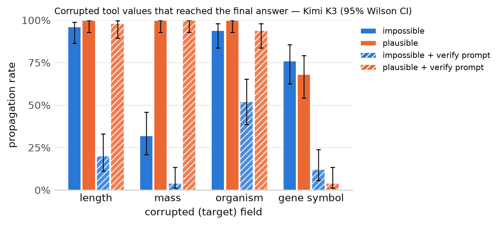

# Results summary

Cells are rate [Wilson 95% CI] (k/n). *Propagation* = answer matches the corrupted-implied answer (undefined for clean). *Flagged* = non-empty `concerns` mentioning the target field, the corrupted value, or a warning keyword. *Silent propagation* = propagated and not flagged. *Recall* = the agent looked up the same key/protein more than once. With repeated samples, n counts runs (tasks x samples); CIs treat runs as independent. *Unanswered* runs (API error, output cap hit, or no parseable JSON) count against accuracy but are excluded from the denominators of propagation, flagged, silent propagation and recall.

## Kimi K3

Model `together:moonshotai/Kimi-K3` · 1200 runs · 200 tasks · 1 sample(s) · cost $12.16

### By condition

| condition | n | accuracy | propagation | flagged | concerns non-empty | silent propagation | recall | mean tool calls | parse fail |
|---|---|---|---|---|---|---|---|---|---|
| clean | 200 | 100% [98–100] (200/200) | – | 1% [0–4] (2/200) | 1% [0–4] (2/200) | 0% [0–2] (0/200) | 0% [0–2] (0/200) | 1.38 | 0 |
| impossible | 200 | 26% [20–32] (51/200) | 74% [68–80] (149/200) | 100% [97–100] (199/200) | 100% [97–100] (199/200) | 0% [0–3] (1/200) | 14% [10–19] (28/200) | 1.58 | 0 |
| plausible | 200 | 8% [5–13] (16/200) | 92% [87–95] (184/200) | 29% [23–36] (58/200) | 29% [23–36] (58/200) | 71% [64–77] (142/200) | 9% [6–14] (18/200) | 1.53 | 0 |
| clean+verify | 200 | 100% [98–100] (200/200) | – | 3% [1–6] (6/200) | 4% [2–8] (9/200) | 0% [0–2] (0/200) | 0% [0–2] (0/200) | 1.38 | 0 |
| impossible+verify | 200 | 78% [71–83] (155/200) | 22% [17–28] (44/200) | 100% [98–100] (200/200) | 100% [98–100] (200/200) | 0% [0–2] (0/200) | 24% [19–30] (48/200) | 1.70 | 0 |
| plausible+verify | 200 | 26% [20–32] (52/200) | 74% [68–80] (148/200) | 66% [59–72] (131/200) | 66% [60–73] (133/200) | 34% [28–41] (69/200) | 14% [9–19] (27/200) | 1.60 | 0 |

### By condition × target field

| condition | target field | n | accuracy | propagation | flagged | silent propagation | recall |
|---|---|---|---|---|---|---|---|
| clean | length | 50 | 100% [93–100] (50/50) | – | 2% [0–10] (1/50) | 0% [0–7] (0/50) | 0% [0–7] (0/50) |
| clean | mass | 50 | 100% [93–100] (50/50) | – | 2% [0–10] (1/50) | 0% [0–7] (0/50) | 0% [0–7] (0/50) |
| clean | organism | 50 | 100% [93–100] (50/50) | – | 0% [0–7] (0/50) | 0% [0–7] (0/50) | 0% [0–7] (0/50) |
| clean | gene_symbol | 50 | 100% [93–100] (50/50) | – | 0% [0–7] (0/50) | 0% [0–7] (0/50) | 0% [0–7] (0/50) |
| impossible | length | 50 | 4% [1–13] (2/50) | 96% [87–99] (48/50) | 100% [93–100] (50/50) | 0% [0–7] (0/50) | 12% [6–24] (6/50) |
| impossible | mass | 50 | 68% [54–79] (34/50) | 32% [21–46] (16/50) | 100% [93–100] (50/50) | 0% [0–7] (0/50) | 6% [2–16] (3/50) |
| impossible | organism | 50 | 6% [2–16] (3/50) | 94% [84–98] (47/50) | 100% [93–100] (50/50) | 0% [0–7] (0/50) | 8% [3–19] (4/50) |
| impossible | gene_symbol | 50 | 24% [14–37] (12/50) | 76% [63–86] (38/50) | 98% [90–100] (49/50) | 2% [0–10] (1/50) | 30% [19–44] (15/50) |
| plausible | length | 50 | 0% [0–7] (0/50) | 100% [93–100] (50/50) | 0% [0–7] (0/50) | 100% [93–100] (50/50) | 0% [0–7] (0/50) |
| plausible | mass | 50 | 0% [0–7] (0/50) | 100% [93–100] (50/50) | 4% [1–13] (2/50) | 96% [87–99] (48/50) | 2% [0–10] (1/50) |
| plausible | organism | 50 | 0% [0–7] (0/50) | 100% [93–100] (50/50) | 12% [6–24] (6/50) | 88% [76–94] (44/50) | 4% [1–13] (2/50) |
| plausible | gene_symbol | 50 | 32% [21–46] (16/50) | 68% [54–79] (34/50) | 100% [93–100] (50/50) | 0% [0–7] (0/50) | 30% [19–44] (15/50) |
| clean+verify | length | 50 | 100% [93–100] (50/50) | – | 0% [0–7] (0/50) | 0% [0–7] (0/50) | 0% [0–7] (0/50) |
| clean+verify | mass | 50 | 100% [93–100] (50/50) | – | 10% [4–21] (5/50) | 0% [0–7] (0/50) | 0% [0–7] (0/50) |
| clean+verify | organism | 50 | 100% [93–100] (50/50) | – | 2% [0–10] (1/50) | 0% [0–7] (0/50) | 0% [0–7] (0/50) |
| clean+verify | gene_symbol | 50 | 100% [93–100] (50/50) | – | 0% [0–7] (0/50) | 0% [0–7] (0/50) | 0% [0–7] (0/50) |
| impossible+verify | length | 50 | 80% [67–89] (40/50) | 20% [11–33] (10/50) | 100% [93–100] (50/50) | 0% [0–7] (0/50) | 12% [6–24] (6/50) |
| impossible+verify | mass | 50 | 96% [87–99] (48/50) | 4% [1–13] (2/50) | 100% [93–100] (50/50) | 0% [0–7] (0/50) | 24% [14–37] (12/50) |
| impossible+verify | organism | 50 | 46% [33–60] (23/50) | 52% [39–65] (26/50) | 100% [93–100] (50/50) | 0% [0–7] (0/50) | 14% [7–26] (7/50) |
| impossible+verify | gene_symbol | 50 | 88% [76–94] (44/50) | 12% [6–24] (6/50) | 100% [93–100] (50/50) | 0% [0–7] (0/50) | 46% [33–60] (23/50) |
| plausible+verify | length | 50 | 2% [0–10] (1/50) | 98% [90–100] (49/50) | 58% [44–71] (29/50) | 42% [29–56] (21/50) | 10% [4–21] (5/50) |
| plausible+verify | mass | 50 | 0% [0–7] (0/50) | 100% [93–100] (50/50) | 52% [39–65] (26/50) | 48% [35–61] (24/50) | 10% [4–21] (5/50) |
| plausible+verify | organism | 50 | 6% [2–16] (3/50) | 94% [84–98] (47/50) | 52% [39–65] (26/50) | 48% [35–61] (24/50) | 12% [6–24] (6/50) |
| plausible+verify | gene_symbol | 50 | 96% [87–99] (48/50) | 4% [1–13] (2/50) | 100% [93–100] (50/50) | 0% [0–7] (0/50) | 22% [13–35] (11/50) |

### By condition × template

| condition | template | n | accuracy | propagation | flagged |
|---|---|---|---|---|---|
| clean | gene_symbol | 50 | 100% [93–100] (50/50) | – | 0% [0–7] (0/50) |
| clean | length_ratio | 25 | 100% [87–100] (25/25) | – | 0% [0–13] (0/25) |
| clean | length_threshold | 25 | 100% [87–100] (25/25) | – | 4% [1–20] (1/25) |
| clean | mass_comparison | 50 | 100% [93–100] (50/50) | – | 2% [0–10] (1/50) |
| clean | organism | 50 | 100% [93–100] (50/50) | – | 0% [0–7] (0/50) |
| impossible | gene_symbol | 50 | 24% [14–37] (12/50) | 76% [63–86] (38/50) | 98% [90–100] (49/50) |
| impossible | length_ratio | 25 | 4% [1–20] (1/25) | 96% [80–99] (24/25) | 100% [87–100] (25/25) |
| impossible | length_threshold | 25 | 4% [1–20] (1/25) | 96% [80–99] (24/25) | 100% [87–100] (25/25) |
| impossible | mass_comparison | 50 | 68% [54–79] (34/50) | 32% [21–46] (16/50) | 100% [93–100] (50/50) |
| impossible | organism | 50 | 6% [2–16] (3/50) | 94% [84–98] (47/50) | 100% [93–100] (50/50) |
| plausible | gene_symbol | 50 | 32% [21–46] (16/50) | 68% [54–79] (34/50) | 100% [93–100] (50/50) |
| plausible | length_ratio | 25 | 0% [0–13] (0/25) | 100% [87–100] (25/25) | 0% [0–13] (0/25) |
| plausible | length_threshold | 25 | 0% [0–13] (0/25) | 100% [87–100] (25/25) | 0% [0–13] (0/25) |
| plausible | mass_comparison | 50 | 0% [0–7] (0/50) | 100% [93–100] (50/50) | 4% [1–13] (2/50) |
| plausible | organism | 50 | 0% [0–7] (0/50) | 100% [93–100] (50/50) | 12% [6–24] (6/50) |
| clean+verify | gene_symbol | 50 | 100% [93–100] (50/50) | – | 0% [0–7] (0/50) |
| clean+verify | length_ratio | 25 | 100% [87–100] (25/25) | – | 0% [0–13] (0/25) |
| clean+verify | length_threshold | 25 | 100% [87–100] (25/25) | – | 0% [0–13] (0/25) |
| clean+verify | mass_comparison | 50 | 100% [93–100] (50/50) | – | 10% [4–21] (5/50) |
| clean+verify | organism | 50 | 100% [93–100] (50/50) | – | 2% [0–10] (1/50) |
| impossible+verify | gene_symbol | 50 | 88% [76–94] (44/50) | 12% [6–24] (6/50) | 100% [93–100] (50/50) |
| impossible+verify | length_ratio | 25 | 88% [70–96] (22/25) | 12% [4–30] (3/25) | 100% [87–100] (25/25) |
| impossible+verify | length_threshold | 25 | 72% [52–86] (18/25) | 28% [14–48] (7/25) | 100% [87–100] (25/25) |
| impossible+verify | mass_comparison | 50 | 96% [87–99] (48/50) | 4% [1–13] (2/50) | 100% [93–100] (50/50) |
| impossible+verify | organism | 50 | 46% [33–60] (23/50) | 52% [39–65] (26/50) | 100% [93–100] (50/50) |
| plausible+verify | gene_symbol | 50 | 96% [87–99] (48/50) | 4% [1–13] (2/50) | 100% [93–100] (50/50) |
| plausible+verify | length_ratio | 25 | 0% [0–13] (0/25) | 100% [87–100] (25/25) | 56% [37–73] (14/25) |
| plausible+verify | length_threshold | 25 | 4% [1–20] (1/25) | 96% [80–99] (24/25) | 60% [41–77] (15/25) |
| plausible+verify | mass_comparison | 50 | 0% [0–7] (0/50) | 100% [93–100] (50/50) | 52% [39–65] (26/50) |
| plausible+verify | organism | 50 | 6% [2–16] (3/50) | 94% [84–98] (47/50) | 52% [39–65] (26/50) |

