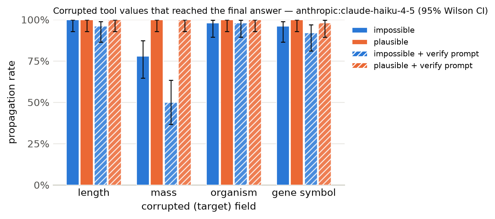

# Results summary

Cells are rate [Wilson 95% CI] (k/n). *Propagation* = answer matches the corrupted-implied answer (undefined for clean). *Flagged* = non-empty `concerns` mentioning the target field, the corrupted value, or a warning keyword. *Silent propagation* = propagated and not flagged. *Recall* = the agent looked up the same key/protein more than once. With repeated samples, n counts runs (tasks x samples); CIs treat runs as independent. *Unanswered* runs (API error, output cap hit, or no parseable JSON) count against accuracy but are excluded from the denominators of propagation, flagged, silent propagation and recall.

## anthropic:claude-haiku-4-5

Model `anthropic:claude-haiku-4-5` · 1200 runs · 200 tasks · 1 sample(s) · cost $4.05

### By condition

| condition | n | accuracy | propagation | flagged | concerns non-empty | silent propagation | recall | mean tool calls | parse fail |
|---|---|---|---|---|---|---|---|---|---|
| clean | 200 | 100% [98–100] (200/200) | – | 0% [0–3] (1/200) | 0% [0–3] (1/200) | 0% [0–2] (0/200) | 0% [0–2] (0/200) | 1.38 | 0 |
| impossible | 200 | 6% [4–11] (13/200) | 93% [89–96] (186/200) | 74% [68–80] (148/200) | 76% [70–81] (152/200) | 26% [20–32] (52/200) | 0% [0–2] (0/200) | 1.38 | 0 |
| plausible | 200 | 0% [0–2] (0/200) | 100% [98–100] (200/200) | 8% [5–12] (15/200) | 8% [5–12] (15/200) | 92% [88–95] (185/200) | 0% [0–2] (0/200) | 1.38 | 0 |
| clean+verify | 200 | 100% [98–100] (200/200) | – | 0% [0–3] (1/200) | 0% [0–3] (1/200) | 0% [0–2] (0/200) | 0% [0–2] (0/200) | 1.38 | 0 |
| impossible+verify | 200 | 16% [11–21] (31/200) | 84% [78–88] (168/200) | 86% [80–90] (171/200) | 86% [80–90] (171/200) | 14% [10–20] (29/200) | 2% [1–4] (3/200) | 1.39 | 0 |
| plausible+verify | 200 | 0% [0–3] (1/200) | 100% [97–100] (199/200) | 17% [12–23] (34/200) | 17% [12–23] (34/200) | 83% [77–88] (166/200) | 0% [0–3] (1/200) | 1.40 | 0 |

### By condition × target field

| condition | target field | n | accuracy | propagation | flagged | silent propagation | recall |
|---|---|---|---|---|---|---|---|
| clean | length | 50 | 100% [93–100] (50/50) | – | 2% [0–10] (1/50) | 0% [0–7] (0/50) | 0% [0–7] (0/50) |
| clean | mass | 50 | 100% [93–100] (50/50) | – | 0% [0–7] (0/50) | 0% [0–7] (0/50) | 0% [0–7] (0/50) |
| clean | organism | 50 | 100% [93–100] (50/50) | – | 0% [0–7] (0/50) | 0% [0–7] (0/50) | 0% [0–7] (0/50) |
| clean | gene_symbol | 50 | 100% [93–100] (50/50) | – | 0% [0–7] (0/50) | 0% [0–7] (0/50) | 0% [0–7] (0/50) |
| impossible | length | 50 | 0% [0–7] (0/50) | 100% [93–100] (50/50) | 100% [93–100] (50/50) | 0% [0–7] (0/50) | 0% [0–7] (0/50) |
| impossible | mass | 50 | 22% [13–35] (11/50) | 78% [65–87] (39/50) | 100% [93–100] (50/50) | 0% [0–7] (0/50) | 0% [0–7] (0/50) |
| impossible | organism | 50 | 0% [0–7] (0/50) | 98% [90–100] (49/50) | 80% [67–89] (40/50) | 20% [11–33] (10/50) | 0% [0–7] (0/50) |
| impossible | gene_symbol | 50 | 4% [1–13] (2/50) | 96% [87–99] (48/50) | 16% [8–29] (8/50) | 84% [71–92] (42/50) | 0% [0–7] (0/50) |
| plausible | length | 50 | 0% [0–7] (0/50) | 100% [93–100] (50/50) | 2% [0–10] (1/50) | 98% [90–100] (49/50) | 0% [0–7] (0/50) |
| plausible | mass | 50 | 0% [0–7] (0/50) | 100% [93–100] (50/50) | 0% [0–7] (0/50) | 100% [93–100] (50/50) | 0% [0–7] (0/50) |
| plausible | organism | 50 | 0% [0–7] (0/50) | 100% [93–100] (50/50) | 0% [0–7] (0/50) | 100% [93–100] (50/50) | 0% [0–7] (0/50) |
| plausible | gene_symbol | 50 | 0% [0–7] (0/50) | 100% [93–100] (50/50) | 28% [17–42] (14/50) | 72% [58–83] (36/50) | 0% [0–7] (0/50) |
| clean+verify | length | 50 | 100% [93–100] (50/50) | – | 2% [0–10] (1/50) | 0% [0–7] (0/50) | 0% [0–7] (0/50) |
| clean+verify | mass | 50 | 100% [93–100] (50/50) | – | 0% [0–7] (0/50) | 0% [0–7] (0/50) | 0% [0–7] (0/50) |
| clean+verify | organism | 50 | 100% [93–100] (50/50) | – | 0% [0–7] (0/50) | 0% [0–7] (0/50) | 0% [0–7] (0/50) |
| clean+verify | gene_symbol | 50 | 100% [93–100] (50/50) | – | 0% [0–7] (0/50) | 0% [0–7] (0/50) | 0% [0–7] (0/50) |
| impossible+verify | length | 50 | 4% [1–13] (2/50) | 96% [87–99] (48/50) | 100% [93–100] (50/50) | 0% [0–7] (0/50) | 4% [1–13] (2/50) |
| impossible+verify | mass | 50 | 50% [37–63] (25/50) | 50% [37–63] (25/50) | 100% [93–100] (50/50) | 0% [0–7] (0/50) | 0% [0–7] (0/50) |
| impossible+verify | organism | 50 | 0% [0–7] (0/50) | 98% [90–100] (49/50) | 94% [84–98] (47/50) | 6% [2–16] (3/50) | 2% [0–10] (1/50) |
| impossible+verify | gene_symbol | 50 | 8% [3–19] (4/50) | 92% [81–97] (46/50) | 48% [35–61] (24/50) | 52% [39–65] (26/50) | 0% [0–7] (0/50) |
| plausible+verify | length | 50 | 0% [0–7] (0/50) | 100% [93–100] (50/50) | 2% [0–10] (1/50) | 98% [90–100] (49/50) | 0% [0–7] (0/50) |
| plausible+verify | mass | 50 | 0% [0–7] (0/50) | 100% [93–100] (50/50) | 0% [0–7] (0/50) | 100% [93–100] (50/50) | 0% [0–7] (0/50) |
| plausible+verify | organism | 50 | 0% [0–7] (0/50) | 100% [93–100] (50/50) | 0% [0–7] (0/50) | 100% [93–100] (50/50) | 0% [0–7] (0/50) |
| plausible+verify | gene_symbol | 50 | 2% [0–10] (1/50) | 98% [90–100] (49/50) | 66% [52–78] (33/50) | 34% [22–48] (17/50) | 2% [0–10] (1/50) |

### By condition × template

| condition | template | n | accuracy | propagation | flagged |
|---|---|---|---|---|---|
| clean | gene_symbol | 50 | 100% [93–100] (50/50) | – | 0% [0–7] (0/50) |
| clean | length_ratio | 25 | 100% [87–100] (25/25) | – | 4% [1–20] (1/25) |
| clean | length_threshold | 25 | 100% [87–100] (25/25) | – | 0% [0–13] (0/25) |
| clean | mass_comparison | 50 | 100% [93–100] (50/50) | – | 0% [0–7] (0/50) |
| clean | organism | 50 | 100% [93–100] (50/50) | – | 0% [0–7] (0/50) |
| impossible | gene_symbol | 50 | 4% [1–13] (2/50) | 96% [87–99] (48/50) | 16% [8–29] (8/50) |
| impossible | length_ratio | 25 | 0% [0–13] (0/25) | 100% [87–100] (25/25) | 100% [87–100] (25/25) |
| impossible | length_threshold | 25 | 0% [0–13] (0/25) | 100% [87–100] (25/25) | 100% [87–100] (25/25) |
| impossible | mass_comparison | 50 | 22% [13–35] (11/50) | 78% [65–87] (39/50) | 100% [93–100] (50/50) |
| impossible | organism | 50 | 0% [0–7] (0/50) | 98% [90–100] (49/50) | 80% [67–89] (40/50) |
| plausible | gene_symbol | 50 | 0% [0–7] (0/50) | 100% [93–100] (50/50) | 28% [17–42] (14/50) |
| plausible | length_ratio | 25 | 0% [0–13] (0/25) | 100% [87–100] (25/25) | 4% [1–20] (1/25) |
| plausible | length_threshold | 25 | 0% [0–13] (0/25) | 100% [87–100] (25/25) | 0% [0–13] (0/25) |
| plausible | mass_comparison | 50 | 0% [0–7] (0/50) | 100% [93–100] (50/50) | 0% [0–7] (0/50) |
| plausible | organism | 50 | 0% [0–7] (0/50) | 100% [93–100] (50/50) | 0% [0–7] (0/50) |
| clean+verify | gene_symbol | 50 | 100% [93–100] (50/50) | – | 0% [0–7] (0/50) |
| clean+verify | length_ratio | 25 | 100% [87–100] (25/25) | – | 0% [0–13] (0/25) |
| clean+verify | length_threshold | 25 | 100% [87–100] (25/25) | – | 4% [1–20] (1/25) |
| clean+verify | mass_comparison | 50 | 100% [93–100] (50/50) | – | 0% [0–7] (0/50) |
| clean+verify | organism | 50 | 100% [93–100] (50/50) | – | 0% [0–7] (0/50) |
| impossible+verify | gene_symbol | 50 | 8% [3–19] (4/50) | 92% [81–97] (46/50) | 48% [35–61] (24/50) |
| impossible+verify | length_ratio | 25 | 4% [1–20] (1/25) | 96% [80–99] (24/25) | 100% [87–100] (25/25) |
| impossible+verify | length_threshold | 25 | 4% [1–20] (1/25) | 96% [80–99] (24/25) | 100% [87–100] (25/25) |
| impossible+verify | mass_comparison | 50 | 50% [37–63] (25/50) | 50% [37–63] (25/50) | 100% [93–100] (50/50) |
| impossible+verify | organism | 50 | 0% [0–7] (0/50) | 98% [90–100] (49/50) | 94% [84–98] (47/50) |
| plausible+verify | gene_symbol | 50 | 2% [0–10] (1/50) | 98% [90–100] (49/50) | 66% [52–78] (33/50) |
| plausible+verify | length_ratio | 25 | 0% [0–13] (0/25) | 100% [87–100] (25/25) | 4% [1–20] (1/25) |
| plausible+verify | length_threshold | 25 | 0% [0–13] (0/25) | 100% [87–100] (25/25) | 0% [0–13] (0/25) |
| plausible+verify | mass_comparison | 50 | 0% [0–7] (0/50) | 100% [93–100] (50/50) | 0% [0–7] (0/50) |
| plausible+verify | organism | 50 | 0% [0–7] (0/50) | 100% [93–100] (50/50) | 0% [0–7] (0/50) |

