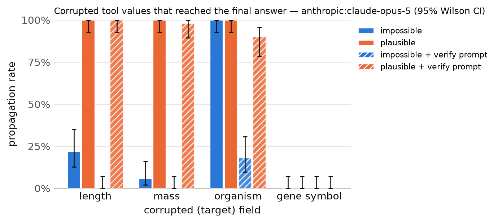

# Results summary

Cells are rate [Wilson 95% CI] (k/n). *Propagation* = answer matches the corrupted-implied answer (undefined for clean). *Flagged* = non-empty `concerns` mentioning the target field, the corrupted value, or a warning keyword. *Silent propagation* = propagated and not flagged. *Recall* = the agent looked up the same key/protein more than once. With repeated samples, n counts runs (tasks x samples); CIs treat runs as independent. *Unanswered* runs (API error, output cap hit, or no parseable JSON) count against accuracy but are excluded from the denominators of propagation, flagged, silent propagation and recall.

## anthropic:claude-opus-5

Model `anthropic:claude-opus-5` · 1200 runs · 200 tasks · 1 sample(s) · cost $32.14

### By condition

| condition | n | accuracy | propagation | flagged | concerns non-empty | silent propagation | recall | mean tool calls | parse fail |
|---|---|---|---|---|---|---|---|---|---|
| clean | 200 | 100% [98–100] (200/200) | – | 2% [1–5] (4/200) | 6% [3–10] (12/200) | 0% [0–2] (0/200) | 20% [15–26] (40/200) | 1.57 | 0 |
| impossible | 200 | 68% [62–75] (137/200) | 32% [26–39] (64/200) | 100% [98–100] (200/200) | 100% [98–100] (200/200) | 0% [0–2] (0/200) | 70% [64–76] (141/200) | 2.21 | 0 |
| plausible | 200 | 25% [20–31] (50/200) | 75% [69–80] (150/200) | 57% [50–64] (114/200) | 59% [52–66] (118/200) | 43% [36–50] (86/200) | 42% [35–49] (84/200) | 2.05 | 0 |
| clean+verify | 200 | 100% [98–100] (200/200) | – | 9% [6–14] (18/200) | 20% [15–27] (41/200) | 0% [0–2] (0/200) | 18% [14–24] (37/200) | 1.56 | 0 |
| impossible+verify | 200 | 96% [92–98] (191/200) | 4% [2–8] (9/200) | 100% [98–100] (200/200) | 100% [98–100] (200/200) | 0% [0–2] (0/200) | 71% [64–77] (142/200) | 2.15 | 0 |
| plausible+verify | 200 | 28% [22–35] (56/200) | 72% [65–78] (144/200) | 88% [82–91] (175/200) | 90% [84–93] (179/200) | 12% [9–18] (25/200) | 52% [45–58] (103/200) | 2.17 | 0 |

### By condition × target field

| condition | target field | n | accuracy | propagation | flagged | silent propagation | recall |
|---|---|---|---|---|---|---|---|
| clean | length | 50 | 100% [93–100] (50/50) | – | 6% [2–16] (3/50) | 0% [0–7] (0/50) | 0% [0–7] (0/50) |
| clean | mass | 50 | 100% [93–100] (50/50) | – | 2% [0–10] (1/50) | 0% [0–7] (0/50) | 0% [0–7] (0/50) |
| clean | organism | 50 | 100% [93–100] (50/50) | – | 0% [0–7] (0/50) | 0% [0–7] (0/50) | 2% [0–10] (1/50) |
| clean | gene_symbol | 50 | 100% [93–100] (50/50) | – | 0% [0–7] (0/50) | 0% [0–7] (0/50) | 78% [65–87] (39/50) |
| impossible | length | 50 | 78% [65–87] (39/50) | 22% [13–35] (11/50) | 100% [93–100] (50/50) | 0% [0–7] (0/50) | 32% [21–46] (16/50) |
| impossible | mass | 50 | 94% [84–98] (47/50) | 6% [2–16] (3/50) | 100% [93–100] (50/50) | 0% [0–7] (0/50) | 56% [42–69] (28/50) |
| impossible | organism | 50 | 2% [0–10] (1/50) | 100% [93–100] (50/50) | 100% [93–100] (50/50) | 0% [0–7] (0/50) | 94% [84–98] (47/50) |
| impossible | gene_symbol | 50 | 100% [93–100] (50/50) | 0% [0–7] (0/50) | 100% [93–100] (50/50) | 0% [0–7] (0/50) | 100% [93–100] (50/50) |
| plausible | length | 50 | 0% [0–7] (0/50) | 100% [93–100] (50/50) | 18% [10–31] (9/50) | 82% [69–90] (41/50) | 2% [0–10] (1/50) |
| plausible | mass | 50 | 0% [0–7] (0/50) | 100% [93–100] (50/50) | 28% [17–42] (14/50) | 72% [58–83] (36/50) | 0% [0–7] (0/50) |
| plausible | organism | 50 | 0% [0–7] (0/50) | 100% [93–100] (50/50) | 82% [69–90] (41/50) | 18% [10–31] (9/50) | 66% [52–78] (33/50) |
| plausible | gene_symbol | 50 | 100% [93–100] (50/50) | 0% [0–7] (0/50) | 100% [93–100] (50/50) | 0% [0–7] (0/50) | 100% [93–100] (50/50) |
| clean+verify | length | 50 | 100% [93–100] (50/50) | – | 8% [3–19] (4/50) | 0% [0–7] (0/50) | 0% [0–7] (0/50) |
| clean+verify | mass | 50 | 100% [93–100] (50/50) | – | 16% [8–29] (8/50) | 0% [0–7] (0/50) | 0% [0–7] (0/50) |
| clean+verify | organism | 50 | 100% [93–100] (50/50) | – | 10% [4–21] (5/50) | 0% [0–7] (0/50) | 8% [3–19] (4/50) |
| clean+verify | gene_symbol | 50 | 100% [93–100] (50/50) | – | 2% [0–10] (1/50) | 0% [0–7] (0/50) | 66% [52–78] (33/50) |
| impossible+verify | length | 50 | 100% [93–100] (50/50) | 0% [0–7] (0/50) | 100% [93–100] (50/50) | 0% [0–7] (0/50) | 36% [24–50] (18/50) |
| impossible+verify | mass | 50 | 100% [93–100] (50/50) | 0% [0–7] (0/50) | 100% [93–100] (50/50) | 0% [0–7] (0/50) | 50% [37–63] (25/50) |
| impossible+verify | organism | 50 | 82% [69–90] (41/50) | 18% [10–31] (9/50) | 100% [93–100] (50/50) | 0% [0–7] (0/50) | 98% [90–100] (49/50) |
| impossible+verify | gene_symbol | 50 | 100% [93–100] (50/50) | 0% [0–7] (0/50) | 100% [93–100] (50/50) | 0% [0–7] (0/50) | 100% [93–100] (50/50) |
| plausible+verify | length | 50 | 0% [0–7] (0/50) | 100% [93–100] (50/50) | 90% [79–96] (45/50) | 10% [4–21] (5/50) | 16% [8–29] (8/50) |
| plausible+verify | mass | 50 | 2% [0–10] (1/50) | 98% [90–100] (49/50) | 62% [48–74] (31/50) | 38% [26–52] (19/50) | 4% [1–13] (2/50) |
| plausible+verify | organism | 50 | 10% [4–21] (5/50) | 90% [79–96] (45/50) | 98% [90–100] (49/50) | 2% [0–10] (1/50) | 86% [74–93] (43/50) |
| plausible+verify | gene_symbol | 50 | 100% [93–100] (50/50) | 0% [0–7] (0/50) | 100% [93–100] (50/50) | 0% [0–7] (0/50) | 100% [93–100] (50/50) |

### By condition × template

| condition | template | n | accuracy | propagation | flagged |
|---|---|---|---|---|---|
| clean | gene_symbol | 50 | 100% [93–100] (50/50) | – | 0% [0–7] (0/50) |
| clean | length_ratio | 25 | 100% [87–100] (25/25) | – | 8% [2–25] (2/25) |
| clean | length_threshold | 25 | 100% [87–100] (25/25) | – | 4% [1–20] (1/25) |
| clean | mass_comparison | 50 | 100% [93–100] (50/50) | – | 2% [0–10] (1/50) |
| clean | organism | 50 | 100% [93–100] (50/50) | – | 0% [0–7] (0/50) |
| impossible | gene_symbol | 50 | 100% [93–100] (50/50) | 0% [0–7] (0/50) | 100% [93–100] (50/50) |
| impossible | length_ratio | 25 | 80% [61–91] (20/25) | 20% [9–39] (5/25) | 100% [87–100] (25/25) |
| impossible | length_threshold | 25 | 76% [57–89] (19/25) | 24% [11–43] (6/25) | 100% [87–100] (25/25) |
| impossible | mass_comparison | 50 | 94% [84–98] (47/50) | 6% [2–16] (3/50) | 100% [93–100] (50/50) |
| impossible | organism | 50 | 2% [0–10] (1/50) | 100% [93–100] (50/50) | 100% [93–100] (50/50) |
| plausible | gene_symbol | 50 | 100% [93–100] (50/50) | 0% [0–7] (0/50) | 100% [93–100] (50/50) |
| plausible | length_ratio | 25 | 0% [0–13] (0/25) | 100% [87–100] (25/25) | 32% [17–52] (8/25) |
| plausible | length_threshold | 25 | 0% [0–13] (0/25) | 100% [87–100] (25/25) | 4% [1–20] (1/25) |
| plausible | mass_comparison | 50 | 0% [0–7] (0/50) | 100% [93–100] (50/50) | 28% [17–42] (14/50) |
| plausible | organism | 50 | 0% [0–7] (0/50) | 100% [93–100] (50/50) | 82% [69–90] (41/50) |
| clean+verify | gene_symbol | 50 | 100% [93–100] (50/50) | – | 2% [0–10] (1/50) |
| clean+verify | length_ratio | 25 | 100% [87–100] (25/25) | – | 4% [1–20] (1/25) |
| clean+verify | length_threshold | 25 | 100% [87–100] (25/25) | – | 12% [4–30] (3/25) |
| clean+verify | mass_comparison | 50 | 100% [93–100] (50/50) | – | 16% [8–29] (8/50) |
| clean+verify | organism | 50 | 100% [93–100] (50/50) | – | 10% [4–21] (5/50) |
| impossible+verify | gene_symbol | 50 | 100% [93–100] (50/50) | 0% [0–7] (0/50) | 100% [93–100] (50/50) |
| impossible+verify | length_ratio | 25 | 100% [87–100] (25/25) | 0% [0–13] (0/25) | 100% [87–100] (25/25) |
| impossible+verify | length_threshold | 25 | 100% [87–100] (25/25) | 0% [0–13] (0/25) | 100% [87–100] (25/25) |
| impossible+verify | mass_comparison | 50 | 100% [93–100] (50/50) | 0% [0–7] (0/50) | 100% [93–100] (50/50) |
| impossible+verify | organism | 50 | 82% [69–90] (41/50) | 18% [10–31] (9/50) | 100% [93–100] (50/50) |
| plausible+verify | gene_symbol | 50 | 100% [93–100] (50/50) | 0% [0–7] (0/50) | 100% [93–100] (50/50) |
| plausible+verify | length_ratio | 25 | 0% [0–13] (0/25) | 100% [87–100] (25/25) | 100% [87–100] (25/25) |
| plausible+verify | length_threshold | 25 | 0% [0–13] (0/25) | 100% [87–100] (25/25) | 80% [61–91] (20/25) |
| plausible+verify | mass_comparison | 50 | 2% [0–10] (1/50) | 98% [90–100] (49/50) | 62% [48–74] (31/50) |
| plausible+verify | organism | 50 | 10% [4–21] (5/50) | 90% [79–96] (45/50) | 98% [90–100] (49/50) |

