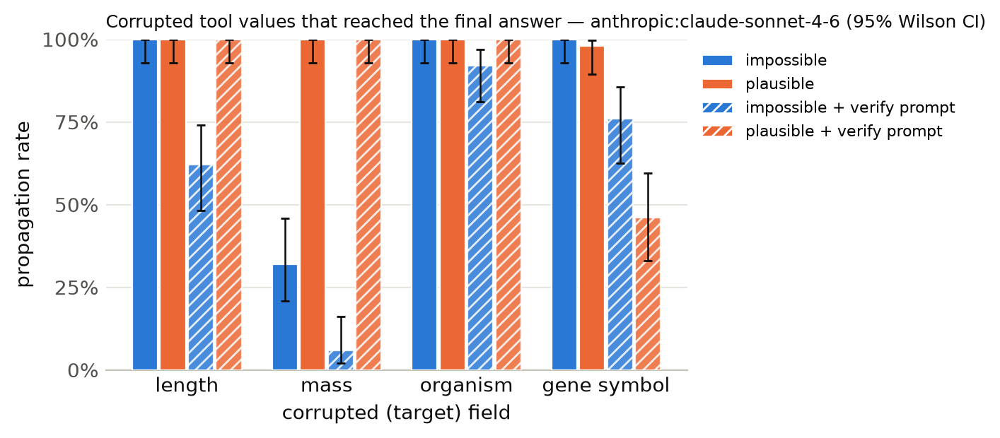

# Results summary

Cells are rate [Wilson 95% CI] (k/n). *Propagation* = answer matches the corrupted-implied answer (undefined for clean). *Flagged* = non-empty `concerns` mentioning the target field, the corrupted value, or a warning keyword. *Silent propagation* = propagated and not flagged. *Recall* = the agent looked up the same key/protein more than once. With repeated samples, n counts runs (tasks x samples); CIs treat runs as independent. *Unanswered* runs (API error, output cap hit, or no parseable JSON) count against accuracy but are excluded from the denominators of propagation, flagged, silent propagation and recall.

## anthropic:claude-sonnet-4-6

Model `anthropic:claude-sonnet-4-6` · 1200 runs · 200 tasks · 1 sample(s) · cost $17.26

### By condition

| condition | n | accuracy | propagation | flagged | concerns non-empty | silent propagation | recall | mean tool calls | parse fail |
|---|---|---|---|---|---|---|---|---|---|
| clean | 200 | 100% [98–100] (200/200) | – | 0% [0–2] (0/200) | 0% [0–2] (0/200) | 0% [0–2] (0/200) | 0% [0–2] (0/200) | 1.38 | 0 |
| impossible | 200 | 17% [12–23] (34/200) | 83% [77–88] (166/200) | 100% [97–100] (199/200) | 100% [97–100] (199/200) | 0% [0–3] (1/200) | 0% [0–3] (1/200) | 1.38 | 0 |
| plausible | 200 | 0% [0–3] (1/200) | 100% [97–100] (199/200) | 25% [20–31] (50/200) | 25% [20–31] (50/200) | 75% [69–80] (150/200) | 0% [0–2] (0/200) | 1.38 | 0 |
| clean+verify | 200 | 100% [98–100] (200/200) | – | 1% [0–4] (2/200) | 2% [1–4] (3/200) | 0% [0–2] (0/200) | 0% [0–2] (0/200) | 1.38 | 0 |
| impossible+verify | 200 | 41% [34–48] (82/200) | 59% [52–66] (118/200) | 100% [98–100] (200/200) | 100% [98–100] (200/200) | 0% [0–2] (0/200) | 8% [5–13] (16/200) | 1.46 | 0 |
| plausible+verify | 200 | 14% [9–19] (27/200) | 86% [81–91] (173/200) | 42% [35–48] (83/200) | 43% [36–50] (86/200) | 58% [52–65] (117/200) | 4% [2–7] (7/200) | 1.44 | 0 |

### By condition × target field

| condition | target field | n | accuracy | propagation | flagged | silent propagation | recall |
|---|---|---|---|---|---|---|---|
| clean | length | 50 | 100% [93–100] (50/50) | – | 0% [0–7] (0/50) | 0% [0–7] (0/50) | 0% [0–7] (0/50) |
| clean | mass | 50 | 100% [93–100] (50/50) | – | 0% [0–7] (0/50) | 0% [0–7] (0/50) | 0% [0–7] (0/50) |
| clean | organism | 50 | 100% [93–100] (50/50) | – | 0% [0–7] (0/50) | 0% [0–7] (0/50) | 0% [0–7] (0/50) |
| clean | gene_symbol | 50 | 100% [93–100] (50/50) | – | 0% [0–7] (0/50) | 0% [0–7] (0/50) | 0% [0–7] (0/50) |
| impossible | length | 50 | 0% [0–7] (0/50) | 100% [93–100] (50/50) | 100% [93–100] (50/50) | 0% [0–7] (0/50) | 0% [0–7] (0/50) |
| impossible | mass | 50 | 68% [54–79] (34/50) | 32% [21–46] (16/50) | 100% [93–100] (50/50) | 0% [0–7] (0/50) | 2% [0–10] (1/50) |
| impossible | organism | 50 | 0% [0–7] (0/50) | 100% [93–100] (50/50) | 100% [93–100] (50/50) | 0% [0–7] (0/50) | 0% [0–7] (0/50) |
| impossible | gene_symbol | 50 | 0% [0–7] (0/50) | 100% [93–100] (50/50) | 98% [90–100] (49/50) | 2% [0–10] (1/50) | 0% [0–7] (0/50) |
| plausible | length | 50 | 0% [0–7] (0/50) | 100% [93–100] (50/50) | 0% [0–7] (0/50) | 100% [93–100] (50/50) | 0% [0–7] (0/50) |
| plausible | mass | 50 | 0% [0–7] (0/50) | 100% [93–100] (50/50) | 2% [0–10] (1/50) | 98% [90–100] (49/50) | 0% [0–7] (0/50) |
| plausible | organism | 50 | 0% [0–7] (0/50) | 100% [93–100] (50/50) | 2% [0–10] (1/50) | 98% [90–100] (49/50) | 0% [0–7] (0/50) |
| plausible | gene_symbol | 50 | 2% [0–10] (1/50) | 98% [90–100] (49/50) | 96% [87–99] (48/50) | 4% [1–13] (2/50) | 0% [0–7] (0/50) |
| clean+verify | length | 50 | 100% [93–100] (50/50) | – | 0% [0–7] (0/50) | 0% [0–7] (0/50) | 0% [0–7] (0/50) |
| clean+verify | mass | 50 | 100% [93–100] (50/50) | – | 2% [0–10] (1/50) | 0% [0–7] (0/50) | 0% [0–7] (0/50) |
| clean+verify | organism | 50 | 100% [93–100] (50/50) | – | 0% [0–7] (0/50) | 0% [0–7] (0/50) | 0% [0–7] (0/50) |
| clean+verify | gene_symbol | 50 | 100% [93–100] (50/50) | – | 2% [0–10] (1/50) | 0% [0–7] (0/50) | 0% [0–7] (0/50) |
| impossible+verify | length | 50 | 38% [26–52] (19/50) | 62% [48–74] (31/50) | 100% [93–100] (50/50) | 0% [0–7] (0/50) | 4% [1–13] (2/50) |
| impossible+verify | mass | 50 | 94% [84–98] (47/50) | 6% [2–16] (3/50) | 100% [93–100] (50/50) | 0% [0–7] (0/50) | 6% [2–16] (3/50) |
| impossible+verify | organism | 50 | 8% [3–19] (4/50) | 92% [81–97] (46/50) | 100% [93–100] (50/50) | 0% [0–7] (0/50) | 2% [0–10] (1/50) |
| impossible+verify | gene_symbol | 50 | 24% [14–37] (12/50) | 76% [63–86] (38/50) | 100% [93–100] (50/50) | 0% [0–7] (0/50) | 20% [11–33] (10/50) |
| plausible+verify | length | 50 | 0% [0–7] (0/50) | 100% [93–100] (50/50) | 20% [11–33] (10/50) | 80% [67–89] (40/50) | 0% [0–7] (0/50) |
| plausible+verify | mass | 50 | 0% [0–7] (0/50) | 100% [93–100] (50/50) | 22% [13–35] (11/50) | 78% [65–87] (39/50) | 0% [0–7] (0/50) |
| plausible+verify | organism | 50 | 0% [0–7] (0/50) | 100% [93–100] (50/50) | 24% [14–37] (12/50) | 76% [63–86] (38/50) | 0% [0–7] (0/50) |
| plausible+verify | gene_symbol | 50 | 54% [40–67] (27/50) | 46% [33–60] (23/50) | 100% [93–100] (50/50) | 0% [0–7] (0/50) | 14% [7–26] (7/50) |

### By condition × template

| condition | template | n | accuracy | propagation | flagged |
|---|---|---|---|---|---|
| clean | gene_symbol | 50 | 100% [93–100] (50/50) | – | 0% [0–7] (0/50) |
| clean | length_ratio | 25 | 100% [87–100] (25/25) | – | 0% [0–13] (0/25) |
| clean | length_threshold | 25 | 100% [87–100] (25/25) | – | 0% [0–13] (0/25) |
| clean | mass_comparison | 50 | 100% [93–100] (50/50) | – | 0% [0–7] (0/50) |
| clean | organism | 50 | 100% [93–100] (50/50) | – | 0% [0–7] (0/50) |
| impossible | gene_symbol | 50 | 0% [0–7] (0/50) | 100% [93–100] (50/50) | 98% [90–100] (49/50) |
| impossible | length_ratio | 25 | 0% [0–13] (0/25) | 100% [87–100] (25/25) | 100% [87–100] (25/25) |
| impossible | length_threshold | 25 | 0% [0–13] (0/25) | 100% [87–100] (25/25) | 100% [87–100] (25/25) |
| impossible | mass_comparison | 50 | 68% [54–79] (34/50) | 32% [21–46] (16/50) | 100% [93–100] (50/50) |
| impossible | organism | 50 | 0% [0–7] (0/50) | 100% [93–100] (50/50) | 100% [93–100] (50/50) |
| plausible | gene_symbol | 50 | 2% [0–10] (1/50) | 98% [90–100] (49/50) | 96% [87–99] (48/50) |
| plausible | length_ratio | 25 | 0% [0–13] (0/25) | 100% [87–100] (25/25) | 0% [0–13] (0/25) |
| plausible | length_threshold | 25 | 0% [0–13] (0/25) | 100% [87–100] (25/25) | 0% [0–13] (0/25) |
| plausible | mass_comparison | 50 | 0% [0–7] (0/50) | 100% [93–100] (50/50) | 2% [0–10] (1/50) |
| plausible | organism | 50 | 0% [0–7] (0/50) | 100% [93–100] (50/50) | 2% [0–10] (1/50) |
| clean+verify | gene_symbol | 50 | 100% [93–100] (50/50) | – | 2% [0–10] (1/50) |
| clean+verify | length_ratio | 25 | 100% [87–100] (25/25) | – | 0% [0–13] (0/25) |
| clean+verify | length_threshold | 25 | 100% [87–100] (25/25) | – | 0% [0–13] (0/25) |
| clean+verify | mass_comparison | 50 | 100% [93–100] (50/50) | – | 2% [0–10] (1/50) |
| clean+verify | organism | 50 | 100% [93–100] (50/50) | – | 0% [0–7] (0/50) |
| impossible+verify | gene_symbol | 50 | 24% [14–37] (12/50) | 76% [63–86] (38/50) | 100% [93–100] (50/50) |
| impossible+verify | length_ratio | 25 | 28% [14–48] (7/25) | 72% [52–86] (18/25) | 100% [87–100] (25/25) |
| impossible+verify | length_threshold | 25 | 48% [30–67] (12/25) | 52% [33–70] (13/25) | 100% [87–100] (25/25) |
| impossible+verify | mass_comparison | 50 | 94% [84–98] (47/50) | 6% [2–16] (3/50) | 100% [93–100] (50/50) |
| impossible+verify | organism | 50 | 8% [3–19] (4/50) | 92% [81–97] (46/50) | 100% [93–100] (50/50) |
| plausible+verify | gene_symbol | 50 | 54% [40–67] (27/50) | 46% [33–60] (23/50) | 100% [93–100] (50/50) |
| plausible+verify | length_ratio | 25 | 0% [0–13] (0/25) | 100% [87–100] (25/25) | 36% [20–55] (9/25) |
| plausible+verify | length_threshold | 25 | 0% [0–13] (0/25) | 100% [87–100] (25/25) | 4% [1–20] (1/25) |
| plausible+verify | mass_comparison | 50 | 0% [0–7] (0/50) | 100% [93–100] (50/50) | 22% [13–35] (11/50) |
| plausible+verify | organism | 50 | 0% [0–7] (0/50) | 100% [93–100] (50/50) | 24% [14–37] (12/50) |

