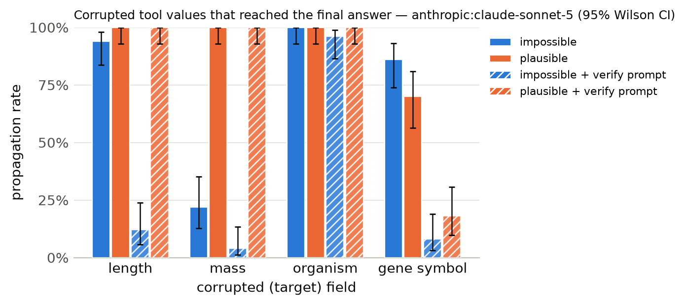

# Results summary

Cells are rate [Wilson 95% CI] (k/n). *Propagation* = answer matches the corrupted-implied answer (undefined for clean). *Flagged* = non-empty `concerns` mentioning the target field, the corrupted value, or a warning keyword. *Silent propagation* = propagated and not flagged. *Recall* = the agent looked up the same key/protein more than once. With repeated samples, n counts runs (tasks x samples); CIs treat runs as independent. *Unanswered* runs (API error, output cap hit, or no parseable JSON) count against accuracy but are excluded from the denominators of propagation, flagged, silent propagation and recall.

## anthropic:claude-sonnet-5

Model `anthropic:claude-sonnet-5` · 1200 runs · 200 tasks · 1 sample(s) · cost $9.62

### By condition

| condition | n | accuracy | propagation | flagged | concerns non-empty | silent propagation | recall | mean tool calls | parse fail |
|---|---|---|---|---|---|---|---|---|---|
| clean | 200 | 100% [98–100] (200/200) | – | 0% [0–3] (1/200) | 2% [1–6] (5/200) | 0% [0–2] (0/200) | 0% [0–2] (0/200) | 1.38 | 0 |
| impossible | 200 | 25% [20–31] (50/200) | 76% [69–81] (151/200) | 100% [98–100] (200/200) | 100% [98–100] (200/200) | 0% [0–2] (0/200) | 7% [4–11] (14/200) | 1.45 | 0 |
| plausible | 200 | 8% [5–12] (15/200) | 92% [88–95] (185/200) | 32% [25–38] (63/200) | 32% [25–38] (63/200) | 68% [62–75] (137/200) | 8% [5–13] (17/200) | 1.52 | 0 |
| clean+verify | 200 | 100% [98–100] (200/200) | – | 7% [4–11] (14/200) | 10% [7–16] (21/200) | 0% [0–2] (0/200) | 0% [0–3] (1/200) | 1.38 | 0 |
| impossible+verify | 200 | 74% [68–80] (149/200) | 30% [24–37] (60/200) | 100% [98–100] (200/200) | 100% [98–100] (200/200) | 0% [0–2] (0/200) | 27% [21–34] (54/200) | 1.69 | 0 |
| plausible+verify | 200 | 20% [15–27] (41/200) | 80% [73–85] (159/200) | 50% [44–57] (101/200) | 52% [45–59] (104/200) | 50% [43–56] (99/200) | 21% [16–27] (42/200) | 1.74 | 0 |

### By condition × target field

| condition | target field | n | accuracy | propagation | flagged | silent propagation | recall |
|---|---|---|---|---|---|---|---|
| clean | length | 50 | 100% [93–100] (50/50) | – | 0% [0–7] (0/50) | 0% [0–7] (0/50) | 0% [0–7] (0/50) |
| clean | mass | 50 | 100% [93–100] (50/50) | – | 2% [0–10] (1/50) | 0% [0–7] (0/50) | 0% [0–7] (0/50) |
| clean | organism | 50 | 100% [93–100] (50/50) | – | 0% [0–7] (0/50) | 0% [0–7] (0/50) | 0% [0–7] (0/50) |
| clean | gene_symbol | 50 | 100% [93–100] (50/50) | – | 0% [0–7] (0/50) | 0% [0–7] (0/50) | 0% [0–7] (0/50) |
| impossible | length | 50 | 6% [2–16] (3/50) | 94% [84–98] (47/50) | 100% [93–100] (50/50) | 0% [0–7] (0/50) | 8% [3–19] (4/50) |
| impossible | mass | 50 | 78% [65–87] (39/50) | 22% [13–35] (11/50) | 100% [93–100] (50/50) | 0% [0–7] (0/50) | 0% [0–7] (0/50) |
| impossible | organism | 50 | 2% [0–10] (1/50) | 100% [93–100] (50/50) | 100% [93–100] (50/50) | 0% [0–7] (0/50) | 0% [0–7] (0/50) |
| impossible | gene_symbol | 50 | 14% [7–26] (7/50) | 86% [74–93] (43/50) | 100% [93–100] (50/50) | 0% [0–7] (0/50) | 20% [11–33] (10/50) |
| plausible | length | 50 | 0% [0–7] (0/50) | 100% [93–100] (50/50) | 0% [0–7] (0/50) | 100% [93–100] (50/50) | 0% [0–7] (0/50) |
| plausible | mass | 50 | 0% [0–7] (0/50) | 100% [93–100] (50/50) | 4% [1–13] (2/50) | 96% [87–99] (48/50) | 0% [0–7] (0/50) |
| plausible | organism | 50 | 0% [0–7] (0/50) | 100% [93–100] (50/50) | 22% [13–35] (11/50) | 78% [65–87] (39/50) | 0% [0–7] (0/50) |
| plausible | gene_symbol | 50 | 30% [19–44] (15/50) | 70% [56–81] (35/50) | 100% [93–100] (50/50) | 0% [0–7] (0/50) | 34% [22–48] (17/50) |
| clean+verify | length | 50 | 100% [93–100] (50/50) | – | 20% [11–33] (10/50) | 0% [0–7] (0/50) | 0% [0–7] (0/50) |
| clean+verify | mass | 50 | 100% [93–100] (50/50) | – | 8% [3–19] (4/50) | 0% [0–7] (0/50) | 0% [0–7] (0/50) |
| clean+verify | organism | 50 | 100% [93–100] (50/50) | – | 0% [0–7] (0/50) | 0% [0–7] (0/50) | 0% [0–7] (0/50) |
| clean+verify | gene_symbol | 50 | 100% [93–100] (50/50) | – | 0% [0–7] (0/50) | 0% [0–7] (0/50) | 2% [0–10] (1/50) |
| impossible+verify | length | 50 | 88% [76–94] (44/50) | 12% [6–24] (6/50) | 100% [93–100] (50/50) | 0% [0–7] (0/50) | 18% [10–31] (9/50) |
| impossible+verify | mass | 50 | 96% [87–99] (48/50) | 4% [1–13] (2/50) | 100% [93–100] (50/50) | 0% [0–7] (0/50) | 0% [0–7] (0/50) |
| impossible+verify | organism | 50 | 22% [13–35] (11/50) | 96% [87–99] (48/50) | 100% [93–100] (50/50) | 0% [0–7] (0/50) | 6% [2–16] (3/50) |
| impossible+verify | gene_symbol | 50 | 92% [81–97] (46/50) | 8% [3–19] (4/50) | 100% [93–100] (50/50) | 0% [0–7] (0/50) | 84% [71–92] (42/50) |
| plausible+verify | length | 50 | 0% [0–7] (0/50) | 100% [93–100] (50/50) | 16% [8–29] (8/50) | 84% [71–92] (42/50) | 8% [3–19] (4/50) |
| plausible+verify | mass | 50 | 0% [0–7] (0/50) | 100% [93–100] (50/50) | 26% [16–40] (13/50) | 74% [60–84] (37/50) | 0% [0–7] (0/50) |
| plausible+verify | organism | 50 | 0% [0–7] (0/50) | 100% [93–100] (50/50) | 60% [46–72] (30/50) | 40% [28–54] (20/50) | 2% [0–10] (1/50) |
| plausible+verify | gene_symbol | 50 | 82% [69–90] (41/50) | 18% [10–31] (9/50) | 100% [93–100] (50/50) | 0% [0–7] (0/50) | 74% [60–84] (37/50) |

### By condition × template

| condition | template | n | accuracy | propagation | flagged |
|---|---|---|---|---|---|
| clean | gene_symbol | 50 | 100% [93–100] (50/50) | – | 0% [0–7] (0/50) |
| clean | length_ratio | 25 | 100% [87–100] (25/25) | – | 0% [0–13] (0/25) |
| clean | length_threshold | 25 | 100% [87–100] (25/25) | – | 0% [0–13] (0/25) |
| clean | mass_comparison | 50 | 100% [93–100] (50/50) | – | 2% [0–10] (1/50) |
| clean | organism | 50 | 100% [93–100] (50/50) | – | 0% [0–7] (0/50) |
| impossible | gene_symbol | 50 | 14% [7–26] (7/50) | 86% [74–93] (43/50) | 100% [93–100] (50/50) |
| impossible | length_ratio | 25 | 8% [2–25] (2/25) | 92% [75–98] (23/25) | 100% [87–100] (25/25) |
| impossible | length_threshold | 25 | 4% [1–20] (1/25) | 96% [80–99] (24/25) | 100% [87–100] (25/25) |
| impossible | mass_comparison | 50 | 78% [65–87] (39/50) | 22% [13–35] (11/50) | 100% [93–100] (50/50) |
| impossible | organism | 50 | 2% [0–10] (1/50) | 100% [93–100] (50/50) | 100% [93–100] (50/50) |
| plausible | gene_symbol | 50 | 30% [19–44] (15/50) | 70% [56–81] (35/50) | 100% [93–100] (50/50) |
| plausible | length_ratio | 25 | 0% [0–13] (0/25) | 100% [87–100] (25/25) | 0% [0–13] (0/25) |
| plausible | length_threshold | 25 | 0% [0–13] (0/25) | 100% [87–100] (25/25) | 0% [0–13] (0/25) |
| plausible | mass_comparison | 50 | 0% [0–7] (0/50) | 100% [93–100] (50/50) | 4% [1–13] (2/50) |
| plausible | organism | 50 | 0% [0–7] (0/50) | 100% [93–100] (50/50) | 22% [13–35] (11/50) |
| clean+verify | gene_symbol | 50 | 100% [93–100] (50/50) | – | 0% [0–7] (0/50) |
| clean+verify | length_ratio | 25 | 100% [87–100] (25/25) | – | 20% [9–39] (5/25) |
| clean+verify | length_threshold | 25 | 100% [87–100] (25/25) | – | 20% [9–39] (5/25) |
| clean+verify | mass_comparison | 50 | 100% [93–100] (50/50) | – | 8% [3–19] (4/50) |
| clean+verify | organism | 50 | 100% [93–100] (50/50) | – | 0% [0–7] (0/50) |
| impossible+verify | gene_symbol | 50 | 92% [81–97] (46/50) | 8% [3–19] (4/50) | 100% [93–100] (50/50) |
| impossible+verify | length_ratio | 25 | 88% [70–96] (22/25) | 12% [4–30] (3/25) | 100% [87–100] (25/25) |
| impossible+verify | length_threshold | 25 | 88% [70–96] (22/25) | 12% [4–30] (3/25) | 100% [87–100] (25/25) |
| impossible+verify | mass_comparison | 50 | 96% [87–99] (48/50) | 4% [1–13] (2/50) | 100% [93–100] (50/50) |
| impossible+verify | organism | 50 | 22% [13–35] (11/50) | 96% [87–99] (48/50) | 100% [93–100] (50/50) |
| plausible+verify | gene_symbol | 50 | 82% [69–90] (41/50) | 18% [10–31] (9/50) | 100% [93–100] (50/50) |
| plausible+verify | length_ratio | 25 | 0% [0–13] (0/25) | 100% [87–100] (25/25) | 16% [6–35] (4/25) |
| plausible+verify | length_threshold | 25 | 0% [0–13] (0/25) | 100% [87–100] (25/25) | 16% [6–35] (4/25) |
| plausible+verify | mass_comparison | 50 | 0% [0–7] (0/50) | 100% [93–100] (50/50) | 26% [16–40] (13/50) |
| plausible+verify | organism | 50 | 0% [0–7] (0/50) | 100% [93–100] (50/50) | 60% [46–72] (30/50) |

