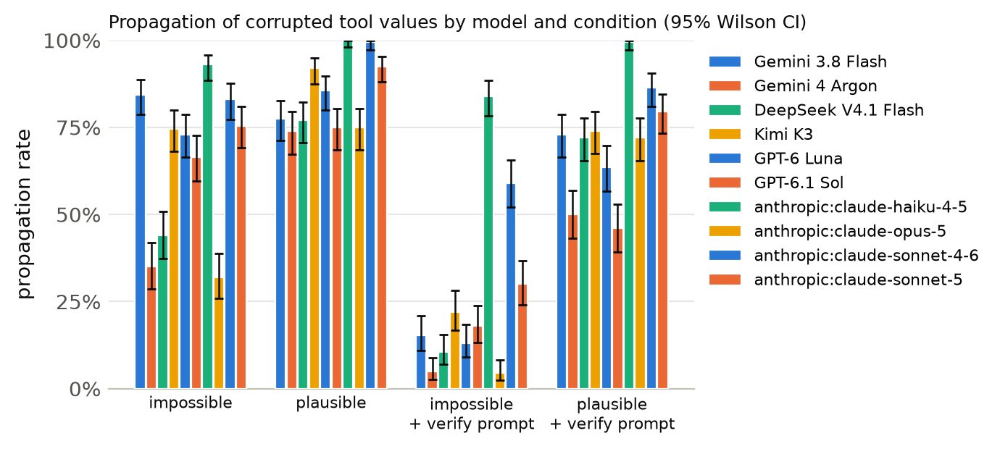
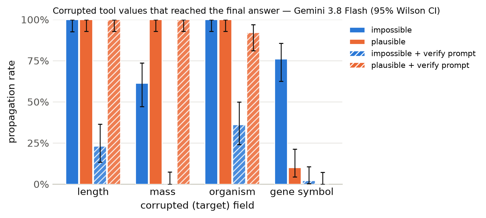

# Results summary

Cells are rate [Wilson 95% CI] (k/n). *Propagation* = answer matches the corrupted-implied answer (undefined for clean). *Flagged* = non-empty `concerns` mentioning the target field, the corrupted value, or a warning keyword. *Silent propagation* = propagated and not flagged. *Recall* = the agent looked up the same key/protein more than once. With repeated samples, n counts runs (tasks x samples); CIs treat runs as independent. *Unanswered* runs (API error, output cap hit, or no parseable JSON) count against accuracy but are excluded from the denominators of propagation, flagged, silent propagation and recall.

Models: Gemini 3.8 Flash, Gemini 4 Argon, DeepSeek V4.1 Flash, Kimi K3, GPT-6 Luna, GPT-6.1 Sol, anthropic:claude-haiku-4-5, anthropic:claude-opus-5, anthropic:claude-sonnet-4-6, anthropic:claude-sonnet-5 · total runs: 12000 · total cost: $100.44

## Cross-model

| model | condition | n | accuracy | propagation | flagged | silent propagation | recall |
|---|---|---|---|---|---|---|---|
| Gemini 3.8 Flash | clean | 200 | 100% [98–100] (200/200) | – | 0% [0–2] (0/200) | 0% [0–2] (0/200) | 0% [0–2] (0/200) |
| Gemini 3.8 Flash | impossible | 200 | 16% [11–21] (31/200) | 84% [79–89] (167/198) | 98% [96–99] (195/198) | 2% [1–4] (3/198) | 57% [50–64] (113/198) |
| Gemini 3.8 Flash | plausible | 200 | 22% [17–29] (45/200) | 78% [71–83] (155/200) | 32% [26–39] (64/200) | 68% [61–74] (136/200) | 27% [21–34] (54/200) |
| Gemini 3.8 Flash | clean+verify | 200 | 100% [98–100] (200/200) | – | 0% [0–3] (1/200) | 0% [0–2] (0/200) | 0% [0–2] (0/200) |
| Gemini 3.8 Flash | impossible+verify | 200 | 83% [77–88] (166/200) | 15% [11–21] (30/196) | 100% [98–100] (196/196) | 0% [0–2] (0/196) | 82% [76–86] (160/196) |
| Gemini 3.8 Flash | plausible+verify | 200 | 26% [21–33] (53/200) | 73% [66–79] (146/200) | 58% [52–65] (117/200) | 42% [35–48] (83/200) | 48% [41–55] (96/200) |
| Gemini 4 Argon | clean | 200 | 100% [98–100] (200/200) | – | 0% [0–3] (1/200) | 0% [0–2] (0/200) | 4% [2–8] (8/200) |
| Gemini 4 Argon | impossible | 200 | 65% [58–71] (130/200) | 35% [29–42] (70/200) | 100% [98–100] (200/200) | 0% [0–2] (0/200) | 40% [33–46] (79/200) |
| Gemini 4 Argon | plausible | 200 | 26% [20–32] (52/200) | 74% [67–79] (147/199) | 95% [91–97] (189/199) | 5% [3–9] (10/199) | 34% [28–41] (68/199) |
| Gemini 4 Argon | clean+verify | 200 | 100% [98–100] (200/200) | – | 0% [0–2] (0/200) | 0% [0–2] (0/200) | 2% [1–5] (4/200) |
| Gemini 4 Argon | impossible+verify | 200 | 95% [91–97] (190/200) | 5% [3–9] (10/200) | 100% [98–100] (200/200) | 0% [0–2] (0/200) | 41% [34–48] (82/200) |
| Gemini 4 Argon | plausible+verify | 200 | 50% [43–57] (100/200) | 50% [43–57] (100/200) | 98% [96–99] (197/200) | 2% [1–4] (3/200) | 40% [33–46] (79/200) |
| DeepSeek V4.1 Flash | clean | 200 | 100% [98–100] (200/200) | – | 0% [0–3] (1/200) | 0% [0–2] (0/200) | 0% [0–2] (0/200) |
| DeepSeek V4.1 Flash | impossible | 200 | 56% [49–63] (112/200) | 44% [37–51] (88/200) | 100% [98–100] (200/200) | 0% [0–2] (0/200) | 46% [39–53] (92/200) |
| DeepSeek V4.1 Flash | plausible | 200 | 23% [18–29] (46/200) | 77% [71–82] (154/200) | 46% [39–53] (92/200) | 54% [47–61] (108/200) | 31% [25–38] (62/200) |
| DeepSeek V4.1 Flash | clean+verify | 200 | 100% [98–100] (200/200) | – | 4% [2–8] (8/200) | 0% [0–2] (0/200) | 2% [1–6] (5/200) |
| DeepSeek V4.1 Flash | impossible+verify | 200 | 90% [84–93] (179/200) | 10% [7–16] (21/200) | 100% [98–100] (200/200) | 0% [0–2] (0/200) | 44% [37–51] (88/200) |
| DeepSeek V4.1 Flash | plausible+verify | 200 | 28% [22–35] (56/200) | 72% [65–78] (144/200) | 73% [66–79] (146/200) | 27% [21–34] (54/200) | 42% [35–49] (84/200) |
| Kimi K3 | clean | 200 | 100% [98–100] (200/200) | – | 1% [0–4] (2/200) | 0% [0–2] (0/200) | 0% [0–2] (0/200) |
| Kimi K3 | impossible | 200 | 26% [20–32] (51/200) | 74% [68–80] (149/200) | 100% [97–100] (199/200) | 0% [0–3] (1/200) | 14% [10–19] (28/200) |
| Kimi K3 | plausible | 200 | 8% [5–13] (16/200) | 92% [87–95] (184/200) | 29% [23–36] (58/200) | 71% [64–77] (142/200) | 9% [6–14] (18/200) |
| Kimi K3 | clean+verify | 200 | 100% [98–100] (200/200) | – | 3% [1–6] (6/200) | 0% [0–2] (0/200) | 0% [0–2] (0/200) |
| Kimi K3 | impossible+verify | 200 | 78% [71–83] (155/200) | 22% [17–28] (44/200) | 100% [98–100] (200/200) | 0% [0–2] (0/200) | 24% [19–30] (48/200) |
| Kimi K3 | plausible+verify | 200 | 26% [20–32] (52/200) | 74% [68–80] (148/200) | 66% [59–72] (131/200) | 34% [28–41] (69/200) | 14% [9–19] (27/200) |
| GPT-6 Luna | clean | 200 | 98% [95–99] (196/200) | – | 0% [0–2] (0/200) | 0% [0–2] (0/200) | 0% [0–2] (0/200) |
| GPT-6 Luna | impossible | 200 | 26% [21–33] (53/200) | 73% [66–79] (146/200) | 76% [70–82] (153/200) | 24% [18–30] (47/200) | 16% [12–22] (32/200) |
| GPT-6 Luna | plausible | 200 | 14% [10–20] (29/200) | 86% [80–90] (171/200) | 17% [12–23] (34/200) | 82% [77–87] (165/200) | 4% [2–8] (9/200) |
| GPT-6 Luna | clean+verify | 200 | 100% [98–100] (200/200) | – | 0% [0–3] (1/200) | 0% [0–2] (0/200) | 0% [0–2] (0/200) |
| GPT-6 Luna | impossible+verify | 200 | 86% [81–91] (173/200) | 13% [9–18] (26/200) | 99% [96–100] (198/200) | 1% [0–4] (2/200) | 18% [14–24] (37/200) |
| GPT-6 Luna | plausible+verify | 200 | 36% [30–43] (72/200) | 64% [57–70] (127/200) | 51% [44–58] (102/200) | 49% [42–56] (98/200) | 14% [9–19] (27/200) |
| GPT-6.1 Sol | clean | 200 | 100% [98–100] (200/200) | – | 0% [0–3] (1/200) | 0% [0–2] (0/200) | 0% [0–2] (0/200) |
| GPT-6.1 Sol | impossible | 200 | 34% [27–40] (67/200) | 66% [60–73] (133/200) | 100% [98–100] (200/200) | 0% [0–2] (0/200) | 84% [79–89] (169/200) |
| GPT-6.1 Sol | plausible | 200 | 25% [20–31] (50/200) | 75% [69–80] (150/200) | 52% [45–59] (104/200) | 48% [41–55] (96/200) | 54% [47–61] (108/200) |
| GPT-6.1 Sol | clean+verify | 200 | 100% [98–100] (200/200) | – | 4% [2–8] (9/200) | 0% [0–2] (0/200) | 4% [2–8] (9/200) |
| GPT-6.1 Sol | impossible+verify | 200 | 82% [76–87] (164/200) | 18% [13–24] (36/200) | 100% [98–100] (200/200) | 0% [0–2] (0/200) | 98% [94–99] (195/200) |
| GPT-6.1 Sol | plausible+verify | 200 | 54% [47–61] (108/200) | 46% [39–53] (92/200) | 96% [93–98] (193/200) | 4% [2–7] (7/200) | 98% [94–99] (195/200) |
| anthropic:claude-haiku-4-5 | clean | 200 | 100% [98–100] (200/200) | – | 0% [0–3] (1/200) | 0% [0–2] (0/200) | 0% [0–2] (0/200) |
| anthropic:claude-haiku-4-5 | impossible | 200 | 6% [4–11] (13/200) | 93% [89–96] (186/200) | 74% [68–80] (148/200) | 26% [20–32] (52/200) | 0% [0–2] (0/200) |
| anthropic:claude-haiku-4-5 | plausible | 200 | 0% [0–2] (0/200) | 100% [98–100] (200/200) | 8% [5–12] (15/200) | 92% [88–95] (185/200) | 0% [0–2] (0/200) |
| anthropic:claude-haiku-4-5 | clean+verify | 200 | 100% [98–100] (200/200) | – | 0% [0–3] (1/200) | 0% [0–2] (0/200) | 0% [0–2] (0/200) |
| anthropic:claude-haiku-4-5 | impossible+verify | 200 | 16% [11–21] (31/200) | 84% [78–88] (168/200) | 86% [80–90] (171/200) | 14% [10–20] (29/200) | 2% [1–4] (3/200) |
| anthropic:claude-haiku-4-5 | plausible+verify | 200 | 0% [0–3] (1/200) | 100% [97–100] (199/200) | 17% [12–23] (34/200) | 83% [77–88] (166/200) | 0% [0–3] (1/200) |
| anthropic:claude-opus-5 | clean | 200 | 100% [98–100] (200/200) | – | 2% [1–5] (4/200) | 0% [0–2] (0/200) | 20% [15–26] (40/200) |
| anthropic:claude-opus-5 | impossible | 200 | 68% [62–75] (137/200) | 32% [26–39] (64/200) | 100% [98–100] (200/200) | 0% [0–2] (0/200) | 70% [64–76] (141/200) |
| anthropic:claude-opus-5 | plausible | 200 | 25% [20–31] (50/200) | 75% [69–80] (150/200) | 57% [50–64] (114/200) | 43% [36–50] (86/200) | 42% [35–49] (84/200) |
| anthropic:claude-opus-5 | clean+verify | 200 | 100% [98–100] (200/200) | – | 9% [6–14] (18/200) | 0% [0–2] (0/200) | 18% [14–24] (37/200) |
| anthropic:claude-opus-5 | impossible+verify | 200 | 96% [92–98] (191/200) | 4% [2–8] (9/200) | 100% [98–100] (200/200) | 0% [0–2] (0/200) | 71% [64–77] (142/200) |
| anthropic:claude-opus-5 | plausible+verify | 200 | 28% [22–35] (56/200) | 72% [65–78] (144/200) | 88% [82–91] (175/200) | 12% [9–18] (25/200) | 52% [45–58] (103/200) |
| anthropic:claude-sonnet-4-6 | clean | 200 | 100% [98–100] (200/200) | – | 0% [0–2] (0/200) | 0% [0–2] (0/200) | 0% [0–2] (0/200) |
| anthropic:claude-sonnet-4-6 | impossible | 200 | 17% [12–23] (34/200) | 83% [77–88] (166/200) | 100% [97–100] (199/200) | 0% [0–3] (1/200) | 0% [0–3] (1/200) |
| anthropic:claude-sonnet-4-6 | plausible | 200 | 0% [0–3] (1/200) | 100% [97–100] (199/200) | 25% [20–31] (50/200) | 75% [69–80] (150/200) | 0% [0–2] (0/200) |
| anthropic:claude-sonnet-4-6 | clean+verify | 200 | 100% [98–100] (200/200) | – | 1% [0–4] (2/200) | 0% [0–2] (0/200) | 0% [0–2] (0/200) |
| anthropic:claude-sonnet-4-6 | impossible+verify | 200 | 41% [34–48] (82/200) | 59% [52–66] (118/200) | 100% [98–100] (200/200) | 0% [0–2] (0/200) | 8% [5–13] (16/200) |
| anthropic:claude-sonnet-4-6 | plausible+verify | 200 | 14% [9–19] (27/200) | 86% [81–91] (173/200) | 42% [35–48] (83/200) | 58% [52–65] (117/200) | 4% [2–7] (7/200) |
| anthropic:claude-sonnet-5 | clean | 200 | 100% [98–100] (200/200) | – | 0% [0–3] (1/200) | 0% [0–2] (0/200) | 0% [0–2] (0/200) |
| anthropic:claude-sonnet-5 | impossible | 200 | 25% [20–31] (50/200) | 76% [69–81] (151/200) | 100% [98–100] (200/200) | 0% [0–2] (0/200) | 7% [4–11] (14/200) |
| anthropic:claude-sonnet-5 | plausible | 200 | 8% [5–12] (15/200) | 92% [88–95] (185/200) | 32% [25–38] (63/200) | 68% [62–75] (137/200) | 8% [5–13] (17/200) |
| anthropic:claude-sonnet-5 | clean+verify | 200 | 100% [98–100] (200/200) | – | 7% [4–11] (14/200) | 0% [0–2] (0/200) | 0% [0–3] (1/200) |
| anthropic:claude-sonnet-5 | impossible+verify | 200 | 74% [68–80] (149/200) | 30% [24–37] (60/200) | 100% [98–100] (200/200) | 0% [0–2] (0/200) | 27% [21–34] (54/200) |
| anthropic:claude-sonnet-5 | plausible+verify | 200 | 20% [15–27] (41/200) | 80% [73–85] (159/200) | 50% [44–57] (101/200) | 50% [43–56] (99/200) | 21% [16–27] (42/200) |

## Primary model: Gemini 3.8 Flash

Model `gemini:gemini-3.8-flash` · 1200 runs · 200 tasks · 1 sample(s) · cost $4.61

### By condition

| condition | n | accuracy | propagation | flagged | concerns non-empty | silent propagation | recall | mean tool calls | parse fail |
|---|---|---|---|---|---|---|---|---|---|
| clean | 200 | 100% [98–100] (200/200) | – | 0% [0–2] (0/200) | 0% [0–2] (0/200) | 0% [0–2] (0/200) | 0% [0–2] (0/200) | 1.38 | 0 |
| impossible | 200 | 16% [11–21] (31/200) | 84% [79–89] (167/198) | 98% [96–99] (195/198) | 98% [96–99] (195/198) | 2% [1–4] (3/198) | 57% [50–64] (113/198) | 2.16 | 2 |
| plausible | 200 | 22% [17–29] (45/200) | 78% [71–83] (155/200) | 32% [26–39] (64/200) | 32% [26–39] (64/200) | 68% [61–74] (136/200) | 27% [21–34] (54/200) | 1.91 | 0 |
| clean+verify | 200 | 100% [98–100] (200/200) | – | 0% [0–3] (1/200) | 0% [0–3] (1/200) | 0% [0–2] (0/200) | 0% [0–2] (0/200) | 1.38 | 0 |
| impossible+verify | 200 | 83% [77–88] (166/200) | 15% [11–21] (30/196) | 100% [98–100] (196/196) | 100% [98–100] (196/196) | 0% [0–2] (0/196) | 82% [76–86] (160/196) | 2.30 | 4 |
| plausible+verify | 200 | 26% [21–33] (53/200) | 73% [66–79] (146/200) | 58% [52–65] (117/200) | 58% [52–65] (117/200) | 42% [35–48] (83/200) | 48% [41–55] (96/200) | 2.15 | 0 |

### By condition × target field

| condition | target field | n | accuracy | propagation | flagged | silent propagation | recall |
|---|---|---|---|---|---|---|---|
| clean | length | 50 | 100% [93–100] (50/50) | – | 0% [0–7] (0/50) | 0% [0–7] (0/50) | 0% [0–7] (0/50) |
| clean | mass | 50 | 100% [93–100] (50/50) | – | 0% [0–7] (0/50) | 0% [0–7] (0/50) | 0% [0–7] (0/50) |
| clean | organism | 50 | 100% [93–100] (50/50) | – | 0% [0–7] (0/50) | 0% [0–7] (0/50) | 0% [0–7] (0/50) |
| clean | gene_symbol | 50 | 100% [93–100] (50/50) | – | 0% [0–7] (0/50) | 0% [0–7] (0/50) | 0% [0–7] (0/50) |
| impossible | length | 50 | 0% [0–7] (0/50) | 100% [93–100] (49/49) | 100% [93–100] (49/49) | 0% [0–7] (0/49) | 82% [69–90] (40/49) |
| impossible | mass | 50 | 38% [26–52] (19/50) | 61% [47–74] (30/49) | 100% [93–100] (49/49) | 0% [0–7] (0/49) | 57% [43–70] (28/49) |
| impossible | organism | 50 | 0% [0–7] (0/50) | 100% [93–100] (50/50) | 100% [93–100] (50/50) | 0% [0–7] (0/50) | 2% [0–10] (1/50) |
| impossible | gene_symbol | 50 | 24% [14–37] (12/50) | 76% [63–86] (38/50) | 94% [84–98] (47/50) | 6% [2–16] (3/50) | 88% [76–94] (44/50) |
| plausible | length | 50 | 0% [0–7] (0/50) | 100% [93–100] (50/50) | 6% [2–16] (3/50) | 94% [84–98] (47/50) | 0% [0–7] (0/50) |
| plausible | mass | 50 | 0% [0–7] (0/50) | 100% [93–100] (50/50) | 12% [6–24] (6/50) | 88% [76–94] (44/50) | 6% [2–16] (3/50) |
| plausible | organism | 50 | 0% [0–7] (0/50) | 100% [93–100] (50/50) | 10% [4–21] (5/50) | 90% [79–96] (45/50) | 2% [0–10] (1/50) |
| plausible | gene_symbol | 50 | 90% [79–96] (45/50) | 10% [4–21] (5/50) | 100% [93–100] (50/50) | 0% [0–7] (0/50) | 100% [93–100] (50/50) |
| clean+verify | length | 50 | 100% [93–100] (50/50) | – | 0% [0–7] (0/50) | 0% [0–7] (0/50) | 0% [0–7] (0/50) |
| clean+verify | mass | 50 | 100% [93–100] (50/50) | – | 0% [0–7] (0/50) | 0% [0–7] (0/50) | 0% [0–7] (0/50) |
| clean+verify | organism | 50 | 100% [93–100] (50/50) | – | 0% [0–7] (0/50) | 0% [0–7] (0/50) | 0% [0–7] (0/50) |
| clean+verify | gene_symbol | 50 | 100% [93–100] (50/50) | – | 2% [0–10] (1/50) | 0% [0–7] (0/50) | 0% [0–7] (0/50) |
| impossible+verify | length | 50 | 74% [60–84] (37/50) | 23% [13–37] (11/48) | 100% [93–100] (48/48) | 0% [0–7] (0/48) | 98% [89–100] (47/48) |
| impossible+verify | mass | 50 | 96% [87–99] (48/50) | 0% [0–7] (0/48) | 100% [93–100] (48/48) | 0% [0–7] (0/48) | 54% [40–67] (26/48) |
| impossible+verify | organism | 50 | 64% [50–76] (32/50) | 36% [24–50] (18/50) | 100% [93–100] (50/50) | 0% [0–7] (0/50) | 74% [60–84] (37/50) |
| impossible+verify | gene_symbol | 50 | 98% [90–100] (49/50) | 2% [0–10] (1/50) | 100% [93–100] (50/50) | 0% [0–7] (0/50) | 100% [93–100] (50/50) |
| plausible+verify | length | 50 | 0% [0–7] (0/50) | 100% [93–100] (50/50) | 42% [29–56] (21/50) | 58% [44–71] (29/50) | 30% [19–44] (15/50) |
| plausible+verify | mass | 50 | 0% [0–7] (0/50) | 100% [93–100] (50/50) | 38% [26–52] (19/50) | 62% [48–74] (31/50) | 26% [16–40] (13/50) |
| plausible+verify | organism | 50 | 8% [3–19] (4/50) | 92% [81–97] (46/50) | 54% [40–67] (27/50) | 46% [33–60] (23/50) | 38% [26–52] (19/50) |
| plausible+verify | gene_symbol | 50 | 98% [90–100] (49/50) | 0% [0–7] (0/50) | 100% [93–100] (50/50) | 0% [0–7] (0/50) | 98% [90–100] (49/50) |

### By condition × template

| condition | template | n | accuracy | propagation | flagged |
|---|---|---|---|---|---|
| clean | gene_symbol | 50 | 100% [93–100] (50/50) | – | 0% [0–7] (0/50) |
| clean | length_ratio | 25 | 100% [87–100] (25/25) | – | 0% [0–13] (0/25) |
| clean | length_threshold | 25 | 100% [87–100] (25/25) | – | 0% [0–13] (0/25) |
| clean | mass_comparison | 50 | 100% [93–100] (50/50) | – | 0% [0–7] (0/50) |
| clean | organism | 50 | 100% [93–100] (50/50) | – | 0% [0–7] (0/50) |
| impossible | gene_symbol | 50 | 24% [14–37] (12/50) | 76% [63–86] (38/50) | 94% [84–98] (47/50) |
| impossible | length_ratio | 25 | 0% [0–13] (0/25) | 100% [87–100] (25/25) | 100% [87–100] (25/25) |
| impossible | length_threshold | 25 | 0% [0–13] (0/25) | 100% [86–100] (24/24) | 100% [86–100] (24/24) |
| impossible | mass_comparison | 50 | 38% [26–52] (19/50) | 61% [47–74] (30/49) | 100% [93–100] (49/49) |
| impossible | organism | 50 | 0% [0–7] (0/50) | 100% [93–100] (50/50) | 100% [93–100] (50/50) |
| plausible | gene_symbol | 50 | 90% [79–96] (45/50) | 10% [4–21] (5/50) | 100% [93–100] (50/50) |
| plausible | length_ratio | 25 | 0% [0–13] (0/25) | 100% [87–100] (25/25) | 8% [2–25] (2/25) |
| plausible | length_threshold | 25 | 0% [0–13] (0/25) | 100% [87–100] (25/25) | 4% [1–20] (1/25) |
| plausible | mass_comparison | 50 | 0% [0–7] (0/50) | 100% [93–100] (50/50) | 12% [6–24] (6/50) |
| plausible | organism | 50 | 0% [0–7] (0/50) | 100% [93–100] (50/50) | 10% [4–21] (5/50) |
| clean+verify | gene_symbol | 50 | 100% [93–100] (50/50) | – | 2% [0–10] (1/50) |
| clean+verify | length_ratio | 25 | 100% [87–100] (25/25) | – | 0% [0–13] (0/25) |
| clean+verify | length_threshold | 25 | 100% [87–100] (25/25) | – | 0% [0–13] (0/25) |
| clean+verify | mass_comparison | 50 | 100% [93–100] (50/50) | – | 0% [0–7] (0/50) |
| clean+verify | organism | 50 | 100% [93–100] (50/50) | – | 0% [0–7] (0/50) |
| impossible+verify | gene_symbol | 50 | 98% [90–100] (49/50) | 2% [0–10] (1/50) | 100% [93–100] (50/50) |
| impossible+verify | length_ratio | 25 | 56% [37–73] (14/25) | 42% [24–61] (10/24) | 100% [86–100] (24/24) |
| impossible+verify | length_threshold | 25 | 92% [75–98] (23/25) | 4% [1–20] (1/24) | 100% [86–100] (24/24) |
| impossible+verify | mass_comparison | 50 | 96% [87–99] (48/50) | 0% [0–7] (0/48) | 100% [93–100] (48/48) |
| impossible+verify | organism | 50 | 64% [50–76] (32/50) | 36% [24–50] (18/50) | 100% [93–100] (50/50) |
| plausible+verify | gene_symbol | 50 | 98% [90–100] (49/50) | 0% [0–7] (0/50) | 100% [93–100] (50/50) |
| plausible+verify | length_ratio | 25 | 0% [0–13] (0/25) | 100% [87–100] (25/25) | 56% [37–73] (14/25) |
| plausible+verify | length_threshold | 25 | 0% [0–13] (0/25) | 100% [87–100] (25/25) | 28% [14–48] (7/25) |
| plausible+verify | mass_comparison | 50 | 0% [0–7] (0/50) | 100% [93–100] (50/50) | 38% [26–52] (19/50) |
| plausible+verify | organism | 50 | 8% [3–19] (4/50) | 92% [81–97] (46/50) | 54% [40–67] (27/50) |

Per-model tables, figures and examples: `models/gemini_3_8_flash/`, `models/gemini_4_argon/`, `models/deepseek_v4_1_flash/`, `models/kimi_k3/`, `models/gpt_6_luna/`, `models/gpt_6_1_sol/`, `models/anthropic_claude_haiku_4_5/`, `models/anthropic_claude_opus_5/`, `models/anthropic_claude_sonnet_4_6/`, `models/anthropic_claude_sonnet_5/`

