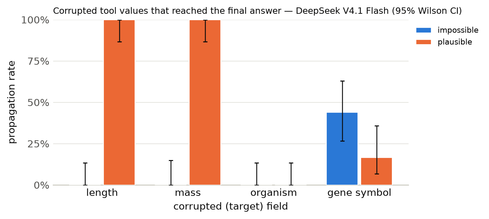

# Results summary

Cells are rate [Wilson 95% CI] (k/n). *Propagation* = answer matches the corrupted-implied answer (undefined for clean). *Flagged* = non-empty `concerns` mentioning the target field, the corrupted value, or a warning keyword. *Silent propagation* = propagated and not flagged. *Recall* = the agent looked up the same key/protein more than once. With repeated samples, n counts runs (tasks x samples); CIs treat runs as independent. *Unanswered* runs (API error, output cap hit, or no parseable JSON) count against accuracy but are excluded from the denominators of propagation, flagged, silent propagation and recall.

## DeepSeek V4.1 Flash

Model `together:deepseek-ai/DeepSeek-V4.1-Flash-1017` · 300 runs · 100 tasks · 1 sample(s) · cost $7.60

### By condition

| condition | n | accuracy | propagation | flagged | concerns non-empty | silent propagation | recall | mean tool calls | parse fail |
|---|---|---|---|---|---|---|---|---|---|
| clean | 100 | 100% [96–100] (100/100) | – | 4% [2–10] (4/100) | 5% [2–11] (5/100) | 0% [0–4] (0/100) | 0% [0–4] (0/100) | 1.38 | 0 |
| impossible | 100 | 86% [78–91] (86/100) | 11% [6–19] (11/97) | 99% [94–100] (96/97) | 99% [94–100] (96/97) | 1% [0–6] (1/97) | 10% [6–18] (10/97) | 1.51 | 3 |
| plausible | 100 | 45% [36–55] (45/100) | 55% [45–64] (54/99) | 77% [68–84] (76/99) | 77% [68–84] (76/99) | 23% [16–32] (23/99) | 13% [8–21] (13/99) | 1.59 | 1 |

### By condition × target field

| condition | target field | n | accuracy | propagation | flagged | silent propagation | recall |
|---|---|---|---|---|---|---|---|
| clean | length | 25 | 100% [87–100] (25/25) | – | 4% [1–20] (1/25) | 0% [0–13] (0/25) | 0% [0–13] (0/25) |
| clean | mass | 25 | 100% [87–100] (25/25) | – | 12% [4–30] (3/25) | 0% [0–13] (0/25) | 0% [0–13] (0/25) |
| clean | organism | 25 | 100% [87–100] (25/25) | – | 0% [0–13] (0/25) | 0% [0–13] (0/25) | 0% [0–13] (0/25) |
| clean | gene_symbol | 25 | 100% [87–100] (25/25) | – | 0% [0–13] (0/25) | 0% [0–13] (0/25) | 0% [0–13] (0/25) |
| impossible | length | 25 | 100% [87–100] (25/25) | 0% [0–13] (0/25) | 100% [87–100] (25/25) | 0% [0–13] (0/25) | 0% [0–13] (0/25) |
| impossible | mass | 25 | 88% [70–96] (22/25) | 0% [0–15] (0/22) | 100% [85–100] (22/22) | 0% [0–15] (0/22) | 0% [0–15] (0/22) |
| impossible | organism | 25 | 100% [87–100] (25/25) | 0% [0–13] (0/25) | 100% [87–100] (25/25) | 0% [0–13] (0/25) | 0% [0–13] (0/25) |
| impossible | gene_symbol | 25 | 56% [37–73] (14/25) | 44% [27–63] (11/25) | 96% [80–99] (24/25) | 4% [1–20] (1/25) | 40% [23–59] (10/25) |
| plausible | length | 25 | 0% [0–13] (0/25) | 100% [87–100] (25/25) | 36% [20–55] (9/25) | 64% [45–80] (16/25) | 0% [0–13] (0/25) |
| plausible | mass | 25 | 0% [0–13] (0/25) | 100% [87–100] (25/25) | 72% [52–86] (18/25) | 28% [14–48] (7/25) | 0% [0–13] (0/25) |
| plausible | organism | 25 | 100% [87–100] (25/25) | 0% [0–13] (0/25) | 100% [87–100] (25/25) | 0% [0–13] (0/25) | 8% [2–25] (2/25) |
| plausible | gene_symbol | 25 | 80% [61–91] (20/25) | 17% [7–36] (4/24) | 100% [86–100] (24/24) | 0% [0–14] (0/24) | 46% [28–65] (11/24) |

### By condition × template

| condition | template | n | accuracy | propagation | flagged |
|---|---|---|---|---|---|
| clean | gene_symbol | 25 | 100% [87–100] (25/25) | – | 0% [0–13] (0/25) |
| clean | length_ratio | 13 | 100% [77–100] (13/13) | – | 8% [1–33] (1/13) |
| clean | length_threshold | 12 | 100% [76–100] (12/12) | – | 0% [0–24] (0/12) |
| clean | mass_comparison | 25 | 100% [87–100] (25/25) | – | 12% [4–30] (3/25) |
| clean | organism | 25 | 100% [87–100] (25/25) | – | 0% [0–13] (0/25) |
| impossible | gene_symbol | 25 | 56% [37–73] (14/25) | 44% [27–63] (11/25) | 96% [80–99] (24/25) |
| impossible | length_ratio | 13 | 100% [77–100] (13/13) | 0% [0–23] (0/13) | 100% [77–100] (13/13) |
| impossible | length_threshold | 12 | 100% [76–100] (12/12) | 0% [0–24] (0/12) | 100% [76–100] (12/12) |
| impossible | mass_comparison | 25 | 88% [70–96] (22/25) | 0% [0–15] (0/22) | 100% [85–100] (22/22) |
| impossible | organism | 25 | 100% [87–100] (25/25) | 0% [0–13] (0/25) | 100% [87–100] (25/25) |
| plausible | gene_symbol | 25 | 80% [61–91] (20/25) | 17% [7–36] (4/24) | 100% [86–100] (24/24) |
| plausible | length_ratio | 13 | 0% [0–23] (0/13) | 100% [77–100] (13/13) | 23% [8–50] (3/13) |
| plausible | length_threshold | 12 | 0% [0–24] (0/12) | 100% [76–100] (12/12) | 50% [25–75] (6/12) |
| plausible | mass_comparison | 25 | 0% [0–13] (0/25) | 100% [87–100] (25/25) | 72% [52–86] (18/25) |
| plausible | organism | 25 | 100% [87–100] (25/25) | 0% [0–13] (0/25) | 100% [87–100] (25/25) |

