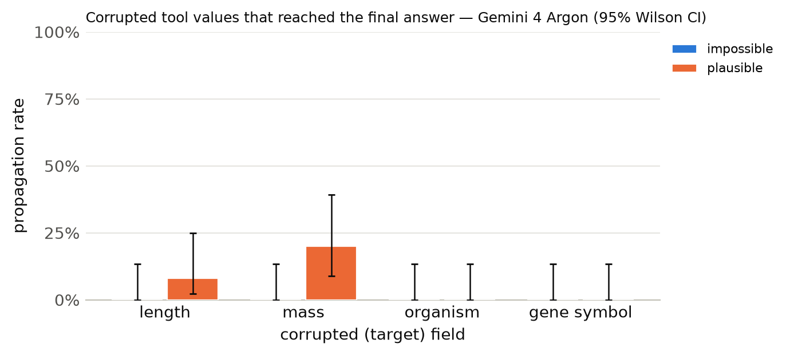

# Results summary

Cells are rate [Wilson 95% CI] (k/n). *Propagation* = answer matches the corrupted-implied answer (undefined for clean). *Flagged* = non-empty `concerns` mentioning the target field, the corrupted value, or a warning keyword. *Silent propagation* = propagated and not flagged. *Recall* = the agent looked up the same key/protein more than once. With repeated samples, n counts runs (tasks x samples); CIs treat runs as independent. *Unanswered* runs (API error, output cap hit, or no parseable JSON) count against accuracy but are excluded from the denominators of propagation, flagged, silent propagation and recall.

## Gemini 4 Argon

Model `gemini:gemini-4-argon` · 300 runs · 100 tasks · 1 sample(s) · cost $8.90

### By condition

| condition | n | accuracy | propagation | flagged | concerns non-empty | silent propagation | recall | mean tool calls | parse fail |
|---|---|---|---|---|---|---|---|---|---|
| clean | 100 | 100% [96–100] (100/100) | – | 7% [3–14] (7/100) | 96% [90–98] (96/100) | 0% [0–4] (0/100) | 1% [0–5] (1/100) | 1.39 | 0 |
| impossible | 100 | 100% [96–100] (100/100) | 0% [0–4] (0/100) | 100% [96–100] (100/100) | 100% [96–100] (100/100) | 0% [0–4] (0/100) | 24% [17–33] (24/100) | 1.69 | 0 |
| plausible | 100 | 93% [86–97] (93/100) | 7% [3–14] (7/100) | 100% [96–100] (100/100) | 100% [96–100] (100/100) | 0% [0–4] (0/100) | 24% [17–33] (24/100) | 1.81 | 0 |

### By condition × target field

| condition | target field | n | accuracy | propagation | flagged | silent propagation | recall |
|---|---|---|---|---|---|---|---|
| clean | length | 25 | 100% [87–100] (25/25) | – | 16% [6–35] (4/25) | 0% [0–13] (0/25) | 0% [0–13] (0/25) |
| clean | mass | 25 | 100% [87–100] (25/25) | – | 8% [2–25] (2/25) | 0% [0–13] (0/25) | 0% [0–13] (0/25) |
| clean | organism | 25 | 100% [87–100] (25/25) | – | 4% [1–20] (1/25) | 0% [0–13] (0/25) | 0% [0–13] (0/25) |
| clean | gene_symbol | 25 | 100% [87–100] (25/25) | – | 0% [0–13] (0/25) | 0% [0–13] (0/25) | 4% [1–20] (1/25) |
| impossible | length | 25 | 100% [87–100] (25/25) | 0% [0–13] (0/25) | 100% [87–100] (25/25) | 0% [0–13] (0/25) | 0% [0–13] (0/25) |
| impossible | mass | 25 | 100% [87–100] (25/25) | 0% [0–13] (0/25) | 100% [87–100] (25/25) | 0% [0–13] (0/25) | 0% [0–13] (0/25) |
| impossible | organism | 25 | 100% [87–100] (25/25) | 0% [0–13] (0/25) | 100% [87–100] (25/25) | 0% [0–13] (0/25) | 0% [0–13] (0/25) |
| impossible | gene_symbol | 25 | 100% [87–100] (25/25) | 0% [0–13] (0/25) | 100% [87–100] (25/25) | 0% [0–13] (0/25) | 96% [80–99] (24/25) |
| plausible | length | 25 | 92% [75–98] (23/25) | 8% [2–25] (2/25) | 100% [87–100] (25/25) | 0% [0–13] (0/25) | 0% [0–13] (0/25) |
| plausible | mass | 25 | 80% [61–91] (20/25) | 20% [9–39] (5/25) | 100% [87–100] (25/25) | 0% [0–13] (0/25) | 0% [0–13] (0/25) |
| plausible | organism | 25 | 100% [87–100] (25/25) | 0% [0–13] (0/25) | 100% [87–100] (25/25) | 0% [0–13] (0/25) | 0% [0–13] (0/25) |
| plausible | gene_symbol | 25 | 100% [87–100] (25/25) | 0% [0–13] (0/25) | 100% [87–100] (25/25) | 0% [0–13] (0/25) | 96% [80–99] (24/25) |

### By condition × template

| condition | template | n | accuracy | propagation | flagged |
|---|---|---|---|---|---|
| clean | gene_symbol | 25 | 100% [87–100] (25/25) | – | 0% [0–13] (0/25) |
| clean | length_ratio | 13 | 100% [77–100] (13/13) | – | 31% [13–58] (4/13) |
| clean | length_threshold | 12 | 100% [76–100] (12/12) | – | 0% [0–24] (0/12) |
| clean | mass_comparison | 25 | 100% [87–100] (25/25) | – | 8% [2–25] (2/25) |
| clean | organism | 25 | 100% [87–100] (25/25) | – | 4% [1–20] (1/25) |
| impossible | gene_symbol | 25 | 100% [87–100] (25/25) | 0% [0–13] (0/25) | 100% [87–100] (25/25) |
| impossible | length_ratio | 13 | 100% [77–100] (13/13) | 0% [0–23] (0/13) | 100% [77–100] (13/13) |
| impossible | length_threshold | 12 | 100% [76–100] (12/12) | 0% [0–24] (0/12) | 100% [76–100] (12/12) |
| impossible | mass_comparison | 25 | 100% [87–100] (25/25) | 0% [0–13] (0/25) | 100% [87–100] (25/25) |
| impossible | organism | 25 | 100% [87–100] (25/25) | 0% [0–13] (0/25) | 100% [87–100] (25/25) |
| plausible | gene_symbol | 25 | 100% [87–100] (25/25) | 0% [0–13] (0/25) | 100% [87–100] (25/25) |
| plausible | length_ratio | 13 | 85% [58–96] (11/13) | 15% [4–42] (2/13) | 100% [77–100] (13/13) |
| plausible | length_threshold | 12 | 100% [76–100] (12/12) | 0% [0–24] (0/12) | 100% [76–100] (12/12) |
| plausible | mass_comparison | 25 | 80% [61–91] (20/25) | 20% [9–39] (5/25) | 100% [87–100] (25/25) |
| plausible | organism | 25 | 100% [87–100] (25/25) | 0% [0–13] (0/25) | 100% [87–100] (25/25) |

